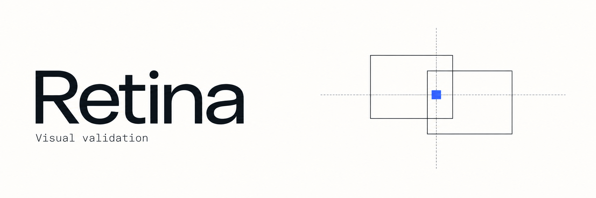

# Retina

**Retina는 웹과 앱의 화면을 확인하고, 프로젝트의 요구사항 충족 여부를 검사하는 검증 도구를 목표로 해요.**

화면이 기준 이미지와 같아도 저장 기능은 고장 났을 수 있어요. 반대로 저장이 잘돼도 버튼이 잘려 보일 수 있죠. Retina는 개발 중 화면을 확인하는 일과, 고정된 빌드가 등록된 요구사항을 만족하는지 확인하는 일을 나눠 다뤄요.

> 현재는 설계 단계예요. 실행 패키지, 설치 가능한 스킬, 테스트, CI 설정은 아직 없어요. 아래 내용은 구현 목표와 제안이며, 검증을 마친 지원 기능이나 성능을 뜻하지 않아요.

## 두 가지 검증 모드

| 모드 | 확인할 질문 | 계획한 실행 범위 |
| --- | --- | --- |
| 개발 중 시각적 검증 | 지금 만든 화면이 명시한 모습과 배치 조건을 만족하나요? | 준비된 개발 서버·설치 앱에서 선택한 화면과 상태를 검사해요 |
| 개발된 프로젝트의 유효성 검증 | 이 빌드가 등록된 요구사항과 사용자 흐름을 만족하나요? | 고정된 빌드에서 검증 목록의 필수 시나리오와 환경을 실행해요 |

개발 중 시각적 검증은 화면의 구조·외형과 회귀 비교를 다뤄요. 회귀 비교는 이전에 승인한 화면과 달라진 부분을 확인하는 검사예요. 새 화면은 이전 이미지가 없어도 명시한 배치·외형 조건부터 검사할 수 있어요.

두 번째 기능에 **기능 검증을 어디까지 포함할지는 아직 미정**이에요. 현재 계획서는 저장 후 재진입 같은 기능 검사와 시각 검사를 함께 수행한다고 가정해요. 기대 결과는 현재 코드의 동작만 보고 만들지 않고, 요구사항이나 사용자 결정에서 가져와요.

## 목표 지원 범위

웹과 React Native / Expo 앱을 로컬과 CI에서 검사하는 것이 목표예요.

| 항목 | 계획한 구성 |
| --- | --- |
| 대상 | 웹과 React Native / Expo 앱 |
| 테스트 실행기 | Vitest |
| 실행 장소 | 개발자 로컬과 CI(변경 사항을 자동 검사하는 실행 환경) |
| 결과 | 정적 HTML 리포트, JSON, 비교 이미지, 실행 로그 |

CI에서는 사람의 조작 없이 준비·검사·결과 저장·종료까지 수행해야 해요. 추가 검토가 필요하면 그 이유와 증거를 남기고 실행을 마치는 방식으로 설계하고 있어요.

## 정적 HTML 판정 리포트

CI 실행 후 **정적 HTML 리포트**에서 결과를 확인할 수 있도록 만들 계획이에요. `report.html`과 이미지·스타일 파일을 CI artifact(내려받을 수 있는 결과 파일 묶음)로 제공해요. 내려받은 리포트는 서버나 로그인 없이 열 수 있어야 해요.

리포트에는 전체 판정과 플랫폼·시나리오별 결과, 검사한 범위와 검사하지 못한 범위, 실패·미완료 이유를 담아요. 이미지 비교가 있는 검사에서는 기준(expected)·현재(actual)·차이(diff) 이미지를 함께 볼 수 있어요.

| 상태 | 계획한 의미 |
| --- | --- |
| `PASS` | 필수 자동 조건을 만족하고 해결되지 않은 필수 검토가 없어요 |
| `FAIL` | 명시한 기대 결과나 규칙을 위반했어요 |
| `REVIEW_REQUIRED` | 새 기준 이미지나 의도한 화면 변경 등에 검토가 필요해요 |
| `INCONCLUSIVE` | 준비·환경·증거 또는 필수 실행이 부족해 판정할 수 없어요 |

## 검증 결과의 범위

통과는 **해당 빌드에 등록한 요구사항과 실행 환경의 검사 결과**를 뜻해요. 한 화면의 통과가 프로젝트 전체의 통과를 뜻하지는 않아요. 실행하지 않은 접근성·성능·보안 검사나 실기기 검증까지 완료했다고 표시하지 않아요.

`PASS` 외의 상태는 CI 성공으로 처리하지 않을 계획이에요. 필수 플랫폼이 빠졌거나 테스트가 0개인 실행도 전체 통과로 표시하지 않아요. AI의 “문제없음”만으로 통과시키거나 실행 누락을 덮어쓰지도 않아요.

구현 방향과 파일럿, 세부 검증 조건은 [검증 계획서](docs/visual-regression-skill-plan.md)에서 확인해보세요. 현재는 실행 패키지를 제공하지 않아 설치·실행 명령도 없어요.

## 브랜드 이미지

[배너](docs/assets/retina-hero-v2.png)와 [심볼](docs/assets/retina-symbol-v2.png)은 프로젝트 소개용 AI 생성 이미지예요. 실제 테스트 결과나 구현된 화면을 나타내지 않아요. [생성 프롬프트](docs/assets/image-prompts-v2.json)도 함께 보관해요.
