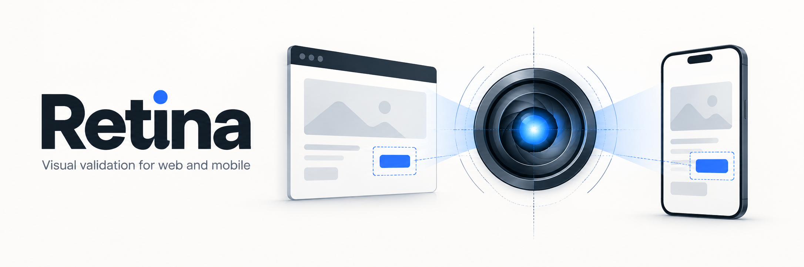
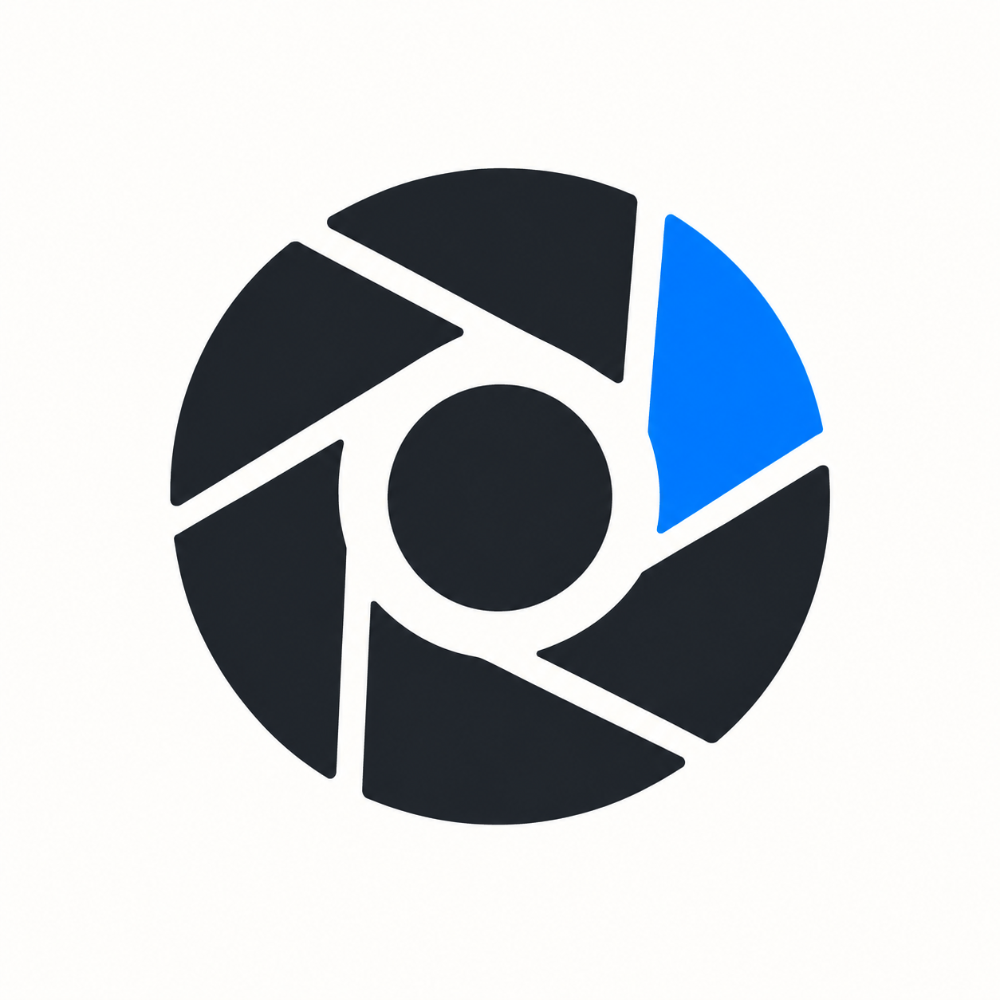

# Retina

**개발 중인 화면부터 개발된 프로젝트까지, 검사한 범위와 근거를 함께 남기는 검증 도구를 만들어요.**

화면이 기준 이미지와 같아도 저장 기능은 고장 났을 수 있어요. 반대로 저장이 잘돼도 버튼이 잘려 보일 수 있죠. Retina는 개발 중 화면을 확인하는 일과, 고정된 빌드가 등록된 요구사항을 만족하는지 확인하는 일을 나눠 다뤄요.

> 현재는 설계 단계예요. 실행 패키지, 설치 가능한 스킬, 테스트, CI 설정은 아직 없어요. 아래 내용은 구현 목표와 제안이며, 검증을 마친 지원 기능이나 성능을 뜻하지 않아요.

## 두 가지 질문을 나눠 검증한다

| 기능 | 확인할 질문 | 계획한 실행 범위 |
| --- | --- | --- |
| 개발 중 시각적 검증 | 지금 만든 화면이 명시한 모습과 배치 조건을 만족하나요? | 준비된 개발 서버·설치 앱에서 선택한 화면과 상태를 검사해요 |
| 개발된 프로젝트의 유효성 검증 | 이 빌드가 등록된 요구사항과 사용자 흐름을 만족하나요? | 고정된 빌드에서 검증 목록의 필수 시나리오와 환경을 실행해요 |

첫 번째 기능은 화면의 구조·외형과 필요한 회귀 비교를 다뤄요. 회귀 비교는 이전에 승인한 화면과 달라진 부분을 확인하는 검사예요. 새 화면은 이전 이미지가 없어도 명시한 배치·외형 조건부터 검사할 수 있어요.

두 번째 기능에 **기능 검증을 어디까지 포함할지는 아직 미정**이에요. 현재 계획서는 저장 후 재진입 같은 기능 검사와 시각 검사를 함께 수행한다고 가정해요. 기대 결과는 현재 코드의 동작만 보고 만들지 않고, 요구사항이나 사용자 결정에서 가져와요.

한 화면의 통과가 프로젝트 전체의 통과를 뜻하지는 않아요. 프로젝트 검증도 해당 빌드의 등록된 검사 범위만 다뤄요. 실행하지 않은 접근성·성능·보안 검사나 실기기 검증까지 완료했다고 표시하지 않아요.

## 웹과 앱을 로컬·CI에서 실행한다

확정한 요구사항은 다음과 같아요. **확정은 구현 완료를 뜻하지 않아요.**

| 항목 | 요구사항 |
| --- | --- |
| 대상 | 웹과 React Native / Expo 앱 |
| 테스트 실행기 | Vitest |
| 실행 장소 | 개발자 로컬과 CI(변경 사항을 자동 검사하는 실행 환경) |
| CI 완료 조건 | 사람의 조작 없이 준비·검사·결과 저장·종료까지 수행 |
| 결과 전달 | 판정과 증거를 담은 정적 HTML 리포트 및 CI artifact(내려받을 수 있는 결과 파일 묶음) |

도구 구성은 아직 제안 단계예요. 웹은 격리된 헤드리스 Chromium(창을 띄우지 않는 브라우저)을 검토하고 있어요. 네이티브 앱은 Appium과 WebdriverIO standalone을 첫 실험 후보로 두어요. 이 조합이 Vitest·Expo에서 안정적으로 실행되는지는 확인해야 해요. CI 공급자도 아직 정하지 않았어요.

공통으로 맞출 부분은 검사 입력, 결과 형식, 이미지 비교, 필수 결과 집계예요. 앱 설치·화면 이동·입력·초기화는 플랫폼별로 구현할 계획이에요. Expo Web 실행이나 React Native 내부 트리의 스냅샷을 네이티브 화면 검증으로 대신하지 않아요.

## 에이전트와 CI의 역할을 나눈다

개발 에이전트는 검사할 화면과 요구사항을 정리하고, 실행 결과와 실제 이미지를 읽어 발견한 문제를 설명해요. 개발 중 시각 검증을 완료했다고 보고하려면 이미지 확인도 필요해요.

CI는 에이전트나 사람의 응답을 기다리지 않고 자동 검사를 끝내야 해요. 승인한 기준 이미지와 명시한 규칙으로 판정하고, 추가 검토가 필요하면 그 상태와 증거를 저장한 뒤 종료해요. AI API나 개인 브라우저 로그인은 자동 실행의 필수 조건으로 두지 않을 계획이에요.

AI의 “문제없음”만으로 통과시키지 않아요. 자동 검사 실패나 실행 누락을 AI 설명으로 덮어쓰지도 않아요. 기준 이미지 변경은 별도 검토 대상으로 남기고, CI가 후보 이미지를 자동 승인하지 않게 설계해요.

## 판정과 증거를 정적 HTML로 전달한다

CI 실행 뒤 결과를 확인할 수 있는 **정적 HTML 리포트는 초기 필수 산출물**이에요. `report.html`과 필요한 이미지·스타일 파일을 상대 경로로 묶어, 결과 파일을 내려받아 열 수 있게 만들 계획이에요. 공개 호스팅이나 자동 배포는 이 요구에 포함하지 않아요.

리포트에는 전체 판정과 플랫폼·시나리오별 판정을 함께 표시해요. 검사한 요구사항과 범위, 미검사 범위, 실패·미완료 이유도 남겨요. 이미지 비교가 있는 검사에는 expected / actual / diff 이미지와 링크를 제공해요.

| 상태 | 계획한 의미 |
| --- | --- |
| `PASS` | 필수 자동 조건을 만족하고 해결되지 않은 필수 검토가 없어요 |
| `FAIL` | 명시한 기대 결과나 규칙을 위반했어요 |
| `REVIEW_REQUIRED` | 새 기준 이미지나 의도한 화면 변경 등에 검토가 필요해요 |
| `INCONCLUSIVE` | 준비·환경·증거 또는 필수 실행이 부족해 판정할 수 없어요 |

`PASS` 외의 상태는 CI 성공으로 처리하지 않을 계획이에요. 필수 플랫폼이 빠졌거나 테스트가 0개인 실행도 전체 통과로 표시하지 않아요. HTML과 함께 기계가 읽을 수 있는 `result.json`, 이미지, 실행 로그를 남길 예정이에요.

## 작은 흐름 하나로 실행 가능성을 확인한다

첫 파일럿은 **입력 폼 → 저장 → 재진입** 흐름을 제안해요. 실제 대상 프로젝트와 화면은 아직 정하지 않았어요. 정상 흐름과 오류 분기 하나를 실행하고, 초기·입력 오류·저장 후 상태의 촬영 지점 3개부터 확인할 계획이에요.

환경은 웹 데스크톱 폭, 웹 모바일 폭, iOS Simulator, Android Emulator의 4개로 시작해요. 웹 모바일 폭 검사는 모바일 Safari 검증을 뜻하지 않아요. 기기·OS·언어·테마 등은 좁게 고정해 같은 조건에서 결과를 반복해서 확인하려고 해요.

웹만 성공해도 네이티브 지원까지 완료했다고 표시하지 않아요. 새 CI 환경에서 각 플랫폼을 준비하고, 빌드를 식별하고, 촬영하고, 리포트를 저장한 뒤 종료하는 것부터 증명할 계획이에요.

## 실행 근거를 쌓으며 범위를 넓힌다

- [ ] 파일럿 프로젝트, 요구사항 근거, 테스트 데이터 초기화 방법과 CI 환경을 정해요.
- [ ] 웹·iOS·Android의 최소 흐름을 로컬과 비대화형 CI에서 실행해요.
- [ ] 두 검증 기능과 판정 집계를 구현하고 정적 HTML·이미지·로그를 남겨요.
- [ ] 같은 빌드를 반복 검사하고, 의도적으로 넣은 결함과 환경 실패를 구분하는지 확인해요.
- [ ] 실제 작업에서 실행 시간, 오탐, 기준 이미지 검토·유지 비용을 측정해요.

범용 시나리오 자동 생성, 환경 조합 생성기, 대시보드, 자동 코드 수정과 기준 이미지 자동 갱신은 초기 범위에 넣지 않아요.

설계의 판단 근거와 실험 조건은 [검증 계획서](docs/visual-regression-skill-plan.md)에서 확인할 수 있어요. 아직 설치·실행 명령은 제공하지 않아요. 첫 검증 대상을 정하려면, 화면과 저장 결과를 함께 확인할 수 있는 사용자 흐름 하나부터 골라보세요.

## 브랜드 이미지

[배너](docs/assets/retina-hero.png)와 [심볼](docs/assets/retina-symbol.png)은 프로젝트 소개용 AI 생성 이미지예요. 실제 테스트 결과나 구현된 화면을 나타내지 않아요. [생성 프롬프트](docs/assets/image-prompts.json)도 함께 보관해요.
