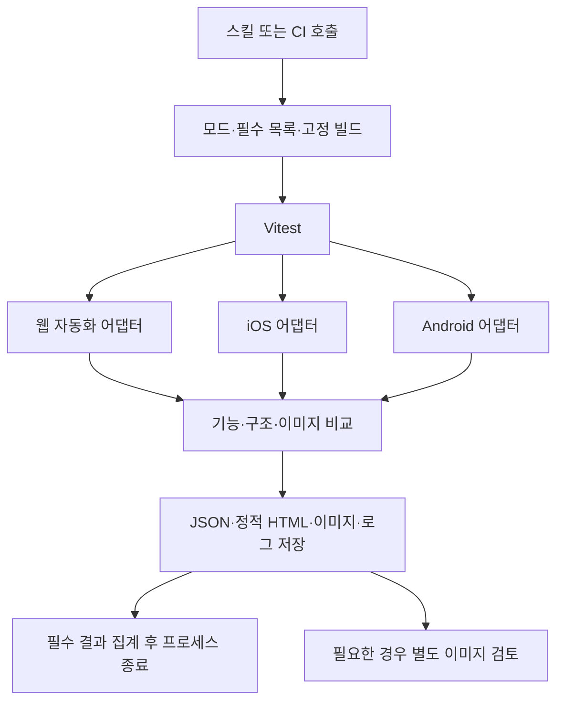

# Retina: 개발 중 시각적 검증·프로젝트 유효성 검증 계획

작성일: 2026-10-25 · 상태: 비관적 가정으로 재작성한 설계안 · 구현·CI 실행 전

Retina는 **① 개발 중 시각적 검증**과 **② 개발된 프로젝트의 유효성 검증**을 제공해요. 대상은 **웹 + React Native / Expo 앱**, 실행기는 **Vitest**예요. **로컬뿐 아니라 사람의 조작 없이 CI에서도 실행되는 것**이 초기 완료 조건이에요.

현재 저장소에는 소개·계획 문서가 있고 실행 패키지·테스트·CI 설정은 없어요. 문서의 도구 구성, 명령 이름과 수치는 구현 제안이며 검증된 성능이 아니에요. ②에 기능 검증을 포함할지는 아직 답변 전이므로, 아래에서는 기능 + 시각 검증을 가정해요. **CI 실행 후 적합성 판정과 근거를 정적 HTML로 제공하는 것**도 필수 결과물이에요.

## 1. 비관적으로 보면 무엇이 문제인가요

가장 큰 위험은 화면 비교 알고리즘보다 **정답 정의, 상태 재현, CI 운영 비용**이에요. 스킬을 작성하는 것과 세 플랫폼에서 신뢰할 수 있는 테스트를 운영하는 것은 별개의 작업이에요.

| 기존 계획의 낙관적 가정 | 수정한 가정과 대응 |
| --- | --- |
| 요구사항과 테스트를 에이전트가 만들면 유효성을 확인할 수 있어요 | 잘못된 구현에서 기대 결과까지 복제할 수 있어요. 명세·사용자 결정 등 구현과 독립된 근거를 요구해요 |
| 같은 조건으로 찍으면 스크린샷이 안정적이에요 | 폰트·그래픽·OS·기기 상태가 흔들릴 수 있어요. 새 CI runner에서 반복 촬영해 확인해요 |
| Vitest를 쓰면 웹·앱 실행도 통일돼요 | 실행기만 통일돼요. 설치·조작·초기화·빌드 식별은 플랫폼별 구현이 필요해요 |
| AI가 이미지를 보면 정상 여부를 판단할 수 있어요 | 작은 결함을 놓치거나 판단이 달라질 수 있어요. 자동 통과의 유일한 근거로 사용하지 않아요 |
| 로컬에서 된 뒤 CI에 연결하면 돼요 | runner·가속·권한·artifact·비대화형 실행이 설계에 영향을 줘요. 첫 실험부터 CI에서 실행해요 |
| 범용 스킬이므로 프로젝트 설정만 있으면 돼요 | fixture와 testID, 화면 진입점, 빌드 식별 등 프로젝트 수정이 필요할 수 있어요. 도입 비용을 측정해요 |

**두 기능과 모든 대상 플랫폼은 유지하되 첫 대상은 사용자 흐름 하나로 줄여요.** Pairwise 생성기, 범용 구조 규칙 언어, 대시보드, 자동 수정 루프는 초기 범위에서 빼요. 정적 HTML 판정 리포트는 초기 범위에 포함해요. 핵심 검증이 실패하면 기능을 늘려 만회하지 않고 실패 원인을 해결하거나 해당 지원을 미완료로 남겨요.

## 2. 두 기능의 계약

| 구분 | ① 개발 중 시각적 검증 | ② 프로젝트 유효성 검증 |
| --- | --- | --- |
| 질문 | 지금 구현한 화면이 명시한 모습·배치 조건을 만족하나요? | 이 빌드가 등록된 요구사항과 사용자 흐름을 만족하나요? |
| 입력 | 대상 화면·상태, 디자인 요구, 예상 변경, 선택적 이전 기준 | 고정 빌드, 요구사항 목록, 필수 시나리오·환경, fixture |
| 범위 | 선택한 변경 화면과 명시한 영향 범위 | 검증 목록에 등록한 필수 케이스 전체 |
| 실행 | 준비된 개발 서버·설치 앱에서 짧게 실행해요 | CI가 준비한 고정 빌드에서 전체 목록을 실행해요 |
| 검사 | 현재 화면의 규칙과 외형, 선택적 회귀 비교 | 기능 assertion + 구조·외형·회귀를 검사해요. 기능 포함은 현재 가정이에요 |
| 결과 | 발견한 문제, 이미지 증거, 검사별 결과·미검사 범위 | 요구사항별 결과, 결함, 미완료·미등록 범위 |
| 통과 의미 | 해당 화면·상태·규칙을 통과했다는 뜻이에요 | 해당 빌드의 선언된 검증 목록을 통과했다는 뜻이에요 |

①이 성공해도 ②가 성공한 것은 아니에요. ②도 프로젝트 전체의 무결성이나 배포 가능성을 인증하지 않아요. 접근성·성능·보안·실기기·미지원 브라우저는 수행하지 않았다면 결과에서 명시해요.

신규 화면은 이전 이미지 없이도 구조 규칙과 명시한 외형 요구를 검사할 수 있어요. 다만 기준이 없는 회귀 검사는 미완료예요. 디자인 근거가 없으면 “보기 좋다”는 추측으로 적합성을 통과시키지 않고 관찰 결과만 제공해요.

②의 기대 결과를 현재 코드 동작만 보고 만들지 않아요. 예를 들어 저장 검증은 성공 토스트만 확인하지 않고, 앱·웹을 재시작하거나 새 세션으로 열었을 때 값이 유지되는지 확인해요. 이 기대 동작 자체에도 요구사항 근거를 연결해요. 근거가 없는 동작은 추론한 후보로 남겨요.

## 3. 첫 파일럿의 정확한 범위

### 사용자 흐름 하나

첫 대상은 테스트 데이터로 실행하는 **입력 폼 → 저장 → 재진입** 흐름을 제안해요. 화면 이름과 프로젝트는 아직 미정이에요.

- 정상 입력과 저장·재진입을 확인해요.
- 잘못된 입력 또는 저장 오류 분기 하나를 확인해요.
- 초기 상태, 입력 오류 상태, 저장 후 상태의 촬영 지점 3개를 확인해요.
- ①에서는 이 흐름의 UI 변경 하나를 확인해요.
- ②에서는 같은 흐름의 독립된 요구사항과 기능·시각 검사를 실행해요.

### 환경 네 개

| 환경 | 최초 고정 범위 |
| --- | --- |
| 웹 데스크톱 | Chromium, 뷰포트 1개 |
| 웹 모바일 폭 | Chromium, 뷰포트 1개예요. 모바일 Safari 검증을 의미하지 않아요 |
| iOS | Simulator 모델·OS·아키텍처 1개 |
| Android | Emulator 모델·API·ABI·렌더러 1개 |

언어·테마·글꼴 배율은 각각 하나로 시작해요. 어느 플랫폼도 조용히 제외하지 않아요. iOS가 동작하지 않으면 웹 성공과 별개로 iOS 및 전체 지원은 미완료예요. 공통 화면이 없다면 플랫폼별 대체 시나리오와 근거를 명시해요.

Pairwise는 이 작은 행렬을 먼저 안정화한 뒤 도입해요. 환경 조합을 줄여도 사용자 흐름과 필수 상태는 제거하지 않아요. 향후 유효한 쌍의 계획 커버리지와 실제 실행 커버리지를 별도 계산해요. Pairwise가 세 조건 이상의 결함까지 보장하지 않는다는 한계도 유지해요. [NIST](https://tsapps.nist.gov/publication/get_pdf.cfm?pub_id=903128)

## 4. 핵심 실패 가설과 대응

| 위험 | 실패가 드러나는 모습 | 초기 대응·진행 조건 |
| --- | --- | --- |
| 잘못된 정답 | 저장이 안 되는데 성공 메시지만 보고 통과해요 | 구현과 독립된 요구 5개를 정하고 저장 무효화 등 결함을 주입해 탐지해요 |
| fixture 구축 비용 | 로그인·데이터·권한을 사람이 매번 초기화해요 | 프로젝트별 setup/reset부터 작성해요. 수동 초기화가 남으면 자동 실행 지원으로 표시하지 않아요 |
| mock의 착시 | 가짜 API에서는 성공하지만 실제 저장 연동은 고장 나요 | mock 기반 검사와 테스트 backend 통합 검사를 다른 suite로 표시해요. mock 성공을 통합 성공으로 승격하지 않아요 |
| 앱 실행 불안정 | 예전 JS bundle, 권한창, 다른 화면을 촬영해요 | 설치 빌드와 실행 bundle을 식별하고 준비 신호·화면 식별을 확인해요 |
| 이미지 오탐 | 같은 코드인데 runner마다 diff가 발생해요 | 고정 환경에서 A/A 반복 실험을 해요. 임계값·마스크를 자동 완화하지 않아요 |
| 작은 결함 누락 | 전체 diff 비율이 작아 버튼 잘림을 통과시켜요 | 핵심 영역 비교와 명시적 구조 규칙을 병행해요 |
| AI 판정 불안정 | 같은 이미지에 다른 결론을 내리고 구현 의도로 결함을 정당화해요 | 정답을 숨긴 평가·반복 검사를 해요. AI의 문제없음은 단독 통과 근거가 아니에요 |
| 기준 오염 | 결함 이미지를 자동 갱신해 이후 모두 통과해요 | CI 기준은 읽기 전용으로 두고 신규 후보와 승인 기준을 분리해요 |
| CI 비용·시간 폭증 | 앱 빌드·부팅·재시도 때문에 개발 흐름에서 사용하지 않아요 | 빌드·준비·검사 시간을 분리 측정하고 실행 상한을 설정해요. 상한 초과를 숨기지 않아요 |
| 설정·테스트 삭제 | 검사 수를 줄여 전체 성공으로 보이게 해요 | 사전에 확정한 필수 목록과 실제 결과를 대조해요. 정책 변경도 검토 대상이에요 |

fixture가 준비됐다는 사실과 요구사항이 맞다는 사실을 구분해요. 화면 두 장이 같아도 둘 다 로딩 화면일 수 있고, 승인 기준에도 기존 버그가 있을 수 있어요. “기준과 동일”과 “요구사항 충족”을 결과에서 별도 근거로 남겨요.

## 5. 실행 구조: CI가 에이전트 없이 끝날 수 있어야 해요

Vitest는 테스트 lifecycle·assertion·플랫폼별 project 실행을 담당해요. 공통화 대상은 **입력·결과 형식, PNG 비교, 필수 목록 집계**예요. 네이티브의 탐색·입력·reset까지 DOM과 같은 API로 만들려고 하지 않아요. [Vitest Projects](https://vitest.dev/guide/projects)

웹은 기존 계획의 **격리된 헤드리스 Chromium 테스트 엔진 + Aside 진단 도구** 방향을 유지해요. 앱은 Appium + WebdriverIO standalone을 첫 검증 후보로 두어요. standalone은 다른 테스트 프로젝트에서 사용할 수 있지만, Vitest와 Expo에서 우리의 시나리오가 안정적으로 실행된다는 증거는 아직 없어요. [WebdriverIO standalone](https://webdriver.io/docs/setuptypes)

Vitest Node에서 어댑터를 호출하고 공통 비교 함수를 assertion에 연결하는 최소 구조로 시작해요. Playwright Test·WDIO 러너를 추가로 운영하지 않아요. 자체 matcher·reporter 플러그인은 단순 helper와 파일 출력으로 부족하다는 근거가 생긴 뒤 만들어요.

### Aside 의존성과 기존 조사 기록

기존 문서에는 Aside CLI 1.26.1020.1855에서 `setViewportSize` 미지원, `emulateMedia` 부재, 사용자 창 크기·프로필 의존을 확인했다는 기록이 있어요. 이 기록은 보존하되 **이번 수정에서 재실행하지 않았고 원본 실험 artifact도 이 저장소에서 확인하지 못했어요.** 최신 버전의 불변 사실로 취급하지 않아요.

CI 실행 패키지는 Aside 설치·개인 로그인·GUI 세션을 요구하지 않아요. 에이전트의 로컬 브라우저 탐색은 Aside를 우선 사용하고, 헤드리스 테스트 엔진의 실행은 적용되는 라우팅 규칙에 따라 지원 불가 근거와 fallback 사유를 남겨요. 계획서가 전역 브라우저 규칙을 자동 변경하거나 예외 승인을 대신하지 않아요. 이 환경의 규칙 파일에는 이번 확인 시 테스트 엔진 예외가 없었어요.

### 네이티브 실행의 한계

앱은 고정된 Expo 테스트 빌드를 사용해요. 로컬 ①에서 development build를 사용할 수 있지만, CI ②는 가능하면 JS bundle을 포함한 테스트 artifact로 실행해 개발 서버 연결 의존을 줄여요. Metro가 꼭 필요하면 CI가 직접 시작하고 준비·종료와 bundle 식별까지 관리해요. development·테스트·release 빌드의 기준을 혼용하지 않아요. [Expo development builds](https://docs.expo.dev/develop/development-builds/introduction/)

OS별 testID 노출, 요소 경계와 이미지 픽셀 좌표 변환, safe area, 권한창, 키보드는 어댑터 검증 항목이에요. 필요한 요소를 읽을 수 없다고 이미지 판독으로 몰래 대체해 구조 검사 통과를 만들지 않아요. React Native JS tree snapshot·Expo Web 결과는 네이티브 화면 검증을 대신하지 않아요.

## 6. CI는 후속 기능이 아니라 초기 실행 대상이에요

CI 공급자는 아직 정하지 않았어요. 아래는 공급자 독립 계약이며 GitHub Actions를 예로 확인했어요. 특정 서비스의 계정·개인 브라우저·개발자 머신 경로에 엔진을 묶지 않아요.

| job | 실행 환경 | 고정·기록할 항목 |
| --- | --- | --- |
| 웹 | Linux runner, 필요 시 컨테이너 | Node·패키지 lockfile·Chromium revision·폰트·OS·이미지 digest·headless 옵션 |
| iOS | macOS runner와 Xcode·Simulator | CPU 아키텍처, Xcode·runtime·기기 모델, simulator용 app artifact |
| Android | VM 가속이 가능한 Linux runner와 Emulator | JDK·SDK·API·system image·ABI·드라이버·그래픽 모드, APK |
| 집계 | 작은 독립 job | 실행 계획 해시, commit·artifact·baseline 식별자, 필수 job 결과와 누락 |

GitHub-hosted Linux runner는 Android 가속을 지원하고 macOS runner도 제공해요. 실제 사용 가능한 이미지·자원·계정 비용은 CI 선택 시 확인해야 해요. Android는 그래픽·VM 가속 조건이 실행 시간과 렌더링에 영향을 줄 수 있어요. [GitHub runner 문서](https://docs.github.com/en/actions/reference/runners/github-hosted-runners), [Android 가속 문서](https://developer.android.com/studio/run/emulator-acceleration)

### 비대화형 실행 계약

1. 깨끗한 checkout에서 lockfile 기준 설치, 도구 버전 확인, 빌드 또는 지정 artifact 다운로드를 수행해요. 최초에는 캐시 없이도 실행돼야 해요.
2. 웹 서버·fixture backend·기기·드라이버의 준비 상태를 제한 시간 안에 확인해요. 사용자 입력을 기다리지 않아요.
3. baseline과 후보 빌드·JS bundle·실행 계획을 식별하고 필수 케이스를 실행해요.
4. 성공·실패·미완료마다 JSON·정적 HTML·이미지·필요한 로그를 저장해요. 실패해도 artifact 업로드를 시도해요.
5. 종료 시 소유한 서버·드라이버·기기를 정리해요. 강제 종료로 결과가 없으면 집계 job이 누락으로 처리해요.
6. 필수 플랫폼 하나라도 실패·취소·미실행이면 전체 지원 결과를 성공으로 만들지 않아요. 가능한 다른 플랫폼의 결과는 수집해요.

선택 실행인 ①과 전체 검증 목록을 실행하는 ②를 구분해요. `--project` 필터가 iOS를 제외했다면 웹 선택 실행 성공으로 보고하고 전체 프로젝트 통과를 표시하지 않아요. 테스트 0개, fixture 준비 실패, 기기 부팅 실패도 비정상 종료예요.

CI job마다 상한을 두고 에이전트·사람의 이미지 검토를 기다리며 프로세스를 열어두지 않아요. 실행과 검토는 저장된 artifact를 통해 연결해요. AI API 키·외부 모델 응답은 자동 검사의 필수 의존성이 아니에요.

### 빌드·캐시·artifact

앱 빌드는 플랫폼별로 만들고 테스트 job은 검증한 해시의 artifact만 설치해요. 이미 만들어진 artifact 재사용은 commit·native 구성·JS bundle·build profile 식별이 맞을 때만 허용해요. iOS simulator artifact와 실기기 artifact를 혼동하지 않아요.

패키지·빌드 캐시는 도입하더라도 lockfile·도구 버전·플랫폼 등을 key에 포함해요. 캐시는 baseline이나 빌드 정체성의 근거가 아니에요. 캐시 적중 실행만 성공하는 상태는 완료로 보지 않아요.

실행 결과는 CI artifact로 올리고 초기 보존 기간은 14일을 제안해요. 승인 baseline은 만료되는 실행 artifact에만 보관하지 않아요. artifact에는 테스트 계정의 합성 데이터만 담고 인증 상태·원본 토큰은 제외해요. 업로드 실패 시 증거가 없으므로 해당 증거 필수 검사는 미완료예요. [CI artifact 문서](https://docs.github.com/en/actions/tutorials/store-and-share-data)

fixture는 개인 계정 없이 실행 가능한 테스트 서비스·계정을 사용해요. mock만 제공하면 mock suite라고 표시해요. 통합 검증에 필요한 테스트 환경이 없으면 통합 지원은 미완료예요. CI 자격 증명이 없는 PR에서도 어떤 suite가 실행되지 않았는지 표시하고 운영 데이터로 대체하지 않아요.

## 7. 기준 이미지와 재현성

초기 baseline은 소량의 PNG와 manifest를 Git으로 관리하는 안을 제안해요. 플랫폼·시나리오·상태·환경 profile별로 나눠요. 실행 결과는 Git에서 제외하고, 용량이 문제가 될 때 LFS·별도 저장소를 검토해요.

manifest에는 기준 이미지 해시, 생성 빌드, 검토 근거, fixture·규칙 버전, 환경 fingerprint를 남겨요. 실행 결과는 후보 빌드·bundle, 테스트 코드·설정·요구사항 목록 해시, baseline revision과 연결해요. 나중에 “무엇을 어떤 기준으로 검사했는지” 재구성할 수 있어야 해요.

**PR 판정의 기준은 CI 환경에서 생성·검토한 baseline**이에요. 개발자 macOS 이미지와 Linux CI 이미지를 직접 비교하지 않아요. 로컬은 CI와 같은 재현 환경을 쓰거나 별도 local profile로 제한해서 보고해요. 로컬 통과를 CI 통과로 대체하지 않아요. 브라우저의 렌더링은 host 환경에 따라 달라질 수 있어요. [Playwright 시각 비교 문서](https://playwright.dev/docs/test-snapshots)

runner label을 고정해도 OS 이미지의 내용까지 영구 고정되는 것은 전제하지 않아요. fingerprint가 바뀌면 환경 변경으로 표시하고 영향을 확인해요. 기기·렌더러·폰트가 다른 기준끼리 비교하거나 이미지를 확대·축소해 억지로 맞추지 않아요.

CI는 baseline을 읽기 전용으로 사용해요. 기준이 없으면 candidate 이미지를 남기고 `REVIEW_REQUIRED`로 종료해요. 원래부터 필수였던 기준을 읽지 못하거나 유실했다면 `INCONCLUSIVE`예요. 새 기준은 정확한 이미지 해시·생성 빌드·검토 근거를 연결해 반영하고 다시 실행해요. `vitest --update`가 baseline 승인이나 정책 완화를 뜻하지 않아요.

이미 승인된 요구 변경도 화면 전체를 무시할 근거가 되지 않아요. 배경색 변경과 텍스트 잘림이 함께 있으면 각각 검증해요. 마스크·임계값·필수 테스트 목록 변경도 결과와 함께 검토해요. 후보 코드가 기준·정책까지 바꾼 경우, 그 변경의 검토 상태를 확인하지 않고 CI 통과를 선언하지 않아요.

CI가 신뢰할 baseline·필수 목록은 보호된 기준 ref나 명시한 승인 버전에서 읽고 실행 시작 시 revision을 고정해요. PR 안에서 바뀐 목록을 그 PR의 유일한 정답으로 사용하지 않아요. 승인 여부를 확인할 연결이 아직 없다면 정책 변경은 `REVIEW_REQUIRED`로 남겨요. 최초 기준 생성은 bootstrap run으로 구분하고 종합 검증 통과를 내지 않아요.

## 8. 판정은 자동 검사와 검토를 분리해요

| 검사 | 정상 여부의 근거 | 근거가 없을 때 |
| --- | --- | --- |
| 기능 | 독립된 요구사항 + 동작 후 관찰 가능한 결과 | 기대 동작을 추론 후보로 남기고 미완료로 표시해요 |
| 구조 | 명시한 요소·경계·포함·정렬 규칙 | 등록 안 된 관계까지 올바르다고 주장하지 않아요 |
| 현재 외형 | 명시한 외형 요구, 측정 결과, 필요한 이미지 검토 | 주관적 적합성은 검토가 필요해요 |
| 회귀 | 유효한 승인 baseline + 같은 조건의 현재 이미지 | 신규 기준 검토가 필요하거나 기준 유실에 따라 미완료로 표시해요 |

픽셀 diff는 변화의 존재를 보여줘요. 그 자체로 버그인지 의도한 변경인지 정하지 않아요. DOM이나 네이티브 경계도 실제 가려짐·잘림을 모두 보장하지 않아요. AI가 없는 자동 검사에서는 측정 가능한 규칙과 승인 기준에 한정해 통과를 말해요.

| 상태 | 의미 | CI 실행 결과 |
| --- | --- | --- |
| `PASS` | 실행 계획에 선언된 필수 자동 조건을 모두 만족하고 해결되지 않은 필수 검토가 없어요 | 성공으로 종료해요 |
| `FAIL` | 명시한 기대 결과·규칙을 위반했어요 | 실패로 종료해요 |
| `REVIEW_REQUIRED` | 신규·의도된 화면 차이가 있거나 근거 판단이 필요한 상태예요 | 성공 처리하지 않고 artifact를 저장한 후 종료해요 |
| `INCONCLUSIVE` | 준비·환경·증거·필수 실행이 불충분해요 | 성공 처리하지 않고 원인을 기록한 후 종료해요 |

Vitest 내장 상태와 Retina 상태를 혼동하지 않아요. 자동 단계에서 확정된 비통과는 assertion 실패와 상세 결과로 남겨요. 집계 단계는 Vitest exit code 외에 누락·검토 필요·artifact 유효성까지 확인해요. 오류나 skip을 PASS로 변환하지 않아요.

기존 계획의 “모든 이미지를 에이전트가 볼 때까지 CI 프로세스 대기”는 제거해요. ①에서 에이전트가 시각 검증 완료를 보고할 때는 실제 이미지 확인이 필요해요. ②의 CI는 승인 기준·자동 규칙만으로 판정할 수 있는 케이스를 끝내고, 필요한 검토는 별도 상태로 남겨요. 에이전트가 보지 않았다면 에이전트 검토 완료라고 표시하지 않아요.

AI 검토는 차이 설명·추가 결함 발견에 사용해요. AI의 “문제없음”으로 수치 실패나 미완료를 덮어쓰지 않아요. 별도 검토 결과는 원본 run·이미지·정책 해시에 연결해 새 최종 verdict를 만들고 원본 자동 결과는 보존해요. 후보 빌드나 artifact가 달라졌다면 재사용하지 않아요.

MVP에서 검토 후 기존 CI check를 성공으로 뒤집지 않아요. 승인 기준·정책을 반영한 **새 CI run**이 통과해야 gate를 통과한 것으로 봐요. 검토 결과 접수 시 hash를 확인하고 재실행을 연결하는 CI 경로를 구현해요. 추가 결함이 발견되면 재현 assertion 또는 미해결 검토 항목으로 새 run에 전달해 자동 검사 성공만으로 사라지지 않게 해요. 연결이 미구현이라면 CI 자동 검사와 사후 검토 결과까지만 제공하고, 통합된 PR 필수 gate 지원은 미완료로 표시해요.

재시도는 처음부터 실패를 지우는 수단이 되기 쉬워요. Vitest 자동 재시도는 기본 0회, 촬영 안정성 확인은 최대 3장 안에서 연속 2장 일치로 제한해요. 첫 오류·반복 결과를 보존하고 관찰된 불안정을 별도 집계해요. 무한 대기와 통과할 때까지 재촬영하는 흐름은 허용하지 않아요.

## 9. 최소 산출물과 미루는 작업

최초 구현은 TypeScript 테스트, 플랫폼별 준비·촬영 코드, PNG 비교 helper, 결과 집계 함수와 스킬 지침만 만들어요. adapter interface는 실제 두 플랫폼 이상에서 반복되는 계약을 확인한 뒤 추출해요.

출력은 기계가 읽는 `result.json`, 사람이 보는 **`report.html`**, expected/actual/diff PNG, 실행·도구 로그예요. CI 요약용 `report.md`는 필요한 경우 같은 결과에서 생성해요. 각 결과에 모드·플랫폼·상태·요구사항·빌드·환경·검사 종류를 붙여요. 엔진은 공급자 독립 CLI로 만들고 CI 설정은 이를 호출하는 얇은 층으로 두어요.

### 정적 HTML 적합성 리포트

리포트의 목적은 “이 빌드가 어떤 범위에서 적합하다고 판단됐고, 무엇이 남았는가”를 CI가 끝난 뒤 확인하는 것이에요. 첫 화면에는 전체 판정, 검증 범위, 실패·검토 필요·미완료 건수, 다음 조치를 보여줘요. `PASS`도 선언한 요구사항과 실행 환경에 한정된 적합성이라는 점을 표시해요.

| 영역 | 보여줄 정보 |
| --- | --- |
| 실행 요약 | 모드, run ID, commit·빌드, 기준 revision, 실행 시간, 전체 판정 |
| 범위와 커버리지 | 필수·실행·미실행 케이스 수, 웹·iOS·Android별 결과, mock·통합 검사의 구분 |
| 판정 상세 | 요구사항·시나리오·검사별 상태, 기대 결과·관찰 결과, 원인과 다음 조치 |
| 시각적 증거 | expected / actual / diff 나란히 보기, 주요 영역 확대, 차이 수치·마스크·임계값 |
| 추적 정보 | 환경 fingerprint, 이미지·설정 해시, 로그 링크, 자동 판정과 별도 검토의 구분 |

`report.html`과 상대 경로의 `assets/`를 하나의 CI artifact로 묶어요. 다운로드해 압축을 풀고 HTML을 열었을 때 서버·로그인·외부 CDN·추가 네트워크 요청 없이 읽을 수 있어야 해요. 필터·접기 같은 작은 기능은 선택 사항이고, JavaScript 없이도 핵심 판정과 이미지가 보여야 해요. JSON을 `fetch()`해야만 화면이 나타나는 구조는 피하고 빌드 시 정적 본문을 생성해요.

HTML과 JSON은 동일한 집계 결과에서 생성해 판정이 어긋나지 않도록 해요. 테스트 이름·오류 메시지 등 외부 입력은 HTML escape하고, 실행 중인 페이지의 스크립트를 리포트에 삽입하지 않아요. 누락된 이미지·실패한 job은 빈 공간으로 숨기지 않고 미확보 사유를 표시해요. 리포트 생성 자체가 실패하면 JSON·로그를 보존하고 필수 결과물 생성 실패로 CI가 성공하지 않게 해요.

초기 제공 방식은 CI artifact 다운로드예요. GitHub Pages 등 URL 게시가 필요하면 별도 배포 범위로 정하며, 이 계획만으로 공개 호스팅을 켜지 않아요.

| 초기 포함 | 다음 단계로 보류 |
| --- | --- |
| 두 모드와 웹·iOS·Android의 최소 흐름 | 범용 UI 자동 탐색·시나리오 자동 생성 |
| Vitest 실행과 명시적 assertion | 범용 구조 규칙 DSL·자동 원인 확정 |
| 프로젝트별 fixture setup/reset | 범용 fixture 자동 생성 |
| PNG 비교·기준 출처·필수 목록 집계 | Pairwise 생성기·상용 Visual AI |
| 깨끗한 CI 실행·정적 HTML·artifact·timeout·정리 | 대시보드·리포트 공개 호스팅·디바이스 팜 |
| 검증과 결과 보고 | 자동 코드 수정 루프·자동 baseline 갱신 |

검사 요청은 검사·보고까지 수행해요. 수정도 요청받으면 개발 에이전트가 수정한 새 빌드에 대해 새 run을 실행해요. ②의 완료는 최종 빌드에서 필수 케이스를 실행한 결과로 판단해요.

## 10. 단계별 진행·중단 기준

아래 시간은 일정 약속이 아니라 **실패를 일찍 발견하기 위한 개발 시간 상한 제안**이에요. 아직 실험하지 않았어요.

| 단계 | 할 일 | 다음 단계로 갈 조건 | 실패하면 |
| --- | --- | --- | --- |
| A. 입력 준비 | 실제 파일럿·요구 5개·fixture·CI 공급자·runner를 선택해요 | 정답 근거와 자동 초기화·빌드 경로를 확보해요 | 범용 엔진보다 프로젝트 준비 비용부터 기록해요 |
| B. 실행 가능성, 최대 5개발일 | 깨끗한 CI에서 웹·iOS·Android 각 1개 흐름을 실행해요 | 수동 조작 없이 빌드를 식별하고 촬영·종료·artifact 확보를 마쳐요 | 막힌 플랫폼·원인·대안을 정리해요. 전체 지원 완료를 주장하지 않아요 |
| C. 최소 두 기능, 추가 최대 10개발일 | 같은 흐름으로 ① UI 변경 검사와 ② 저장·재진입 검사를 하고 정적 HTML을 출력해요 | 정상·결함·환경 실패를 구분하고 JSON·HTML 판정이 일치해요 | 기능 추가를 중단하고 실패 가설과 범위를 재검토해요 |
| D. 재현성·비용 평가 | 아래 정상 반복·결함·CI 장애 실험을 해요 | 정한 오류·지연·운영 비용 기준을 충족해요 | 자동 필수 gate 도입을 보류하고 진단 도구로만 제한해요 |
| E. 제한 도입 | 실제 작업에서 일정 기간 결과를 관찰해요 | 유지·검토 시간이 수동 QA 대비 이득이에요 | 시나리오 수 확대·Pairwise·대시보드를 보류해요 |

5일·10일이 지나면 자동으로 기간을 늘리는 대신 무엇이 안 됐는지와 다음 선택을 제시해요. 이 시간 내에 끝난다는 예측은 아니에요. iOS runner 확보나 테스트 backend 준비가 안 되면 외부 의존성을 별도 지연으로 기록해요.

### 초기 수용 실험

| 실험 | 판정 기준 제안 |
| --- | --- |
| 캐시·개인 자격 증명 없는 새 CI 실행 | 세 플랫폼 모두 설치·준비·실행·증거 저장을 수행하고 수동 조작은 0회예요 |
| A/A 동일 빌드, profile별 30회 | 3개 이상 새 runner 실행에 나눠 정상 필수 검사가 30회 모두 통과해야 해요. 첫 실패·재시도까지 집계해요 |
| UI 결함 평가 | 색·폰트·간격·이미지 누락·작은 버튼 잘림·넘침 등 사전 지정 결함을 검출해요. 튜닝용 이미지와 평가용 이미지를 분리해요 |
| 기능 결함 평가 | 저장 무효화·잘못된 값 유지·오류 응답 무시를 주입해 해당 assertion 실패를 확인해요 |
| 정답 오염 검사 | 기대값을 구현에서 그대로 복제한 테스트가 핵심 결함을 놓치는지 확인해요. 독립 근거 없는 테스트로 유효성을 통과시키지 않아요 |
| 환경·인프라 장애 | 잘못된 bundle·기기 미부팅·테스트 0개·baseline 유실·artifact 업로드 실패·job 취소에서 거짓 PASS는 0건이어야 해요 |
| 상태 오염 | 실행 순서 변경·강제 종료 후 재실행에도 fixture가 초기화되고 이전 사용자의 값이 남지 않아야 해요 |
| AI 평가 | 정답을 숨긴 정상·결함 이미지 집합을 3회 검토해 누락·오탐·판정 불일치를 기록해요. 핵심 누락 시 AI 판정 권한을 확대하지 않아요 |
| 정책 변경 | 마스크 확대·임계값 완화·필수 케이스 삭제로 결함을 숨겼을 때 변경을 표시하고 검토 없이 전체를 통과시키지 않아요 |
| 정적 HTML | CI artifact를 내려받아 오프라인으로 열었을 때 판정·이미지가 표시되고 JSON과 상태·건수가 일치해야 해요. 필수 job·이미지 누락도 표시해요 |
| 리포트 입력·생성 실패 | 오류 메시지가 실행 코드로 해석되지 않고 HTML 생성 실패가 CI 성공으로 숨겨지지 않아야 해요 |

30회 성공도 낮은 flake율이나 제품 품질을 보장하지 않아요. 실험에서 다룬 결함 종류·환경·표본 수를 결과와 함께 공개해요. 서로 다른 환경과 실제 업무 변경에서도 계속 관찰해야 해요.

4개 profile × 촬영 지점 3개 × 30회만으로도 현재 이미지가 360장 필요해요. 촬영 안정성 확인용 추가 이미지·결함 실험·앱 빌드는 별도예요. 이 비용을 측정하기 전 환경 조합을 늘리지 않아요.

### 시간·운영 비용 목표

초기 목표는 준비된 빌드에서 ①의 단일 profile 자동 검사 2분 이내, ②의 최소 행렬 자동 검사 15분 이내예요. 빌드·의존성 다운로드·runner 대기·AI/사람 검토 시간은 별도로 측정해 총 대기시간에서도 숨기지 않아요. CI job의 초기 상한은 빌드 30분, 테스트 20분을 제안하며 실제 파일럿에 맞춰 수정해요.

profile별 p50·p95, cold/warm 실행, 최초 실패율, fixture 유지 시간, baseline 검토 시간, CI 사용 시간을 기록해요. 실행 한 번이 수동 QA보다 느려도 병렬 실행·반복 사용으로 이득이 있을 수 있으므로, 최종 판단은 실제 변경 여러 건의 총 작업 시간으로 해요. 비용 단가는 CI 공급자·runner 선택 후 계산해요.

## 11. 아직 결정하지 않은 사항

확정된 것은 두 기능, 웹·React Native/Expo, Vitest, 로컬·CI 지원, CI 후 정적 HTML 적합성 리포트예요. ②의 기능 검사 포함 범위, 파일럿 프로젝트, 독립된 요구사항 근거, CI 공급자·runner 예산, 테스트 backend와 baseline 검토 주체는 미정이에요.

다음 구체적 작업은 **실제 흐름 하나를 정하고 깨끗한 CI에서 세 플랫폼을 끝까지 실행하는 실험**이에요. 스킬 문구나 범용 패키지를 먼저 완성하는 것을 프로젝트 진척으로 삼지 않아요. 실행·판정·유지 비용을 확인한 뒤 범위를 넓혀요.
