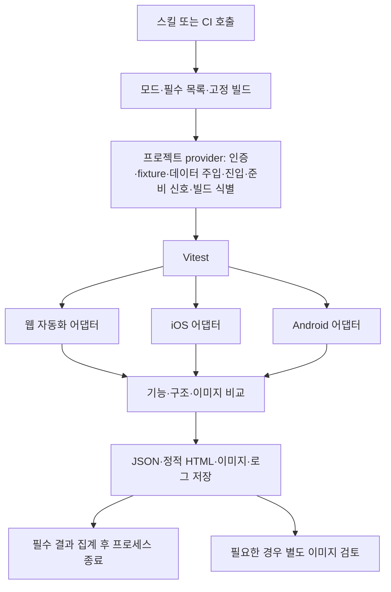
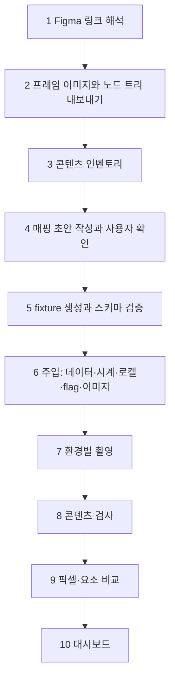

# Retina: 개발 중 시각적 검증·프로젝트 유효성 검증 계획

작성일: 2026-10-25 · 상태: 비관적 가정으로 재작성한 설계안에 사용자 결정(2026-10-25)을 반영 · 구현·CI 실행 전

Retina는 **① 개발 중 시각적 검증**과 **② 개발된 프로젝트의 유효성 검증**을 제공하는 **범용 패키지**예요. 어떤 도메인·프로젝트에서도 쓸 수 있어야 하고, 특정 회사의 코드에 묶지 않아요. 대상은 **URL로 접근하는 웹 앱 + React Native / Expo 앱(bare RN 포함)**, 실행기는 **Vitest**예요. **로컬뿐 아니라 사람의 조작 없이 CI에서도 실행되는 것**이 초기 완료 조건이에요. ①의 핵심은 **Figma 프레임과 구현을 비교하는 디자인 비교**예요(13장).

현재 저장소에는 소개·계획 문서와 Bun 워크스페이스 골격(패키지 3개, 소스는 비어 있음)이 있어요. 실행 로직·시나리오·CI 설정은 없어요. 문서의 도구 구성, 명령·인터페이스 이름, Figma API 사용법과 수치는 구현 제안이며 검증된 성능이 아니에요. 지금까지 실제로 실행한 것은 두 가지예요. 하나는 Aside 재확인(5장)이에요. 다른 하나는 저장소 골격 점검이에요. `bun install`로 40개 패키지를 설치해 `bun.lock`을 만들었고, `bun run typecheck`는 TypeScript 7.0.2로 종료 코드 0이었고, `bun run test`는 테스트가 아직 없어 `--passWithNoTests`로 통과했어요. Node가 adapter-web에서 retina로 가는 워크스페이스 링크를 해석하는 것도 확인했어요. 예제 4개는 `bun run typecheck`와 `bun run example:build`가 통과했고 API 스모크 테스트도 통과했어요(6.4). Retina 실행은 아직 한 번도 하지 않았어요. `--passWithNoTests`는 실제 테스트가 생기면 제거해요. 테스트 0개를 비정상으로 보는 규칙(9장)과 충돌하기 때문이에요. SkinSeoulFront 조사(14장)는 읽기 전용 조사예요. **CI 실행 후 적합성 판정과 근거를 정적 HTML로 제공하는 것**도 필수 결과물이에요.

문서는 세 부분이에요. **제1부(1~13장)**는 범용 Retina의 계약이고, 특정 프로젝트의 이름·경로·환경 변수·URL·계정이 나오지 않아요. **제2부(14~19장)**는 첫 파일럿 SkinSeoulFront가 그 계약을 어떻게 채우는지 보여 주는 한 가지 예시예요. **제3부(20~23장)**는 단계 계획, 수용 실험, 결정 사항이에요.

## 확정된 결정 (사용자, 2026-10-25)

아래 표는 결정 기록이라 제1부와 달리 파일럿 이름이 나와요.

| 결정 | 내용 | 반영 위치 |
| --- | --- | --- |
| **범용 패키지** | 어떤 도메인·프로젝트에서도 동작해요. SkinSeoulFront는 첫 파일럿 소비자일 뿐이에요 | 전체, 6장, 제2부 |
| **Figma 디자인 비교** | ①의 핵심 요구예요. 더 이상 후속 범위가 아니에요. Figma 프레임을 환경별 구현과 비교하고 HTML 대시보드로 보여 줘요 | 13장 |
| **디자인 데이터 맞추기** | 비교 전에 앱의 동적 데이터를 Figma 디자인에 맞춰요. 마스킹은 맞출 수 없는 부분에만 쓰는 최후 수단이에요 | 13.4 |
| ② 검증 범위 | 기능 검증 + 시각 검증을 모두 포함해요. 더 이상 가정이 아니에요 | 2장 |
| 파일럿 프로젝트 | SkinSeoulFront 모노레포 | 제2부 |
| CI 공급자 | GitHub Actions | 9장, 17장 |
| Android 로컬 실행 | CI뿐 아니라 개발 Mac에서도 실행해요. 예전의 "로컬에서는 Android 에뮬레이터를 띄우지 않는다"는 습관을 뒤집는 결정이라, 메모리 예산 안에서 직렬로 실행해요 | 8장, 18장 |
| 브라우저 규칙 | 테스트 코드는 Playwright 번들 Chromium을 headless로 실행할 수 있어요. 사용자 Chrome·프로필·headed 창은 계속 금지예요 | 5장 |
| 도구·런타임 | Retina 저장소는 Bun 1.4.0으로 관리하고, 런타임 타깃은 Node `>=22.18.0`이에요. 배포 패키지에 Bun 전용 API를 쓰지 않아요 | 6장 |

# 제1부. 범용 Retina

## 1. 주요 위험과 전제

가장 큰 위험은 화면 비교 알고리즘보다 **정답 정의, 상태 재현, CI 운영 비용**이에요. 스킬을 작성하는 것과 세 플랫폼에서 신뢰할 수 있는 테스트를 운영하는 것은 별개의 작업이에요.

| 기존 계획의 낙관적 가정 | 수정한 가정과 대응 |
| --- | --- |
| 요구사항과 테스트를 에이전트가 만들면 유효성을 확인할 수 있어요 | 잘못된 구현에서 기대 결과까지 복제할 수 있어요. 명세·사용자 결정 등 구현과 독립된 근거를 요구해요 |
| 같은 조건으로 찍으면 스크린샷이 안정적이에요 | 폰트·그래픽·OS·기기 상태가 흔들릴 수 있어요. 새 CI runner에서 반복 촬영해 확인해요 |
| Vitest를 쓰면 웹·앱 실행도 통일돼요 | 실행기만 통일돼요. 설치·조작·초기화·빌드 식별은 플랫폼별 구현이 필요해요 |
| AI가 이미지를 보면 정상 여부를 판단할 수 있어요 | 작은 결함을 놓치거나 판단이 달라질 수 있어요. 자동 통과의 유일한 근거로 사용하지 않아요 |
| 로컬에서 된 뒤 CI에 연결하면 돼요 | runner·가속·권한·artifact·비대화형 실행이 설계에 영향을 줘요. 첫 실험부터 CI에서 실행해요 |
| 범용 스킬이므로 프로젝트 설정만 있으면 돼요 | fixture와 식별자, 화면 진입점, 빌드 식별 등 프로젝트 수정이 필요할 수 있어요. 7장의 테스트 계약으로 도입 비용을 측정해요 |
| 첫 파일럿에서 되면 범용이에요 | 파일럿의 사정이 엔진에 스며들 수 있어요. 프로젝트별 차이는 provider로만 주입하고(6장), 파일럿과 무관한 두 번째 예제 프로젝트를 Retina 코드 변경 없이 실행해 확인해요 |
| Figma와 구현을 겹치면 차이가 바로 보여요 | 데이터·폰트·스케일·상태바가 다르면 거의 모든 픽셀이 달라져요. 데이터를 먼저 맞추고, 정렬 규칙을 적용하고, 변환을 전부 기록한 뒤 비교해요(13장) |

**두 기능과 모든 대상 플랫폼은 유지하되 첫 대상은 사용자 흐름 하나로 줄여요.** Pairwise 생성기, 범용 구조 규칙 언어, 상시 운영 대시보드, 자동 수정 루프는 초기 범위에서 빼요. 정적 HTML 판정 리포트와 디자인 비교 화면은 초기 범위에 포함해요. 핵심 검증이 실패하면 기능을 늘려 만회하지 않고 실패 원인을 해결하거나 해당 지원을 미완료로 남겨요.

## 2. 두 기능의 계약

| 구분 | ① 개발 중 시각적 검증 | ② 프로젝트 유효성 검증 |
| --- | --- | --- |
| 질문 | 지금 구현한 화면이 디자인과 명시한 배치 조건을 만족하나요? | 이 빌드가 등록된 요구사항과 사용자 흐름을 만족하나요? |
| 입력 | **Figma 프레임 링크**, 대상 화면·상태, 디자인 요구, 예상 변경, 선택적 이전 기준 | 고정 빌드, 요구사항 목록, 필수 시나리오·환경, fixture |
| 범위 | 선택한 변경 화면과 명시한 영향 범위 | 검증 목록에 등록한 필수 케이스 전체 |
| 실행 | 로컬은 준비된 개발 서버·설치 앱에서 짧게 실행해요. CI는 ②의 gate와 분리된 정보용 job에서 디자인 비교와 merge-base 대 head 회귀 진단을 실행해요(9.4) | CI가 준비한 고정 빌드에서 전체 목록을 실행해요 |
| 검사 | **디자인 비교(Figma 링크가 있으면 기본)**, 현재 화면의 규칙과 외형, 선택적 회귀 비교 | **기능 assertion + 구조·외형·회귀**를 검사해요(확정) |
| 결과 | 발견한 문제, 이미지 증거, 검사별 결과·미검사 범위, 환경별 일치율 | 요구사항별 결과, 결함, 미완료·미등록 범위 |
| 통과 의미 | 해당 화면·상태·규칙을 통과했다는 뜻이에요 | 해당 빌드의 선언된 검증 목록을 통과했다는 뜻이에요 |

①이 성공해도 ②가 성공한 것은 아니에요. ②도 프로젝트 전체의 무결성이나 배포 가능성을 인증하지 않아요. 접근성·성능·보안·실기기·미지원 브라우저는 수행하지 않았다면 결과에서 명시해요.

신규 화면은 이전 이미지 없이도 구조 규칙과 명시한 외형 요구, Figma 프레임과의 비교를 검사할 수 있어요. 다만 기준이 없는 회귀 검사는 미완료예요. Figma 프레임은 디자인 근거이지 승인 baseline이 아니에요(13.8). 디자인 근거가 없으면 "보기 좋다"는 추측으로 적합성을 통과시키지 않고 관찰 결과만 제공해요.

②의 기대 결과를 현재 코드 동작만 보고 만들지 않아요. 예를 들어 저장 검증은 성공 토스트만 확인하지 않고, 앱·웹을 재시작하거나 새 세션으로 열었을 때 값이 유지되는지 확인해요. 이 기대 동작 자체에도 요구사항 근거를 연결해요. 근거가 없는 동작은 추론한 후보로 남겨요.

## 3. 지원 범위와 환경 profile

### 3.1 대상과 가정하지 않는 것

- 웹: URL로 접근할 수 있는 웹 앱이면 돼요. 프레임워크는 가리지 않아요.
- 앱: React Native / Expo 앱이에요. bare RN도 포함해요.
- 가정하지 않는 것: 패키지 매니저, 빌드 도구, 모노레포 여부. 소비 프로젝트가 빌드 명령이나 빌드된 artifact를 제공해요.

### 3.2 사용자 흐름 하나

소비 프로젝트마다 테스트 데이터로 실행하는 **입력 폼 → 저장 → 재진입** 형태의 흐름 하나로 시작하길 제안해요. 구체 흐름은 소비 프로젝트가 정해요.

- 정상 입력과 저장·재진입을 확인해요.
- 잘못된 입력 또는 저장 오류 분기 하나를 확인해요.
- 초기 상태, 입력 오류 상태, 저장 후 상태의 촬영 지점 3개를 확인해요.
- ①에서는 이 흐름의 UI 변경 하나를 Figma 프레임과 비교해요.
- ②에서는 같은 흐름의 독립된 요구사항과 기능·시각 검사를 실행해요.

### 3.3 환경 네 개

profile 값은 프로젝트의 `retina.config.ts`가 단일 출처예요(6장). Figma 프레임은 이 profile에 매핑해요(13.2). 최초 고정 범위는 아래 네 개예요.

| 환경 | 최초 고정 범위 |
| --- | --- |
| 웹 데스크톱 | Chromium, 뷰포트 1개 |
| 웹 모바일 폭 | Chromium, 뷰포트 1개예요. 모바일 Safari 검증을 의미하지 않아요 |
| iOS | Simulator 모델·OS·아키텍처 1개 |
| Android | Emulator 모델·API·ABI·렌더러 1개 |

언어·테마·글꼴 배율은 각각 하나로 시작해요. 어느 플랫폼도 조용히 제외하지 않아요. iOS가 동작하지 않으면 웹 성공과 별개로 iOS 및 전체 지원은 미완료예요. 공통 화면이 없다면 플랫폼별 대체 시나리오와 근거를 명시해요.

Pairwise는 이 작은 행렬을 먼저 안정화한 뒤 도입해요. 환경 조합을 줄여도 사용자 흐름과 필수 상태는 제거하지 않아요. 향후 유효한 쌍의 계획 커버리지와 실제 실행 커버리지를 별도 계산해요. Pairwise가 세 조건 이상의 결함까지 보장하지 않는다는 한계도 유지해요. [NIST](https://tsapps.nist.gov/publication/get_pdf.cfm?pub_id=903128)

## 4. 핵심 실패 가설과 대응

| 위험 | 실패가 드러나는 모습 | 초기 대응·진행 조건 |
| --- | --- | --- |
| 잘못된 정답 | 저장이 안 되는데 성공 메시지만 보고 통과해요 | 구현과 독립된 요구 5개를 정하고 저장 무효화 등 결함을 주입해 탐지해요 |
| fixture 구축 비용 | 로그인·데이터·권한을 사람이 매번 초기화해요 | 프로젝트별 setup/reset부터 작성해요. 수동 초기화가 남으면 자동 실행 지원으로 표시하지 않아요 |
| 공유 상태 오염 | 병렬 job·로컬·CI가 같은 계정·데이터를 동시에 바꿔 서로 깨뜨려요 | 플랫폼별·run별 계정으로 격리하고, reset은 멱등으로 작성해요. 같은 fixture 범위의 직렬화는 보조 수단이에요(6장, 16.4) |
| mock의 착시 | 가짜 API에서는 성공하지만 실제 저장 연동은 고장 나요 | mock 기반 검사와 테스트 backend 통합 검사를 다른 suite로 표시해요. mock 성공을 통합 성공으로 승격하지 않아요 |
| 디자인 fixture 드리프트 | 디자인용 mock 데이터가 실제 API 계약과 어긋나 있어요 | fixture를 프로젝트 스키마로 검증하고, 실패하면 `INCONCLUSIVE`예요(13.4) |
| 디자인 비교 노이즈 | 데이터·폰트·스케일 차이로 전체가 다르다고 나와요 | 데이터 맞추기 → 콘텐츠 검사 → 정렬 → 비교 순서를 지키고 모든 변환·마스크를 공개해요(13장) |
| 앱 실행 불안정 | 예전 JS bundle, 권한창, 다른 화면을 촬영해요 | 설치 빌드와 실행 bundle을 식별하고 준비 신호·화면 식별을 확인해요 |
| 이미지 오탐 | 같은 코드인데 runner마다 diff가 발생해요 | 고정 환경에서 A/A 반복 실험을 해요. 임계값·마스크를 자동 완화하지 않아요 |
| 작은 결함 누락 | 전체 diff 비율이 작아 버튼 잘림을 통과시켜요 | 핵심 영역 비교와 명시적 구조 규칙을 병행해요 |
| AI 판정 불안정 | 같은 이미지에 다른 결론을 내리고 구현 의도로 결함을 정당화해요 | 정답을 숨긴 평가·반복 검사를 해요. AI의 문제없음은 단독 통과 근거가 아니에요 |
| 기준 오염 | 결함 이미지를 자동 갱신해 이후 모두 통과해요 | CI 기준은 읽기 전용으로 두고 신규 후보와 승인 기준을 분리해요. 승인 경로는 10장이에요 |
| CI 비용·시간 폭증 | 앱 빌드·부팅·재시도 때문에 개발 흐름에서 사용하지 않아요 | 빌드·준비·검사 시간을 분리 측정하고 실행 상한을 설정해요. 상한 초과를 숨기지 않아요 |
| 로컬 메모리 압박 | 에뮬레이터·시뮬레이터·번들러가 겹쳐 개발 머신이 느려지거나 앱이 죽어요 | 직렬 실행, 부팅 전 메모리 점검, 소유 프로세스만 정리해요(8.3) |
| 자격 증명이 빌드 산출물에 들어감 | 앱 번들이나 artifact에 세션 쿠키·API 키가 인라인돼서, 저장소 읽기 권한이 있는 누구나 보존 기간 동안 내려받을 수 있어요 | 자격 증명을 빌드 시점에 넣지 않아요. 테스트 모드에서 실행 시점에 단명 토큰을 주입해요(launch argument, 테스트 딥링크, mock 서버 인증). 불가피하면 전용 저권한 테스트 계정, 단명 자격 증명, 최소 artifact 보존, run 뒤 교체를 지켜요(6장) |
| 설정·테스트 삭제 | 검사 수를 줄여 전체 성공으로 보이게 해요 | 사전에 확정한 필수 목록과 실제 결과를 대조해요. 정책 변경도 검토 대상이에요 |

fixture가 준비됐다는 사실과 요구사항이 맞다는 사실을 구분해요. 화면 두 장이 같아도 둘 다 로딩 화면일 수 있고, 승인 기준에도 기존 버그가 있을 수 있어요. "기준과 동일"과 "요구사항 충족"을 결과에서 별도 근거로 남겨요.

## 5. 실행 구조



Vitest는 테스트 lifecycle·assertion·플랫폼별 project 실행을 담당해요. 공통화 대상은 **입력·결과 형식, PNG 비교, 필수 목록 집계**예요. 네이티브의 탐색·입력·reset까지 DOM과 같은 API로 만들려고 하지 않아요. [Vitest Projects](https://vitest.dev/guide/projects)

웹은 **격리된 헤드리스 Chromium 테스트 엔진 + Aside 진단 도구** 방향을 유지해요. 앱은 Appium + WebdriverIO standalone을 첫 검증 후보로 두어요. standalone은 다른 테스트 프로젝트에서 사용할 수 있지만, Vitest와 Expo에서 우리의 시나리오가 안정적으로 실행된다는 증거는 아직 없어요. [WebdriverIO standalone](https://webdriver.io/docs/setuptypes)

Vitest Node에서 어댑터를 호출하고 공통 비교 함수를 assertion에 연결하는 최소 구조로 시작해요. Playwright Test·WDIO 러너를 추가로 운영하지 않아요. 자체 matcher·reporter 플러그인은 단순 helper와 파일 출력으로 부족하다는 근거가 생긴 뒤 만들어요.

### 5.1 Vitest 실행 설정

- 각 플랫폼 project는 기기·브라우저 하나당 worker 1개로 실행해요(`fileParallelism: false`, `maxWorkers: 1`). 옵션 이름과 동작은 Vitest 버전에 따라 달라질 수 있어 단계 B에서 확인해요.
- 앱 실행과 촬영 반복을 고려해 `testTimeout`·`hookTimeout`을 단위 테스트보다 크게 잡아요. 값은 단계 B에서 측정해 정해요.
- Appium 서버·기기 부팅·웹 서버 시작·mock 서버 시작은 `globalSetup`에서 처리하고 teardown에서 정리해요.
- 케이스별 Retina 상태는 Vitest `task.meta`에 기록해 집계 함수가 읽어요.
- 자동 재시도는 기본 0회예요(11장).

### 5.2 Aside 의존성과 기존 조사 기록

2026-10-25에 Aside CLI 1.26.1020.1855에서 `setViewportSize`는 `TypeError: not a function`, `emulateMedia`는 없음, 뷰포트·DPR은 사용자 창(측정 시 1440×900, DPR 2)을 따르는 것을 다시 확인했어요. 실행 명령과 출력은 `docs/plan-review-2026-10-25.md`에 남겼어요. 사용자 쿠키·자격 증명 위에서 동작하고 `import`/`require`가 안 되며 1회 120초 제한이 있어요. Aside 버전이 바뀌면 같은 명령으로 다시 확인해요. 이 확인은 Aside를 촬영 엔진으로 쓸 수 없다는 근거예요.

CI 실행 패키지는 Aside 설치·개인 로그인·GUI 세션을 요구하지 않아요. 에이전트의 대화형 브라우저 탐색은 Aside로 해요. 헤드리스 테스트 엔진은 브라우저 작업 규칙의 "자동화 테스트 엔진" 예외(2026-10-25 추가)를 따라요. 번들 Chromium을 headless로만 실행하고 사용자 Chrome·프로필·headed 창은 사용하지 않아요. 이 규칙은 에이전트의 로컬 세션에 적용되는 규칙이고, 계획서가 규칙 자체를 바꾸지는 않아요.

### 5.3 네이티브 실행의 한계

앱은 고정된 Expo 테스트 빌드를 사용해요. 로컬 ①에서 development build를 사용할 수 있지만, CI ②는 가능하면 JS bundle을 포함한 테스트 artifact로 실행해 개발 서버 연결 의존을 줄여요. Metro(JS 번들러)가 꼭 필요하면 CI가 직접 시작하고 준비·종료와 bundle 식별까지 관리해요. development·테스트·release 빌드의 기준을 혼용하지 않아요. [Expo development builds](https://docs.expo.dev/develop/development-builds/introduction/)

OS별 testID 노출, 요소 경계와 이미지 픽셀 좌표 변환, safe area, 권한창, 키보드는 어댑터 검증 항목이에요. 필요한 요소를 읽을 수 없다고 이미지 판독으로 몰래 대체해 구조 검사 통과를 만들지 않아요. React Native JS tree snapshot·Expo Web 결과는 네이티브 화면 검증을 대신하지 않아요.

**①에서 네이티브 변경 전 기준을 얻는 비용**은 변경 종류에 따라 달라요. 이 절은 회귀 비교에 해당하고, 디자인 비교는 변경 전 빌드가 필요 없어요(13.8).

- JS·asset만 바뀌었다면 같은 설치 바이너리에 변경 전 커밋의 bundle을 로드해 촬영해요. 기준과 후보의 bundle 모드를 맞춰요.
- 네이티브 코드·네이티브 의존성·config plugin이 바뀌었다면 바이너리를 다시 빌드해야 해서 ①의 시간 목표(22장, 2분)를 넘어요. 이때는 승인 baseline이 있을 때만 회귀를 실행하고, 없으면 미지원으로 표시해요.
- 판단이 불확실하면 네이티브 변경으로 취급해요.

### 5.4 기기 상태 고정 절차 후보

단계 B에서 확인할 후보이고 아직 실행하지 않았어요.

| 항목 | iOS Simulator | Android Emulator |
| --- | --- | --- |
| 상태바 | `xcrun simctl status_bar <device> override`로 시간·배터리·신호를 고정해요 | SystemUI demo mode로 시계·아이콘을 고정해요 |
| 테마 | `xcrun simctl ui <device> appearance light\|dark` | `adb shell cmd uimode night yes\|no` |
| 글꼴 배율 | `xcrun simctl ui <device> content_size <category>` | `adb shell settings put system font_scale <value>` |
| 애니메이션 | 앱 테스트 모드에서 끄고, 모션 감소 설정을 검토해요 | `window_animation_scale`·`transition_animation_scale`·`animator_duration_scale`을 0으로 둬요 |
| 권한 창 | 케이스별로 미리 허용해요. 권한 창이 검증 대상이면 자동 허용을 꺼요 | 같아요 |

## 6. 확장 지점·설정·패키지 구성

### 6.1 원칙

- Retina 코드에는 소비 프로젝트의 이름·경로·환경 변수·URL·계정이 없어요. 프로젝트별 차이는 **provider**로 주입해요.
- 설정은 프로젝트마다 하나(`retina.config.ts`)예요. 시나리오·테스트·baseline·fixture 코드는 소비 저장소에 둬요.
- Retina는 소비 저장소에 **정확한 버전으로 고정한 devDependency**로 설치해요(`^` 범위 금지).
- Retina는 기본 구현과 예시(`examples/`)를 제공해요. 어떤 프로젝트의 코드도 제공하지 않아요.
- provider가 없거나 실패하면 해당 검사는 `INCONCLUSIVE`예요. 통과로 넘기지 않아요.

### 6.2 provider 인터페이스 (모두 제안)

| 확장 지점 | 프로젝트가 구현하는 일 | Retina 기본 제공(제안) | 예시 |
| --- | --- | --- | --- |
| 인증·세션 `AuthProvider` | 테스트 사용자 상태로 만들기 | `cookieAuth`, `storageStateAuth`, `runtimeTokenAuth`(앱: 테스트 모드에서 실행 시점에 단명 토큰 주입), `preAuthenticatedBuild`(자격 증명이 빌드에 들어가서 마지막 수단, 4장) | 웹: API 로그인 응답의 쿠키 주입. 앱: launch argument·테스트 딥링크·mock 서버 인증으로 토큰 주입 |
| fixture `FixtureHooks` | `setup`, `snapshot`, `restore` | 훅 호출 순서·잔존 상태 복구 규칙·오류 처리 | 테스트 계정의 데이터를 정해진 상태로 reset |
| 데이터 주입 `DataProvider` | 화면이 쓰는 데이터를 fixture로 제공 | `routeInterceptor`(웹 `page.route`), `mockServer`(로컬 mock HTTP 서버), `backendSeedHook`(테스트 backend 시딩 훅) | 라우트 → fixture JSON, 테스트 계정 시딩 |
| 실행 환경 고정 `EnvOverrides` | 시계·날짜·로캘·타임존·통화·숫자 형식·feature flag·세션을 테스트 모드에서 덮어쓰기 | 값 선언과 적용 확인 | 고정 날짜, 고정 로캘, flag 전부 off |
| fixture 스키마 검증 `SchemaValidator` | fixture가 실제 API 계약에 맞는지 검증 | 훅 호출과 실패 처리 | OpenAPI, JSON Schema, zod, TS 타입 |
| 빌드 식별 `BuildIdentityProvider` | 실행 중인 빌드·bundle 식별자 읽기 | `metaTagIdentity`, `httpEndpointIdentity` | expo-updates의 update id, hot-updater의 bundle id, 자체 build-info endpoint |
| 진입 `Navigator` | 대상 화면으로 이동 | `urlNavigator`, `deepLinkNavigator`, `scriptedNavigator`(조작 단계 목록) | URL, deep link, 탭·버튼 조작 |
| 준비 신호 `ReadySignal` | 화면이 촬영 가능해진 시점 알리기 | 지정 요소의 등장·속성 값 확인 | 화면별 ready 표식 요소 |
| 요소 매핑 `LocatorMap` | 논리 id → 플랫폼별 식별자 | `testId` 기반 매핑 | `data-testid`, `testID`, accessibility id |

시나리오는 논리 id(`checkout-form.submit` 같은 이름)만 쓰고 플랫폼별 식별자는 `LocatorMap`이 풀어요. 그래서 같은 시나리오가 웹과 앱에서 모두 읽혀요.

fixture에는 두 가지 규칙이 있어요. `setup`은 멱등(여러 번 실행해도 같은 상태)으로 정해진 초기 상태를 만들어요. 상태가 공유 자원이면 `snapshot`/`restore`를 구현하고, 강제 종료 뒤 다음 실행이 잔존 상태를 먼저 복구해요. 복구 정보를 저장할 곳이 없는 환경(일회용 runner)에서는 snapshot/restore에 기대지 않고 멱등 reset을 써요. 같은 `fixtureScope`를 쓰는 profile은 동시에 실행하지 않아요.

### 6.3 `retina.config.ts` 형태 (제안)

```ts
import { defineConfig } from '<retina 패키지>'

export default defineConfig({
  profiles: {
    'web-desktop': { platform: 'web', viewport: { width: 1440, height: 900 }, fixtureScope: 'a' },
    'ios': { platform: 'ios', device: { udid: process.env.RETINA_IOS_UDID } },
    // web-mobile, android도 같은 형태
  },
  providers: { auth, fixture, data, env, schema, buildIdentity, navigator, ready, locators }, // 소비 저장소가 구현
  design: {
    frames: [ /* 13.2: Figma 프레임 → 촬영 지점·환경 매핑 */ ],
    fixturesDir: 'retina/design-fixtures',
  },
  report: { open: 'serve' }, // 'os' | 'print' | 'serve' | false. CI에서는 항상 false
  scenarios: ['retina/scenarios/*.test.ts'],
  baselines: '.retina/baselines',
  requiredEnv: ['<필요한 환경 변수 이름>'], // 이름만 선언. 누락 시 실행 전 INCONCLUSIVE, 값은 기록하지 않음
})
```

### 6.4 저장소 구성 (골격만 있고 구현은 아직)

```text
packages/
  retina/                  # 코어 + CLI. 가벼운 의존성만(pixelmatch, HTTP 서버, 스키마 검증기)
    src/
      cli/                 # Controller: retina run / review / finalize / report --open
      config/              # 공개 API: defineConfig, config 스키마, 확장 지점 타입
      domain/
        run/               # 실행 계획, 오케스트레이션, profile 선택, 메모리 가드 정책
        verdict/           # 상태 4종, 집계, 종료 코드
        compare/           # 정렬, 픽셀 비교, 일치율, 마스크
        design-data/       # Figma 레이어 → 데이터 매핑, fixture 생성, 콘텐츠 일치
        review/            # review.json 검증, 해시 확인, 병합 규칙
      infrastructure/
        figma/             # Figma REST 클라이언트(images, nodes), 파일 버전별 내보내기 캐시
        mock-server/       # 라우트 → fixture JSON 로컬 HTTP 서버
        storage/           # .retina/ 파일, baseline manifest, run artifact
        report/            # 정적 HTML 대시보드와 result.json 렌더링
    test/
  adapter-web/             # playwright(번들 Chromium, headless)에 의존해서 별도 패키지
    src/ test/
  adapter-native/          # appium·webdriverio에 의존해서 별도 패키지. 웹만 쓰는 소비자는 설치하지 않아요
    src/shared/ src/ios/ src/android/ test/   # 기기 고정, 안정화 명령, 메모리 가드, Metro 처리
skills/retina/references/  # SKILL.md + 모드별 참조(dev-visual·Figma, project-validation, configuration, baseline policy)
actions/                   # composite GitHub Actions(에뮬레이터·시뮬레이터 준비, retina 실행, 리포트 업로드 등)
.github/workflows/         # 소비 저장소가 호출하는 reusable workflow(workflow_call)
examples/shared/  examples/api/  examples/web/  examples/expo/   # 파일럿과 무관한 도메인 중립 예제(범용 경로 증명용, 20장). 현황은 아래
docs/
```

- **패키지가 세 개뿐인 이유**는 개념이 아니라 **의존성 무게**로 나눴기 때문이에요. 더 쪼개는 건 근거가 생긴 뒤에만 해요. 두 플랫폼 이상에서 반복되는 계약을 확인한 뒤 어댑터 공통 interface를 추출하는 규칙과 같아요.
- **계층**은 `cli → domain → infrastructure`이고 건너뛰지 않아요. domain은 프레임워크 import가 없어요. 어댑터는 infrastructure에 해당하고, 어댑터가 따를 interface는 `config/`에 선언해요.
- Vitest 연결 helper는 `packages/retina`의 공개 API(`config/`)에 두는 것을 제안해요.
- 스킬은 호스트별로 배포해요. 1순위는 Claude Code 플러그인이고 Codex 표시 정보도 유지해요. 스킬은 ①의 이미지 검토, 매핑 초안 작성, `review.json` 작성을 안내해요.

**예제 현황 (2026-10-25 확인)**: 루트 `workspaces`는 `["packages/*", "examples/*"]`예요. 예제는 Retina API를 아직 쓰지 않는 뼈대이고, 각 예제에 `retina/README.md`와 빈 소비자 폴더가 있어요. 흐름은 Profile → Edit(이름 필수, 이메일 형식 검사) → Save → Profile 재조회로, G-B3·G-C6의 도메인 중립 흐름이에요.

| 워크스페이스 | 내용 |
| --- | --- |
| `retina-example-shared` | 검증 규칙·메시지·API 클라이언트, React hook(`retina-example-shared/react`, 클라이언트 주입) |
| `retina-example-api` | node:http와 메모리 저장소. `GET/PUT /profile`, `TEST_MODE=1`일 때만 `/__test/health`·`/__test/reset`과 `X-Retina-Run` 헤더별 저장소(최대 50개, LRU). 기본 `127.0.0.1:4010` |
| `retina-example-web` | Vite 8.3.5 + React 19.3.0. 경로 `/`·`/edit`, 주요 요소에 `data-testid`, 데이터 로딩 뒤 `data-retina-ready="profile\|edit"`, `<meta name="retina-build-id">`(`VITE_BUILD_ID`, 기본 "dev"), `VITE_API_BASE_URL` |
| `retina-example-expo` | Expo SDK 58, RN 0.88.0. `testID`, 1×1 투명 `retina-ready-<screen>`·`retina-build-id` 표식, scheme `retina-example`, `EXPO_PUBLIC_API_BASE_URL`(기본값은 iOS 127.0.0.1, Android 10.0.2.2) |

- 확인한 것: `bun install --frozen-lockfile` 변경 없음, `bun run typecheck`(패키지 + 예제 4개) 통과, API 스모크(GET seed, 잘못된 PUT은 400과 `fieldErrors`, 올바른 PUT은 값 trim, `POST /__test/reset`으로 seed 복귀) 통과, `bun run example:build`(web vite build, `expo export` ios·android) 통과, 남는 리스너 없음. 루트 script는 `typecheck`(= `typecheck:packages` + `typecheck:examples`), `example:api`, `example:api:test`, `example:web`, `example:expo`, `example:build`예요. **Retina 실행은 아직 한 번도 하지 않았어요.**
- 미검증·후속(단계 B 작업에 배정): (a) 1×1 투명 표식이 XCUITest·UiAutomator2에 보이는지(G-B4·G-B5). (b) Android release 빌드는 mock API로의 평문 HTTP를 막아요(debug는 가능, G-B10). (c) ready·build-id·run id 표식은 `VITE_RETINA_TEST_MODE`·`EXPO_PUBLIC_RETINA_TEST_MODE`가 켜졌을 때만 번들에 들어가요. `bun run example:check:prod`가 production 산출물에서 표식 문자열 0건을, `example:check:test`가 테스트 빌드에서 표식 존재를 확인했어요. 실행 ID는 빌드가 아니라 실행 시점에 넘겨요(웹 `?retinaRun=`, 앱 딥링크 `?run=`). 웹의 실행 ID 전달은 브라우저에서 아직 돌려 보지 않았어요. (d) 웹 정적 호스트에는 `/edit`용 SPA fallback이 필요해요(G-B3).

### 6.5 도구와 실행 환경 (사용자 결정, 2026-10-25)

Retina 저장소의 루트 `package.json`과 `packages/retina/package.json`에 아래 내용이 이미 설정돼 있어요. 설치·타입 검사·테스트 실행(테스트 없음)은 확인했고(머리말), 게시용 빌드와 소비자 쪽 npm 설치는 확인하지 않았어요. 루트 `test` script의 `--passWithNoTests`는 실제 테스트가 생기면 제거해요.

| 항목 | 결정 |
| --- | --- |
| 패키지 매니저·스크립트 실행 | **Bun 1.4.0**. 루트 `package.json`에 `packageManager: bun@1.4.0`, `workspaces: ["packages/*", "examples/*"]`를 두고 `bun.lock`을 커밋해요 |
| linker | 루트 `bunfig.toml`에서 `linker = "hoisted"`예요. isolated linker에서는 `expo-constants`가 두 번 설치돼 expo-doctor가 중복 네이티브 모듈을 지적했고, 바꾼 뒤 20/20이 됐어요. 대가로 선언하지 않은 의존성이 해석될 수 있어서, `packages/*`의 의존성 선언 누락을 잡는 G-B11(tarball을 Node·npm으로 설치)이 더 중요해요. React는 워크스페이스 전체에서 한 버전으로 고정해요 |
| 버전 차이 | 예제는 TypeScript 6.0.3(템플릿 도구체인)이고 루트는 7.0.2예요. 예제 Expo는 SDK 58 / RN 0.88이고 파일럿은 SDK 57 / RN 0.86이라, 네이티브 어댑터는 SDK 하나를 가정하면 안 돼요(23장 25번) |
| 런타임 타깃 | **Node `>=22.18.0`이에요. Bun이 아니에요.** 소비자는 Node에서 npm·pnpm·yarn을 쓰고, Appium·WebdriverIO·Playwright가 Node 도구이기 때문이에요. `vitest`와 `tsc` bin도 Node에서 돌아가요(node shebang) |
| 금지 | 배포하는 패키지에서 Bun 전용 API(`Bun.*`, `bun:*`)를 쓰지 않아요. Bun은 이 저장소의 개발 도구일 뿐 소비자에게 Bun 설치를 요구하지 않아요 |
| 개발 도구 | TypeScript 7.0.2(`tsc` 타입 검사, 지금은 `noEmit`), Vitest 5.0.5(Retina 자체 테스트), `@types/node` 22. 게시용 빌드·emit 전략은 정하지 않았어요(지금 `exports`는 `src/index.ts`를 가리켜요) |
| 패키지 이름(임시, `private: true`) | `retina`(packages/retina), `retina-adapter-web`, `retina-adapter-native`. npm의 비스코프 이름 `retina`는 이미 사용 중이라(v0.1.1) 게시 이름이나 scope는 정하지 않았어요(23장) |
| 소비자의 Vitest 호환 | 미정. 시나리오 helper가 `vitest`를 peerDependency로 선언할 가능성이 커요. 지원 범위를 정하고 시험해요(23장) |

### 6.6 CLI (제안)

| 명령 | 하는 일 |
| --- | --- |
| `retina run` | `--mode dev\|validate`, `--platform`, `--profile`을 받아요. 디자인 비교 단계(13.1)를 포함해요. 3~5단계 결과는 캐시를 재사용하고, `--refresh-design`(이름 제안)으로 다시 만들어요 |
| `retina review` | `review.json`을 검증하고 해시를 확인해 접수해요. 해시가 다르면 거부해요(종료 코드 `2`) |
| `retina finalize` | 결과를 집계하고 baseline 승인 여부를 CI 공급자 API로 확인한 뒤 최종 상태와 종료 코드를 정해요. CI의 aggregate-report job이 호출해요 |
| `retina report --open` | `report.html`을 만들고 설정에 따라 열어요(13.9) |

종료 코드는 11장 표를 따라요.

### 6.7 소비 저장소의 구성

소비 저장소에 두는 파일이에요. Retina 저장소에는 만들지 않아요.

```text
retina.config.ts
retina/
  scenarios/*.test.ts                          # 시나리오
  design-fixtures/<scenario>/<checkpoint>.json # 13.4의 매핑과 fixture
  hooks/                                       # 인증·fixture·데이터 provider 구현
.retina/
  baselines/                                   # 커밋, CODEOWNERS 대상(10장)
  reviews/                                     # review.json, 커밋
  runs/                                        # run 산출물, gitignore
```

### 6.8 소비 방법

1. 정확한 버전으로 devDependency를 추가해요. 배포 경로(사설 레지스트리·git 의존성 등)는 23장의 결정이에요. 웹만 쓰면 `adapter-native`는 설치하지 않아요.
2. 루트에 `retina.config.ts`를 두고, provider 구현은 `retina/hooks/`, 시나리오는 `retina/scenarios/`에 둬요.
3. 로컬은 `retina run`, CI는 9장의 reusable workflow를 호출해요.
4. 업그레이드는 버전을 올리는 PR로만 하고, 결과 `result.json`에 Retina 버전을 남겨요.

## 7. 대상 프로젝트가 제공할 테스트 계약

도입 전 점검표로 써요. 비어 있는 항목은 해당 검사의 `INCONCLUSIVE`가 돼요.

| 항목 | 웹 | 앱 | 수준 | 없을 때 |
| --- | --- | --- | --- | --- |
| 안정 식별자 | `data-testid` | `testID`(OS별 노출 속성은 단계 B에서 확인) | 구조 검사·영역 비교에 필수 | 해당 검사 `INCONCLUSIVE` |
| 준비 완료 신호 | 화면별 ready 표식(예: `data-retina-ready`) | 같은 의미의 식별자 요소 | 필수 | 촬영하지 않고 `INCONCLUSIVE` |
| fixture setup/reset | 테스트 전용 seed·API | 테스트 빌드의 초기화 딥링크·API | 상태 변경 흐름에 필수 | 자동 실행 지원 아님 |
| **API base URL 덮어쓰기** | 테스트 모드에서 설정·환경 변수로 변경(또는 `page.route`로 대체) | 테스트 빌드가 API base URL을 mock 서버로 바꿀 수 있어야 해요 | 디자인 데이터 맞추기에 필수 | 해당 데이터는 마스크하고 낮은 신뢰로 표시해요(13.4) |
| **시계·로캘·flag 덮어쓰기** | 테스트 모드에서 고정 | 같음 | 디자인 비교에 필수 | 날짜·형식 영역을 마스크해요 |
| 디자인 에셋 서빙 | 이미지 URL을 fixture 에셋으로 교체 | 같음 | 권장 | 이미지 영역을 마스크해요 |
| 빌드 식별자 | 메타 태그·응답 헤더로 커밋·빌드 ID 노출 | native 빌드 ID + JS bundle·update ID 노출 | 회귀에 필수 | 회귀 `INCONCLUSIVE` |
| 진입 경로 | URL | 테스트용 딥링크 scheme | 필수 | 이동 동작을 테스트 코드로 작성 |
| 시간·랜덤·네트워크 고정 | 테스트 모드 플래그, mock | 같음 | 권장 | 마스크 증가, 불안정 시 `INCONCLUSIVE` |
| 개발 오버레이 차단 | 오류 오버레이 비활성 | dev menu·LogBox 비활성 | 권장 | 오버레이 감지 시 `INCONCLUSIVE` |

테스트 모드 코드, base URL·시계·로캘·flag 덮어쓰기, 초기화 API는 빌드 플래그로 분리해 **production 빌드에 포함되지 않게** 해요. production 빌드 산출물에 테스트 모드 식별 문자열이 없는지 확인하는 검사를 소비 프로젝트 CI에 넣도록 안내해요.

## 8. 로컬 profile과 CI profile

### 8.1 두 profile의 차이

두 profile 모두 웹·iOS·Android를 실행해요. 차이는 실행 방식과 보고 방식이에요.

| 항목 | 로컬 profile | CI profile |
| --- | --- | --- |
| 플랫폼 | 웹·iOS·Android (Android 포함이 확정 결정) | 같아요 |
| 실행 방식 | 플랫폼 직렬, 기기 한 번에 하나, 메모리 가드(8.3) | job을 플랫폼별 runner에서 병렬로 실행해요 |
| 앱 빌드 | 이미 설치된 빌드나 CI artifact 재사용이 기본이에요. 로컬 빌드는 최후 수단이에요 | 빌드 job이 만든 artifact만 설치해요 |
| baseline | 생성하지 않아요. 비교는 8.2 조건에서만 해요 | 기준 환경에서만 생성·비교해요 |
| 리포트 | 끝나면 설정에 따라 열어요(13.9) | 열지 않고 artifact와 PR 요약으로 제공해요 |
| 보고 | `profile: local`, 실행한 플랫폼 명시 | `profile: ci`, 필수 목록 전체와 대조 |

### 8.2 baseline과 환경 일치

- baseline은 CI 기준 환경에서만 만들어요. 개발자 Mac에서 만든 이미지는 baseline이 될 수 없어요.
- 로컬 실행은 **환경 fingerprint가 CI baseline과 정확히 일치할 때만** 그 baseline과 비교해요. fingerprint에는 OS, 브라우저·도구 버전, 기기 모델·API·ABI, 화면 크기·density 설정, 렌더러, 폰트 구성이 들어가요.
- 하나라도 다르면 local profile로 실행해요. 기능·구조·외형 요구 검사와 디자인 비교는 하고, 회귀 비교는 하지 않고 이유를 결과에 적어요. 로컬 통과를 CI 통과로 대체하지 않아요.
- 로컬에서 CI와 같은 웹 환경이 필요하면 CI와 같은 컨테이너 이미지(digest 고정)로 실행해요. 로컬 컨테이너의 메모리 비용은 단계 B에서 측정해요.
- Android의 CPU 아키텍처(ABI)가 CI와 다르면(Apple silicon의 arm64 대 CI의 x86_64 가능성) fingerprint가 달라져 local profile이 돼요. 이 경우를 숨기지 않아요.

### 8.3 로컬 메모리 가드

로컬에서 Android 에뮬레이터를 띄우는 건 메모리 부담이 큰 선택이에요. 그래서 아래 가드를 설계 요건으로 둬요. 구체 임계값은 단계 B에서 측정해 정하고, 근거가 된 사례는 18장에 있어요. 모두 아직 구현·검증 전이에요.

| 가드 | 동작 |
| --- | --- |
| 직렬·단일 기기 | 플랫폼을 한 번에 하나씩 실행해요. 앞 플랫폼의 기기·드라이버·번들러를 정리한 뒤 다음을 시작해요 |
| 부팅 전 메모리 점검 | 호스트 여유 메모리와 메모리 압박 수준을 기록해요. 임계값 미만이면 부팅하지 않고 해당 케이스를 `INCONCLUSIVE`, 사유 "호스트 메모리 부족"으로 남겨요 |
| AVD RAM 상한 | 에뮬레이터 RAM을 profile에서 고정해요(`-memory <MB>` 등). 상한은 호스트 여유 메모리에 맞춰 단계 B에서 정해요 |
| 에뮬레이터 `/data` 여유 | 설치 전에 여유 공간을 확인하고, 단일 ABI 빌드를 써요. 공간 부족은 설치 실패로 새지 않게 사전 `INCONCLUSIVE`로 처리해요 |
| 소유 프로세스만 종료 | Retina가 시작한 기기·드라이버·번들러·서버·mock 서버의 PID(와 시작 시각)를 run 상태 파일에 기록하고 그것만 종료해요. 사용자가 띄운 시뮬레이터·번들러는 건드리지 않아요 |
| 기기 고정 | iOS는 UDID, Android는 시리얼을 profile에서 명시해요. 다른 기기가 떠 있어도 거기로 새지 않고, 기기를 지정하지 않으면 실행하지 않아요 |
| 잔존 프로세스 | 시작 시 이전 run의 상태 파일을 확인해요. 소유가 확실하면 정리하고, 불명확하면 정리하지 않고 경고해요 |
| 최대 RSS 기록 | run마다 소유 프로세스의 최대 RSS와 시작·종료 시점의 여유 메모리를 `result.json`에 기록해요 |
| 사전 빌드 재사용 | 미리 빌드한 WebDriverAgent(iOS 자동화 드라이버)와 앱 artifact를 재사용해 세션마다 빌드를 띄우지 않아요 |

로컬 결과는 실행한 플랫폼을 명시해서 보고해요. 메모리 부족으로 건너뛴 플랫폼은 미실행이 아니라 "`INCONCLUSIVE`(호스트 메모리 부족)"이고, 세 플랫폼 통과로 보고하지 않아요.

## 9. CI 실행 요건과 재사용 workflow

### 9.1 공급자 독립 계약

특정 서비스의 계정·개인 브라우저·개발자 머신 경로에 엔진을 묶지 않아요. 확정한 공급자는 GitHub Actions이고(9.2), 아래 계약은 공급자와 무관해요.

| job | 실행 환경 | 고정·기록할 항목 |
| --- | --- | --- |
| 웹 | Linux runner, 필요 시 컨테이너 | Node·패키지 lockfile·Chromium revision·폰트·OS·이미지 digest·headless 옵션 |
| iOS | macOS runner와 Xcode·Simulator | CPU 아키텍처, Xcode·runtime·기기 모델, simulator용 app artifact |
| Android | VM 가속이 가능한 Linux runner와 Emulator | JDK·SDK·API·system image·ABI·드라이버·그래픽 모드, APK |
| 집계 | 작은 독립 job | 실행 계획 해시, commit·artifact·baseline 식별자, 필수 job 결과와 누락 |

GitHub-hosted Linux runner는 Android 가속을 지원하고 macOS runner도 제공해요. 실제 사용 가능한 이미지·자원·계정 비용은 단계 A에서 확인해야 해요(미검증). [GitHub runner 문서](https://docs.github.com/en/actions/reference/runners/github-hosted-runners), [Android 가속 문서](https://developer.android.com/studio/run/emulator-acceleration)

#### 비대화형 실행 계약

1. 깨끗한 checkout에서 lockfile 기준 설치, 도구 버전 확인, 빌드 또는 지정 artifact 다운로드를 수행해요. 최초에는 캐시 없이도 실행돼야 해요.
2. 웹 서버·fixture backend·mock 서버·기기·드라이버의 준비 상태를 제한 시간 안에 확인해요. 사용자 입력을 기다리지 않아요.
3. baseline과 후보 빌드·JS bundle·실행 계획을 식별하고 필수 케이스를 실행해요.
4. 성공·실패·미완료마다 JSON·정적 HTML·이미지·필요한 로그를 저장해요. 실패해도 artifact 업로드를 시도해요.
5. 종료 시 소유한 서버·드라이버·기기를 정리해요. 강제 종료로 결과가 없으면 집계 job이 누락으로 처리해요.
6. 필수 플랫폼 하나라도 실패·취소·미실행이면 전체 지원 결과를 성공으로 만들지 않아요. 가능한 다른 플랫폼의 결과는 수집해요.

선택 실행인 ①과 전체 검증 목록을 실행하는 ②를 구분해요. `--project` 필터가 iOS를 제외했다면 웹 선택 실행 성공으로 보고하고 전체 프로젝트 통과를 표시하지 않아요. 테스트 0개, fixture 준비 실패, 기기 부팅 실패도 비정상 종료예요.

CI job마다 상한을 두고 에이전트·사람의 이미지 검토를 기다리며 프로세스를 열어두지 않아요. 실행과 검토는 저장된 artifact를 통해 연결해요. AI API 키·외부 모델 응답은 자동 검사의 필수 의존성이 아니에요.

#### 빌드·캐시·artifact

앱 빌드는 플랫폼별로 만들고 테스트 job은 검증한 해시의 artifact만 설치해요. 이미 만들어진 artifact 재사용은 commit·native 구성·JS bundle·build profile 식별이 맞을 때만 허용해요. iOS simulator artifact와 실기기 artifact를 혼동하지 않아요. 패키지·빌드 캐시는 도입하더라도 lockfile·도구 버전·플랫폼 등을 key에 포함해요. 캐시는 baseline이나 빌드 정체성의 근거가 아니고, 캐시 적중 실행만 성공하는 상태는 완료로 보지 않아요.

실행 결과는 CI artifact로 올리고 초기 보존 기간은 14일을 제안해요. 승인 baseline은 만료되는 실행 artifact에만 보관하지 않아요. artifact에는 테스트 계정의 합성 데이터만 담고 인증 상태·원본 토큰은 제외해요. 앱 빌드 artifact에도 자격 증명을 넣지 않아요(4장). 업로드 실패 시 증거가 없으므로 해당 증거 필수 검사는 미완료예요. [CI artifact 문서](https://docs.github.com/en/actions/tutorials/store-and-share-data)

fixture는 개인 계정 없이 실행 가능한 테스트 서비스·계정을 사용해요. mock만 제공하면 mock suite라고 표시해요. 통합 검증에 필요한 테스트 환경이 없으면 통합 지원은 미완료예요. CI 자격 증명이 없는 PR(예: fork)에서도 어떤 suite가 실행되지 않았는지 표시하고 운영 데이터로 대체하지 않아요.

### 9.2 GitHub Actions 자산 (제안)

Retina가 재사용 workflow와 composite action을 제공해요. 소비 저장소는 이를 inputs와 함께 호출하고, 자기 workflow에는 빌드만 남겨요.

| 자산 | 역할 |
| --- | --- |
| `retina-validate.yml` (reusable workflow) | **②의 gate 후보.** test-web, test-ios, test-android, aggregate-report를 실행하고 정적 HTML artifact와 최종 상태를 만들어요 |
| `retina-dev.yml` (reusable workflow) | **①의 정보용 check.** 디자인 비교(13장)와 merge-base 대 head 회귀 진단을 실행하고 대시보드를 artifact와 job summary로 남겨요. gate 판정에 쓰지 않아요 |
| `actions/setup` | 고정 버전 Retina 설치, 도구 버전 기록, 환경 fingerprint 수집 |
| `actions/android-emulator` | KVM 설정, AVD 생성(RAM 상한), 부팅 대기, 시리얼 고정 |
| `actions/ios-simulator` | 기기 생성·부팅, UDID 고정, 상태바 고정 |

| 입력(제안) | 의미 |
| --- | --- |
| `platforms` | 이번 실행 계획에 포함할 플랫폼 목록이에요. 집계가 이 목록을 기준으로 누락을 판단해요 |
| `profiles` | 실행할 profile 이름 |
| `install-command` | 소비 프로젝트의 의존성 설치 명령 |
| `web-start-command`, `web-base-url` | 웹 서버 시작 명령과 접근 주소예요. 소비 프로젝트가 빌드·시작을 책임져요 |
| `ios-app-artifact`, `android-app-artifact` | 소비 프로젝트의 빌드 job이 올린 artifact 이름 |
| `emit-baseline` | true면 비교 대신 후보 baseline을 만들어 artifact로 올려요(10장) |
| `retention-days` | artifact 보존 기간(기본 14) |
| `secret-names` | secret 슬롯(아래)에 들어 있는 값을 어떤 환경 변수 이름으로 쓸지, 슬롯 순서대로 쉼표로 적어요 |

- 빌드는 소비 프로젝트 workflow에 둬요. 빌드 명령·서명·secret이 프로젝트마다 다르기 때문이에요. 지정한 artifact가 없으면 해당 플랫폼은 `INCONCLUSIVE`예요.
- **secret은 호출하는 쪽이 이름을 지정해 명시적으로 넘기는 것이 기본**이에요. reusable workflow는 받을 secret 이름을 미리 선언해야 하는데 프로젝트별 이름을 알 수 없어서, `RETINA_ENV_1`~`RETINA_ENV_8` 같은 슬롯(이름 제안)을 선언하고 호출 쪽이 `secret-names`로 환경 변수 이름과 맞춰요. 슬롯이 불편하면 소비 저장소의 job이 composite action을 호출하면서 `env:`로 넘기는 방식을 써요(23장). Retina는 `requiredEnv`로 선언된 **이름**의 존재만 확인해요. Figma API 토큰도 같은 방식이에요. 값은 로그·리포트·artifact에 남기지 않아요.
- `secrets: inherit`는 GitHub 문서에서 호출자와 피호출 workflow가 같은 조직·엔터프라이즈에 있을 때만 설명하고, 소유자가 다른 예시는 secret을 이름으로 넘겨요(2026-10-25 확인). 소유자가 같을 때만 쓰고, 그때도 호출 대상을 커밋 SHA로 고정해요.
- **저장소 접근**: private 저장소의 reusable workflow는 그 저장소의 Actions 접근 정책이 호출하는 저장소를 허용해야 호출할 수 있어요. 실제로는 같은 소유자(개인 또는 조직) 아래의 저장소로 한정될 가능성이 커요(미검증). Retina 저장소와 소비 저장소의 소유자가 다르고 Retina가 private이면 workflow 호출이 안 될 수 있고, Retina 패키지를 설치하는 데도 토큰이 필요해요. 해결안(Retina 공개, 조직으로 이전·미러, 소비 저장소가 workflow를 vendoring·pin)은 23장의 결정이고, Retina 저장소의 공개 여부는 확인하지 않았어요.
- 소비 저장소는 reusable workflow를 태그가 아닌 **커밋 SHA 또는 정확한 버전**으로 고정해요.
- **fixture 격리**는 플랫폼별·run별 계정이 기본이에요. workflow 안의 `concurrency` 그룹은 보조 수단이고, 쓴다면 필수 run이 대기 중 취소로 밀려나지 않게 플랫폼 계정 단위로 범위를 좁혀요(GitHub 동작은 문서로 재확인 필요, 16.4).

### 9.3 job 구성과 상한

| job | runner(확인 필요) | 상한(제안) | 비고 |
| --- | --- | --- | --- |
| test-web | Linux + 고정 Playwright 컨테이너 | 20분 | 버전은 Retina가 고정해 fingerprint에 기록해요 |
| test-ios | macOS(Apple silicon 추정) | 20분 | 빌드 job 30분은 소비 프로젝트 쪽이에요 |
| test-android | Linux + KVM | 20분 | 부팅·에뮬레이터 RAM 상한은 8.3 |
| aggregate-report | Linux, 작은 job | 10분 | validate 전용이에요. `if: always()`로 실행해 누락·실패를 집계해요 |
| dev-visual(①) | Linux(웹 디자인 비교·회귀 진단), 앱은 선택 | 20분 | 정보용이에요. 필수 check로 지정하지 않고 validate job과 분리해요 |

runner 사양·분당 비용·macOS 사용 가능 시간은 모두 미검증이에요. 단계 A에서 측정해요.

### 9.4 트리거·빈도와 ①의 CI 실행

- 웹: 관련 경로가 바뀐 모든 PR에서 실행해요(제안).
- iOS·Android: macOS runner 비용과 시간 때문에 PR 라벨, 야간 실행, 릴리스 전 실행을 제안해요. 최종 빈도는 단계 A에서 비용을 보고 결정해요(23장).
- 집계는 실행 시작 시 **선언한 플랫폼 목록**을 기준으로 판정해요. 웹만 선언한 run은 "웹 선택 실행 통과"로 보고하고 전체 지원 통과를 표시하지 않아요. 전체 지원 통과는 세 플랫폼을 선언하고 모두 실행한 run에만 붙어요.
- **항상 빨간 정보용 check의 위험**: 임계값이 없는 동안 ① job이 늘 `3`으로 끝나면 사람들이 빨간색을 무시하는 습관이 생겨요. 선택지는 dev workflow가 Checks API로 결론 `neutral`인 check run을 따로 만드는 거예요(`checks: write` 필요, reusable workflow에서 `GITHUB_TOKEN`으로 가능한지는 미검증). 이때도 종료 코드 의미는 job 로그와 summary에 그대로 남겨요(23장).
- 워크플로 이벤트에 `workflow_dispatch`를 포함해 수동 전체 실행과 baseline 후보 생성을 지원해요.
- **gate 후보는 `retina-validate.yml`의 `retina finalize` 종료 코드뿐이에요.** 프로젝트가 임계값을 정한 디자인 검사를 ②의 필수 목록에 등록하면, 그 검사는 validate job에서 실행해요.
- **①의 CI 실행은 ②의 gate와 분리해요.** 디자인 비교(13장)와 merge-base 대 head 회귀 진단은 `retina-dev.yml`의 별도 job에서 실행하는 **정보용 check**이고, 필수 check로 지정하지 않으며 validate job에 넣지 않아요. 결과와 대시보드는 artifact와 job summary(판정·일치율·artifact 링크)로 남겨요. 이 job의 종료 코드도 11장을 그대로 따라서, 임계값이 없으면 `3`으로 끝나 job이 실패로 표시돼요. gate는 아니지만 성공으로 위장하지 않아요. Figma 토큰이 없으면 `INCONCLUSIVE`예요. 회귀 진단은 PR의 merge-base와 head를 같은 job에서 각각 빌드·촬영해 비교해요. 같은 runner에서 찍으므로 환경 차이가 없고, 승인 baseline이 없는 화면도 PR이 만든 시각 차이를 보여 줄 수 있어요. 이 비교는 ①의 진단 결과이며 ②의 gate 판정을 대신하지 않아요. 네이티브는 5장의 변경 종류 규칙을 따라요.

## 10. 기준 이미지와 재현성

초기 baseline은 소량의 PNG와 manifest를 Git으로 관리하는 안을 제안해요. 플랫폼·시나리오·상태·환경 profile별로 나눠요. 실행 결과는 Git에서 제외하고, 용량이 문제가 될 때 LFS·별도 저장소를 검토해요. **Figma에서 내보낸 PNG는 baseline이 아니에요.** 디자인 참조는 13장의 캐시에만 두고 `baselines` 경로에 쓰지 않아요.

manifest에는 기준 이미지 해시, 생성 빌드, 검토 근거, fixture·규칙 버전, 환경 fingerprint를 남겨요. 실행 결과는 후보 빌드·bundle, 테스트 코드·설정·요구사항 목록 해시, baseline revision과 연결해요. 나중에 "무엇을 어떤 기준으로 검사했는지" 재구성할 수 있어야 해요.

**PR 판정의 기준은 CI 환경에서 생성·검토한 baseline**이에요. 개발자 macOS 이미지와 Linux CI 이미지를 직접 비교하지 않아요. 브라우저의 렌더링은 host 환경에 따라 달라질 수 있어요. [Playwright 시각 비교 문서](https://playwright.dev/docs/test-snapshots)

runner label을 고정해도 OS 이미지의 내용까지 영구 고정되는 것은 전제하지 않아요. fingerprint가 바뀌면 환경 변경으로 표시하고 영향을 확인해요. 기기·렌더러·폰트가 다른 기준끼리 비교하거나 이미지를 확대·축소해 억지로 맞추지 않아요.

CI는 baseline을 읽기 전용으로 사용해요. 기준이 없으면 candidate 이미지를 남기고 `REVIEW_REQUIRED`로 종료해요. 원래부터 필수였던 기준을 읽지 못하거나 유실했다면 `INCONCLUSIVE`예요. `vitest --update`가 baseline 승인이나 정책 완화를 뜻하지 않아요. 최초 기준 생성은 bootstrap run으로 구분하고 종합 검증 통과를 내지 않아요.

이미 승인된 요구 변경도 화면 전체를 무시할 근거가 되지 않아요. 배경색 변경과 텍스트 잘림이 함께 있으면 각각 검증해요. 마스크·임계값·필수 테스트 목록 변경도 결과와 함께 검토해요.

### 10.1 baseline 승인 경로

"PR 안에서 바뀐 baseline·목록을 그 PR의 유일한 정답으로 쓰지 않는다"는 규칙만 두면, 의도한 시각 변경이 있는 PR은 영원히 `REVIEW_REQUIRED`예요. 그래서 승인 경로를 정의해요.

1. baseline은 `.retina/baselines/`에 두고, 필수 목록·정책이 들어 있는 `retina.config.ts`와 함께 CODEOWNERS로 검토자를 지정해요.
2. PR의 첫 run은 baseline이 없거나 달라서 `REVIEW_REQUIRED`로 끝나요. candidate 이미지와 `report.html`이 artifact로 남아요.
3. 기준 환경 CI에서 `emit-baseline`으로 후보 baseline을 만들어요. 개발자는 `report.html`로 이미지를 검토하고 후보를 PR에 커밋해요. 봇이 baseline을 자동으로 커밋하지 않아요.
4. PR이 보호 경로를 바꾸면 `retina finalize`가 CI 공급자 API로 **지정 검토자의 승인 여부를 확인**해요. 승인이 없으면 바뀐 baseline으로 비교한 결과도 `REVIEW_REQUIRED`로 남겨요.
5. 승인은 승인한 커밋에 묶여요. 승인 뒤 이미지가 바뀌면 승인이 무효가 돼 다시 검토해요. 결과에는 승인자·커밋·이미지 해시를 연결해 기록해요.
6. 승인 후 **새 run**이 통과해야 gate를 통과해요. 기존 run을 성공으로 뒤집지 않아요.
7. 승인 여부를 확인하는 연결이 아직 없으면 정책 변경은 `REVIEW_REQUIRED`로 남기고 PR 필수 gate 지원은 미완료로 표시해요.

GitHub에서는 "Require review from Code Owners"와 "Dismiss stale approvals" 설정, 리뷰 API로 구현하는 안이에요. 이 설정들이 요구를 충족하는지는 단계 C에서 시험 PR로 확인해요(미검증).

## 11. 판정 기준과 검토 절차

| 검사 | 정상 여부의 근거 | 근거가 없을 때 |
| --- | --- | --- |
| 기능 | 독립된 요구사항 + 동작 후 관찰 가능한 결과 | 기대 동작을 추론 후보로 남기고 미완료로 표시해요 |
| 구조 | 명시한 요소·경계·포함·정렬 규칙 | 등록 안 된 관계까지 올바르다고 주장하지 않아요 |
| 현재 외형 | 명시한 외형 요구, 측정 결과, 필요한 이미지 검토 | 주관적 적합성은 검토가 필요해요 |
| 디자인 | Figma 참조 + 콘텐츠 일치 + 일치율 + 명시한 임계값·규칙(13.8) | 참조를 못 가져오면 미완료, 임계값이 없으면 검토 필요로 표시해요 |
| 회귀 | 유효한 승인 baseline + 같은 조건의 현재 이미지 | 신규 기준 검토가 필요하거나 기준 유실에 따라 미완료로 표시해요 |

검사 종류마다 결과를 따로 가져요. 한 케이스에 `design`과 `regression`이 둘 다 있으면 상태도 각각이고, 집계는 더 나쁜 쪽을 따라요.

픽셀 diff는 변화의 존재를 보여줘요. 그 자체로 버그인지 의도한 변경인지 정하지 않아요. DOM이나 네이티브 경계도 실제 가려짐·잘림을 모두 보장하지 않아요. AI가 없는 자동 검사에서는 측정 가능한 규칙과 승인 기준에 한정해 통과를 말해요.

| 상태 | 의미 | CI 실행 결과 |
| --- | --- | --- |
| `PASS` | 실행 계획에 선언된 필수 자동 조건을 모두 만족하고 해결되지 않은 필수 검토가 없어요 | 성공으로 종료해요 |
| `FAIL` | 명시한 기대 결과·규칙을 위반했어요 | 실패로 종료해요 |
| `REVIEW_REQUIRED` | 신규·의도된 화면 차이가 있거나 근거 판단이 필요한 상태예요 | 성공 처리하지 않고 artifact를 저장한 후 종료해요 |
| `INCONCLUSIVE` | 준비·환경·증거·필수 실행이 불충분해요 | 성공 처리하지 않고 원인을 기록한 후 종료해요 |

Vitest 내장 상태와 Retina 상태를 혼동하지 않아요. 자동 단계에서 확정된 비통과는 assertion 실패와 상세 결과로 남겨요. 집계 단계는 Vitest exit code 외에 누락·검토 필요·artifact 유효성까지 확인해요. 오류나 skip을 PASS로 변환하지 않아요.

### 11.1 종료 코드 (제안)

| 코드 | 의미 | CI 처리 |
| --- | --- | --- |
| `0` | 필수 결과가 모두 `PASS` | 성공 |
| `1` | `FAIL` 존재 | 실패 |
| `2` | 실행 오류(설정 오류·기기 미부팅·테스트 0개·provider 오류) | 실패 |
| `3` | `REVIEW_REQUIRED`·`INCONCLUSIVE`만 존재 | **성공 아님.** job은 실패로 끝나고, job summary에서 "검토 필요"로 구분해 보여 줘요 |

CI에서는 `0`만 성공이에요. `3`을 성공으로 바꾸는 설정은 두지 않아요. 결과 파일은 종료 전에 항상 쓰고, 집계 job은 종료 코드가 아니라 결과 파일을 읽어 판정해요.

어느 job의 종료 코드가 무엇을 gate하는지는 아래와 같아요.

| job | 종료 코드의 역할 |
| --- | --- |
| ② validate의 `retina finalize` | PR 필수 check의 후보예요. `0`만 성공이에요 |
| ① dev의 `retina run --mode dev` | 정보용이에요. 종료 코드는 위 표를 그대로 따라 `3`이면 job이 실패로 표시되지만, 필수 check가 아니라서 gate에 쓰지 않아요. 성공으로 바꾸는 설정은 없어요 |
| 로컬 실행 | 개발자 참고용이에요. gate가 아니에요 |

### 11.2 ①에서 사용자가 차이를 수락하는 경로

로컬 ① 루프에서 의도한 변경이 매번 `REVIEW_REQUIRED` → baseline 승인 → 재실행을 거치면 개발 중 확인으로 쓰기 어려워요. 디자인 비교도 일치율이 100%인 경우가 드물어서 같은 문제가 생겨요. 그래서 아래 경로를 둬요.

- 기대 속성·구조 규칙을 충족하고 에이전트가 나머지 차이를 설명한 뒤, **사용자가 이번 실행에서 차이를 직접 수락**하면 해당 케이스를 `PASS`로 기록하고 `acceptance: { by: "user", diffHash }`를 남겨요.
- 에이전트는 스스로 수락할 수 없어요. 수락은 해당 ① 실행에만 유효해요.
- `REVIEW_REQUIRED`(차이 검토)만 수락할 수 있고, `FAIL`·`INCONCLUSIVE`는 수락으로 바꾸지 않아요.
- 수락한 결과는 `mode: dev`, `gateEligible: false`로 표시해요. 승인 baseline 갱신이나 ②·CI gate 통과로 이어지지 않아요.

### 11.3 검토 결과 형식 `review.json` (제안)

```json
{
  "runId": "2026-10-25T13-40-00Z-a1b2",
  "caseId": "checkout-form/web-mobile/after-submit",
  "checkKind": "design",
  "designRef": { "fileKey": "…", "nodeId": "…", "figmaVersion": "…" },
  "requirementIds": ["form-persist"],
  "policyHash": "sha256:…",
  "imageHashes": { "expected": "sha256:…", "actual": "sha256:…", "diff": "sha256:…" },
  "verdict": "REVIEW_REQUIRED",
  "observations": [
    { "fact": "제출 버튼이 폼 오른쪽 경계를 12px 벗어남", "evidence": "diff 영역 #2" }
  ],
  "reviewer": "agent",
  "acceptance": null,
  "reviewedAt": "2026-10-25T13:52:10Z"
}
```

- 해시가 대상 run의 산출물과 다르면 `retina review`가 검토를 거부해요(종료 코드 `2`).
- 합칠 때는 자동 결과와 검토 결과 중 더 나쁜 쪽을 따라요(`FAIL` > `INCONCLUSIVE` > `REVIEW_REQUIRED` > `PASS`). 위 수락 경로만 예외예요.
- 별도 검토 결과는 새 최종 verdict 파일을 만들고, 원본 자동 결과는 보존해요. 후보 빌드나 artifact가 달라졌다면 재사용하지 않아요.

### 11.4 에이전트 검토와 gate

"모든 이미지를 에이전트가 볼 때까지 CI 프로세스 대기"는 제거해요. ①에서 에이전트가 시각 검증 완료를 보고할 때는 실제 이미지 확인이 필요해요. ②의 CI는 승인 기준·자동 규칙만으로 판정할 수 있는 케이스를 끝내고, 필요한 검토는 별도 상태로 남겨요. 에이전트가 보지 않았다면 에이전트 검토 완료라고 표시하지 않아요.

AI 검토는 차이 설명·추가 결함 발견에 사용해요. AI의 "문제없음"으로 수치 실패나 미완료를 덮어쓰지 않아요. **낮은 일치율을 AI가 `PASS`로 바꾸는 일도 없어요.**

MVP에서 검토 후 기존 CI check를 성공으로 뒤집지 않아요. 승인 기준·정책을 반영한 **새 CI run**이 통과해야 gate를 통과한 것으로 봐요(10장 승인 경로). 추가 결함이 발견되면 재현 assertion 또는 미해결 검토 항목으로 새 run에 전달해 자동 검사 성공만으로 사라지지 않게 해요. 이 연결이 미구현이라면 CI 자동 검사와 사후 검토 결과까지만 제공하고, 통합된 PR 필수 gate 지원은 미완료로 표시해요.

재시도는 처음부터 실패를 지우는 수단이 되기 쉬워요. Vitest 자동 재시도는 기본 0회, 촬영 안정성 확인은 최대 3장 안에서 연속 2장 일치로 제한해요. 첫 오류·반복 결과를 보존하고 관찰된 불안정을 별도 집계해요. 무한 대기와 통과할 때까지 재촬영하는 흐름은 허용하지 않아요.

## 12. 초기 산출물과 후속 과제

최초 구현은 TypeScript 테스트, 플랫폼별 준비·촬영 코드, PNG 비교 helper, 결과 집계 함수와 스킬 지침만 만들어요.

출력은 기계가 읽는 `result.json`, 사람이 보는 **`report.html`**, expected/actual/diff PNG, 실행·도구 로그예요. CI 요약용 `report.md`는 필요한 경우 같은 결과에서 생성해요. 각 결과에 모드·플랫폼·상태·요구사항·빌드·환경·검사 종류·Retina 버전을 붙여요. 엔진은 공급자 독립 CLI로 만들고 CI 설정은 이를 호출하는 얇은 층으로 두어요.

### 12.1 정적 HTML 적합성 리포트

리포트의 목적은 "이 빌드가 어떤 범위에서 적합하다고 판단됐고, 무엇이 남았는가"를 CI가 끝난 뒤 확인하는 것이에요. 첫 화면에는 전체 판정, 검증 범위, 실패·검토 필요·미완료 건수, 다음 조치를 보여줘요. `PASS`도 선언한 요구사항과 실행 환경에 한정된 적합성이라는 점을 표시해요.

| 영역 | 보여줄 정보 |
| --- | --- |
| 실행 요약 | 모드, run ID, commit·빌드, 기준 revision, 실행 시간, 전체 판정, 선언한 플랫폼 목록 |
| 범위와 커버리지 | 필수·실행·미실행 케이스 수, 웹·iOS·Android별 결과, mock·통합 검사의 구분 |
| 판정 상세 | 요구사항·시나리오·검사별 상태, 기대 결과·관찰 결과, 원인과 다음 조치 |
| 시각적 증거 | expected / actual / diff 나란히 보기, 주요 영역 확대, 차이 수치·마스크·임계값 |
| 디자인 비교 | 환경별 Figma 대 구현 화면, 오버레이, 차이 목록, 일치율·콘텐츠 일치(13.7) |
| 추적 정보 | 환경 fingerprint, 이미지·설정 해시, 로그 링크, 자동 판정과 별도 검토의 구분, 최대 메모리 |

`report.html`과 상대 경로의 `assets/`를 하나의 CI artifact로 묶어요. 다운로드해 압축을 풀고 HTML을 열었을 때 서버·로그인·외부 CDN·추가 네트워크 요청 없이 읽을 수 있어야 해요. 필터·접기·슬라이더 같은 기능은 JavaScript 보강이고, JavaScript 없이도 핵심 판정과 이미지가 보여야 해요. JSON을 `fetch()`해야만 화면이 나타나는 구조는 피하고 빌드 시 정적 본문을 생성해요.

HTML과 JSON은 동일한 집계 결과에서 생성해 판정이 어긋나지 않도록 해요. 테스트 이름·오류 메시지 등 외부 입력은 HTML escape하고, 실행 중인 페이지의 스크립트를 리포트에 삽입하지 않아요. 누락된 이미지·실패한 job은 빈 공간으로 숨기지 않고 미확보 사유를 표시해요. 리포트 생성 자체가 실패하면 JSON·로그를 보존하고 필수 결과물 생성 실패로 CI가 성공하지 않게 해요. 초기 제공 방식은 CI artifact 다운로드예요. URL 게시는 별도 배포 범위로 정하며, 이 계획만으로 공개 호스팅을 켜지 않아요.

| 초기 포함 | 다음 단계로 보류 |
| --- | --- |
| 두 모드와 웹·iOS·Android의 최소 흐름 | 범용 UI 자동 탐색·시나리오 자동 생성 |
| Figma 프레임 비교와 디자인 데이터 맞추기 | Figma 레이어 bounds와 DOM·네이티브 bounds의 요소 비교(MVP 포함 여부는 23장) |
| Vitest 실행과 명시적 assertion | 범용 구조 규칙 DSL·자동 원인 확정 |
| provider 기반 fixture setup/reset | 범용 fixture 자동 생성 |
| PNG 비교·기준 출처·필수 목록 집계 | Pairwise 생성기·상용 Visual AI |
| 깨끗한 CI 실행·정적 HTML·artifact·timeout·정리 | 상시 대시보드·리포트 공개 호스팅·디바이스 팜 |
| 검증과 결과 보고 | 자동 코드 수정 루프·자동 baseline 갱신 |

검사 요청은 검사·보고까지 수행해요. 수정도 요청받으면 개발 에이전트가 수정한 새 빌드에 대해 새 run을 실행해요. ②의 완료는 최종 빌드에서 필수 케이스를 실행한 결과로 판단해요.

## 13. Figma 디자인 비교

①의 기본 검사예요(확정, 2026-10-25). 개발 중에 Figma 프레임 링크를 하나 이상 주면, 에이전트가 작업을 끝낸 뒤 Retina가 실행되고 HTML 대시보드가 열려요. 환경마다 구현 스크린샷, Figma 프레임과의 오버레이, 차이, 일치한 부분, 일치율을 보여 줘요. 이 장은 도메인과 무관해요. Figma API 사용법·rate limit·응답 형식은 모두 단계 B에서 확인할 대상이고 아직 호출해 보지 않았어요.

### 13.1 절차



| 단계 | 하는 일 | 결과 | 재사용 |
| --- | --- | --- | --- |
| 1. 링크 해석 | URL에서 file key와 node id를 뽑아요 | 프레임 참조 | 매번 |
| 2. 내보내기 | 프레임 PNG와 노드 트리를 가져와요(13.3) | 참조 PNG, 노드 트리, Figma 버전 | 버전이 같으면 캐시 |
| 3. 인벤토리 | 프레임의 텍스트·이미지·반복 항목·상태를 목록으로 만들어요(13.4) | 콘텐츠 인벤토리 | Figma 버전이 같으면 재사용 |
| 4. 매핑 | 에이전트가 초안을 쓰고 사용자가 확인해요 | 매핑 파일 | 매핑이 같으면 재사용 |
| 5. fixture | 매핑대로 fixture 데이터를 만들고 스키마로 검증해요 | fixture 파일, 검증 결과 | 매핑이 같으면 재사용 |
| 6. 주입 | 데이터 provider·환경 고정·에셋 서빙을 적용해요 | 주입된 앱 상태 | 매번 |
| 7. 촬영 | profile별로 촬영해요 | 구현 PNG | 매번 |
| 8. 콘텐츠 검사 | 렌더된 텍스트를 매핑된 Figma 텍스트와 대조해요 | 콘텐츠 일치 결과 | 매번 |
| 9. 비교 | 정렬한 뒤 픽셀(선택: 요소)을 비교해요 | 일치율, 차이 목록 | 매번 |
| 10. 대시보드 | 결과를 `report.html`로 만들어요 | 리포트 | 매번 |

3~5단계는 Figma 버전이나 매핑이 바뀔 때만 다시 해요. 대시보드는 fixture 버전과 Figma 버전을 보여 주고, 기록한 Figma 버전이 현재 버전과 다르면 "오래된 fixture" 경고를 띄워요.

### 13.2 입력: 프레임을 화면·환경에 매핑

- 입력은 Figma 프레임 URL 하나 이상이에요. URL의 `node-id`는 `-`로 쓰고 API는 `:`로 써서, `12-34`는 `12:34`로 바꿔요. 브랜치 URL이면 브랜치의 key를 file key로 써요.
- 각 프레임을 **화면·상태·촬영 지점**과 **적용할 환경**에 매핑해요. 매핑은 시나리오 config나 요청에 둬요.
- 모바일 프레임이 하나뿐이면 web-mobile, iOS, Android 모두와 비교해요. 데스크톱 프레임은 web-desktop과 비교해요.
- **플랫폼별 프레임을 허용해요.** 같은 화면에 iOS용·Android용 프레임이 따로 있으면 각각 해당 플랫폼에만 매핑해요. iOS 기준으로 그린 프레임을 Android와 비교하면 내비게이션 바·시스템 폰트·기본 컨트롤 차이가 일치율에 섞이기 때문이에요(13.5).
- 프레임이 모호하면 **묻고, 추측하지 않아요.** 예를 들면 폭이 어느 환경에도 맞지 않거나, 같은 화면의 여러 상태 중 어느 것인지 알 수 없는 경우예요.

```ts
design: {
  frames: [
    { id: 'form-initial-m', url: '<Figma 프레임 URL>', checkpoint: 'form/initial', envs: ['web-mobile', 'ios', 'android'] },
    { id: 'form-initial-d', url: '<Figma 프레임 URL>', checkpoint: 'form/initial', envs: ['web-desktop'] },
  ],
}
```

### 13.3 기준 이미지 가져오기

- 이미지는 Figma REST API의 images 엔드포인트(`GET /v1/images/{file_key}?ids=…&format=png&scale=…`)로 내보내고, 헤더 `X-Figma-Token`으로 인증해요. 응답이 이미지 URL 목록인지, URL이 만료되는지, `scale` 허용 범위, rate limit, 큰 프레임의 제한은 단계 B에서 확인해요.
- 토큰은 프로젝트별이에요. CI secret이나 로컬 환경 변수로 두고 `requiredEnv`에 **이름만** 선언해요. 리포트·로그·artifact에 쓰지 않아요.
- 내보낸 PNG는 **file key + node id + 파일 버전(`lastModified` 또는 version) + scale**을 key로 캐시해요. 실행 때마다 현재 파일 버전을 조회하고(호출 방법은 단계 B에서 확인), 사용한 버전을 `result.json`에 기록해서 같은 비교를 다시 만들 수 있게 해요.
- 가져오기에 실패하고 맞는 캐시도 없으면 `INCONCLUSIVE`예요. 오래된 이미지를 조용히 쓰지 않아요.
- 에이전트는 Figma MCP를 쓸 수 있으면 써도 돼요. 엔진은 MCP에 의존하지 않아요.
- 노드 트리(레이어 이름·절대 좌표·텍스트)는 files nodes 엔드포인트(`GET /v1/files/{key}/nodes?ids=…`)로 가져와요. 콘텐츠 인벤토리(13.4)에 필요하고, 요소 bounds 비교는 2단계 범위예요(23장).

### 13.4 디자인 데이터 맞추기

같은 데이터로 그려야 비교가 의미 있어요. 그래서 비교 전에 앱의 동적 데이터를 디자인에 맞춰요. **마스킹은 맞출 수 없는 부분에만 쓰는 최후 수단**이에요.

**콘텐츠 인벤토리.** 프레임마다 다음을 모아서 Figma 버전과 함께 저장해요.

- 텍스트 레이어: 레이어 이름·경로, 문자열, bounds.
- 이미지 fill: 에셋으로 내보내요.
- 반복 항목: 개수와 순서.
- 보이는 상태: 배지, 빈 상태·오류 상태, 선택된 탭 등.

**매핑.** 자동 매핑은 믿을 수 없어요. 에이전트가 초안을 쓰고(Figma 레이어 → 데이터 필드 경로 또는 논리 요소 id), 사용자가 확인해요. 확인한 매핑과 그 결과 fixture는 소비 저장소에 저장해요(예: `retina/design-fixtures/<scenario>/<checkpoint>.json`).

- 매핑되지 않은 텍스트 레이어는 목록으로 보여 주고 무시하지 않아요.
- Figma의 lorem ipsum이나 명백한 자리표시 문구는 표시해요. 사용자가 디자인을 고칠지, 마스크를 받아들일지 정해요.

**주입.** 데이터 provider(6장)로 fixture를 앱에 넣어요.

| 방법 | 대상 | 설명 |
| --- | --- | --- |
| 네트워크 가로채기 | 웹 | Playwright `page.route`로 fixture 응답을 줘요 |
| 로컬 mock HTTP 서버 | 웹·네이티브 | 라우트 → fixture JSON을 제공하는 서버예요. 앱의 테스트 빌드·테스트 모드가 API base URL을 이 서버로 향해요. Retina는 앱 트래픽을 직접 가로챌 수 없어서 네이티브의 범용 경로예요. 에뮬레이터·시뮬레이터에서 호스트에 닿는 주소(예: Android 에뮬레이터의 `10.0.2.2`)와 평문 HTTP 허용 여부는 단계 B에서 확인해요 |
| 프로젝트 훅 | 테스트 backend | 테스트 계정에 fixture 데이터를 시딩해요 |

API 밖의 입력도 디자인에 맞춰 고정해요. 시계·날짜(디자인은 고정된 날짜를 보여 줘요), 로캘, 통화·숫자 형식, 타임존, feature flag·실험, 사용자·세션 상태, 이미지 에셋이 해당돼요. 이미지는 live CDN 대신 Figma에서 내보낸 에셋이나 프로젝트 테스트 이미지를 서빙해요.

**fixture 드리프트 방지.** 디자인 fixture는 실제 API 계약을 따라야 해요. 프로젝트의 스키마(OpenAPI·JSON Schema·zod·TS 타입)로 검증하는 훅을 실행하고, 실패한 fixture는 비교를 `INCONCLUSIVE`로 만들어요. 디자인 데이터로 실행한 결과는 `suite: design-mock`으로 표시하고 통합 검증으로 승격하지 않아요. ②의 기능 검증은 계속 실제 테스트 backend를 써요.

**콘텐츠를 픽셀보다 먼저 검사한다.** 주입하고 촬영한 뒤 렌더된 텍스트(DOM 텍스트·접근성 라벨·네이티브 요소 텍스트)를 매핑된 Figma 텍스트와 대조해요. 촬영 지점마다 **콘텐츠 일치** 결과를 내요. 결과는 일치, 불일치(기대 값 대 실제 값), 누락 중 하나예요. 픽셀 일치율이 낮은 이유가 데이터인지 레이아웃·스타일인지 알려 줘요. 콘텐츠 일치가 100% 미만이면 대시보드가 이를 가장 먼저 보여 주고 픽셀 일치율에 "콘텐츠 미정렬"을 붙여요.

**남는 차이.** 맞출 수 없는 것(OS 상태바, 시스템 폰트 렌더링, 플랫폼 기본 컨트롤, 라이브 지도·영상)은 사유와 면적을 공개하고 마스크해요. 마스크가 프레임에서 차지하는 비율을 일치율 옆에 보여 주고, 기준(예: 20%)을 넘으면 "낮은 신뢰"로 표시해요(기준값은 23장).

### 13.5 비교 전 정렬

날것 그대로 비교하면 노이즈가 커요. 아래 규칙을 적용하고, **조용히 크기를 바꿔 맞추지 않아요.** 모든 변환은 `transforms`에 기록하고 리포트에 보여 줘요.

| 항목 | 규칙 |
| --- | --- |
| 촬영 폭 | 웹은 뷰포트를 프레임 폭(CSS px)으로 맞춰요. 네이티브는 기기가 폭을 정해서 방법이 달라요. iOS는 프레임 폭(pt)과 같은 pt 폭의 Simulator 모델을 골라요. Android는 `adb shell wm size`·`wm density`로 프레임의 dp 폭에 맞춰요(dp = px ÷ (density ÷ 160)). 고른 모델과 설정값은 `transforms`와 fingerprint에 기록해요. 폭을 맞출 수 없으면 `INCONCLUSIVE`로 두거나, 명시적 리샘플링으로 바꾸고 "낮은 신뢰"로 표시해요. 조용히 넘어가지 않아요 |
| 플랫폼 UI 차이 | Android와 iOS는 내비게이션 바, 시스템 폰트, 기본 컨트롤이 달라요. 플랫폼별 프레임을 쓰고(13.2), 그래도 남는 차이는 13.4의 방식으로 사유와 면적을 공개하고 마스크해요 |
| 스케일 | Figma 내보내기 `scale`을 촬영 DPR(기기 density)에 맞춰 요청해서 변환 없이 비교해요. Android는 density가 정수가 아닐 수 있어요. 맞출 수 없을 때만 명시적으로 리샘플링하고 기록해요 |
| 비교 영역 | 프레임 영역만 잘라서 비교해요 |
| 높이 불일치 | 전체 페이지 촬영과 프레임 높이가 다르면 프레임 높이까지만 위쪽 기준으로 비교해요. 구현이 길면 초과분을 "프레임 밖"으로 표시하고, 짧으면 부족분을 불일치로 세요. 조용히 채우지 않아요 |
| 상태바·safe area | 범위에 넣은 프로젝트가 아니면 제외하고 사유를 표시해요 |
| 동적·콘텐츠 영역 | 13.4의 순서(맞추기 → 남는 것만 마스크)를 따라요. 마스크는 사유와 면적을 공개해요 |
| 폰트·안티앨리어싱 | 색 임계값(tolerance) 설정을 둬요. 기본값은 단계 B·D의 측정 후 정해요(23장) |

### 13.6 일치율 정의

- **픽셀 일치율** = 1 − (불일치 픽셀 수 ÷ 비교한 픽셀 수). 비교한 픽셀은 정렬과 마스크를 적용한 뒤의 면적이에요. 색 임계값을 같이 보여 줘요.
- **요소 일치율**(요소 비교를 넣는 경우만): Figma 레이어 중 논리 id로 매핑된 요소의 bounds가 구현과 ±N px 이내인 비율이에요. N은 설정값이에요.
- **콘텐츠 일치**(13.4)는 일치율과 별도 결과예요.
- 모든 숫자 옆에 마스크 비율, 임계값, 스케일, Figma 버전, fixture 버전을 같이 보여 줘요.

### 13.7 대시보드 구성

촬영 지점 × 환경마다 아래를 보여 줘요. 리포트 제약(12장)은 그대로예요. artifact에서 오프라인으로 열리고, 핵심 판정과 이미지는 JavaScript 없이 보여요.

| 요소 | 내용 | JS 필요 |
| --- | --- | --- |
| 나란히 보기 | Figma 프레임과 구현 화면 | 아니요 |
| 콘텐츠 일치 | 일치·불일치(기대 대 실제)·누락. 100% 미만이면 맨 위 | 아니요 |
| 일치율 | 픽셀(과 요소) 일치율과 마스크 비율, 임계값, 스케일, 버전 | 아니요 |
| 차이 표시 | diff 마스크 이미지, 불일치 영역을 박스로 표시하고 위치·크기·면적 상위 N개를 표로 나열 | 아니요 |
| 일치한 영역 | 일치 영역을 별도 이미지나 목록으로 | 아니요 |
| 오버레이 | 미리 만든 50% 블렌드 이미지와 차이 블렌드 이미지 | 아니요 |
| 오버레이 슬라이더 | onion-skin 불투명도 슬라이더, swipe 슬라이더, difference blend | 예(보강) |
| 신선도 | fixture 버전, Figma 버전, 오래된 fixture 경고 | 아니요 |

### 13.8 판정 의미와 회귀와의 관계

디자인과 구현이 100% 일치하는 경우는 드물어요. 일치율은 **증거**이고 그 자체로 통과가 아니에요.

| 상황 | 디자인 검사 상태 |
| --- | --- |
| 임계값 미설정(기본) | `REVIEW_REQUIRED`. 일치율은 참고 정보이고 자동으로 `PASS`도 `FAIL`도 만들지 않아요 |
| 프로젝트가 촬영 지점별 임계값을 설정했고 그 이하 | `REVIEW_REQUIRED` (`FAIL`이 아니에요) |
| 프로젝트 임계값 충족 + 콘텐츠 일치 100% + 마스크 비율이 한도 이내 | 자동 판정은 `PASS`예요. 에이전트·사용자 검토는 선택이고 상태를 낮출 수만 있어요. 검토로 `PASS`를 올리지 않아요 |
| 명시한 레이아웃 규칙(구조 검사) 위반 | `FAIL` |
| fixture 스키마 실패, Figma 가져오기 실패, 오래된 fixture | `INCONCLUSIVE` |
| 콘텐츠 불일치 | `REVIEW_REQUIRED`(데이터 문제인지 결함인지 검토) |

- AI는 낮은 일치율을 `PASS`로 바꾸지 않아요. 사용자 수락은 11장의 경로만 따라요(`mode: dev`, `gateEligible: false`).
- **디자인 비교와 회귀 비교는 별개 검사**이고 결과도 따로예요(`design` 대 `regression`). Figma 링크가 있으면 ①은 디자인 비교가 기본이고, 회귀는 선택이에요. ②는 CI baseline이 1차 기준이에요.
- Figma 프레임은 **디자인 참조이지 승인 baseline이 아니에요.** 디자인 비교가 통과해도 baseline이 되지 않고, `.retina/baselines/`에 들어가지 않아요(10장).
- 종료 코드는 11장 표를 따라요. 디자인 검사가 `REVIEW_REQUIRED`면 `3`이고, 어느 CI job에서도 성공이 아니에요.
- **CI에서 디자인 검사는 ①의 정보용 job(`retina-dev`)에서 실행해요.** 임계값이 없는 동안 이 job은 `3`으로 끝나 실패로 표시되지만 필수 check가 아니라서 ②의 gate를 막지 않고, 성공으로 위장하지도 않아요(9.4, 11.1). 프로젝트가 임계값을 정한 디자인 검사를 ②의 필수 목록에 등록하면 그 검사만 validate job에서 gate 대상이 돼요.

### 13.9 작업 뒤 리포트 열기

- `retina run`이 끝나면(또는 `retina report --open`) `report.html`을 열어요. 방식은 설정으로 고르고(`report.open`: OS 기본 핸들러, 경로 출력, localhost 서빙 후 주소 출력, 끔), **CI에서는 항상 꺼요.**
- CI에서는 대시보드가 artifact이고, PR에는 job summary나 링크로 남겨요(9.4).
- 스킬·환경 메모(엔진이 아닌 이 사용자 환경의 규칙): 브라우저 규칙이 Chrome을 금지하므로 이 환경의 스킬은 리포트를 localhost로 서빙하고 Aside 가이드의 `aside "<URL>"` 명령으로 `aside "http://localhost:<port>/report.html"`을 사용자의 브라우저 화면에 열어요. 단계 B에서 localhost 주소가 실제로 열리는지 한 줄로 확인해요.

# 제2부. 첫 파일럿: SkinSeoulFront

제1부의 계약을 한 프로젝트가 어떻게 채우는지 보여 주는 예시예요. 여기의 이름·경로·환경 변수는 제1부로 새어 나가지 않아요. 아직 아무것도 구현·실행하지 않았어요.

## 14. 조사한 사실

origin/master 69798f747 기준 조사(2026-10-23 커밋), 읽기 전용이에요. "추정"은 조사로 확인하지 못한 항목이에요.

| 영역 | 확인한 사실 | 구분 |
| --- | --- | --- |
| 도구 | pnpm 12.8.1(isolated linker), turbo, Node 22. 루트 vitest는 없고 workspace마다 설정이 있어요. Vitest는 webapp ^3.0.9, webapp-e2e ^3.2.1, new-mobile 3.2.4 | 조사 |
| Vitest 버전 위험 | `chore/SSD-7403-vitest-5` 브랜치(Vitest 5 업그레이드 작업)가 있어 업그레이드가 올 가능성이 커요. 병합 여부는 확인하지 않았어요 | 추정 |
| 웹 | `apps/webapp`, Next.js 16, `next dev` 포트 3000. 환경은 `scripts/env.sh`가 `.env.{dev,staging,prod,playwright}`로 주입하고 `.env.playwright`는 API를 staging으로 향해요. `data-testid` 사용 약 192곳 | 조사 |
| 기존 웹 E2E | `apps/webapp-e2e`: Vitest + 일반 `playwright` ^1.52(Chromium, `@playwright/test` 아님), page object, smoke·functional suite(login, cart, checkout, my-account 등), workers=1, junit reporter. AWS CodeBuild(`buildspec.e2e.yml`)에서 실행해요 | 조사 |
| 웹 로그인 | reCAPTCHA를 피해 `/api/auth/login`을 API 키로 호출해요(`src/core/session.ts`). 환경 변수 이름: `TEST_LOGIN_EMAIL`, `TEST_LOGIN_PASSWORD`, `SKIN_SEOUL_API_KEY`/`TEST_AUTOMATION_API_KEY`. 공유 QA 자동화 계정을 써요 | 조사 |
| 모바일 | `apps/new-mobile`, Expo ~57, RN 0.86. `eas.json` profile: `local`(developmentClient, Android apk, iOS Debug), `dev`, `staging`, `prod`. `simulator` 설정 profile은 없어요 | 조사 |
| 앱 variant | `APP_VARIANT`가 scheme·bundle id를 정해요: local-skinseoul/`com.skinseoul.mobile.local`, dev-skinseoul, staging-skinseoul, skinseoul | 조사 |
| 앱 식별자 | `testID` 약 79곳, MyProfile·SavedAddresses 화면에는 없어요 | 조사 |
| 빌드 식별 | expo-updates 없음. JS bundle id는 hot-updater `HotUpdater.getBundleId()`로 얻을 수 있고 expo-constants를 쓸 수 있어요 | 조사 |
| 앱 인증 | `EXPO_PUBLIC_DEV_AUTH_COOKIE`로 local variant가 로그인된 채 시작해요 | 조사 |
| dev client | `dev:ios`가 `--dev-client`를 쓰는데 `expo-dev-client`가 package.json에 없어요 | 미확인 공백 |
| 앱 E2E | master에는 쓸 만한 앱 E2E 하네스가 없어요. 병합되지 않은 `origin/codex/rn-e2e-poc`(2026-08-27)에 Appium/WebdriverIO POC(`apps/mobile-e2e`)가 있고, **예전 `apps/mobile` 앱** 대상 iOS 전용이에요(appium ^3.7, webdriverio ^9.20, 순수 .mjs, Vitest 아님). Android는 새로 만들어야 해요 | 조사 |
| GitHub Actions | ubuntu-latest job만 있어요(단위 테스트, 웹 빌드, 번들 분석, 릴리스·PR 정리). 모바일·에뮬레이터·시뮬레이터 job은 없고, 모바일 빌드는 AWS CodeBuild의 EAS 클라우드 빌드나 hot-updater OTA로 해요 | 조사 |
| 백엔드 | seed 스크립트 없음. base URL은 `{dev-,staging-,}api.skin-seoul.com` 형태이고 dev·staging은 Cloudflare Access 토큰(`EXPO_PUBLIC_CF_ACCESS_CLIENT_ID`/`_SECRET`)이 필요해요 | 조사 |
| API base URL 설정 방식, API 스키마 소스 | 앱·웹이 base URL을 어디서 읽는지, 스키마(zod·TS 타입 등)가 어디에 있는지는 확인하지 않았어요 | 미확인 |

이 표에서 파일럿 계획이 나와요. 웹은 기존 `apps/webapp-e2e`의 로그인·page object를 재사용하고, 앱은 새 어댑터로 가요. GitHub Actions에는 macOS 시뮬레이터 빌드와 Android APK 빌드 job을 새로 추가해야 해요.

## 15. 파일럿 흐름: 저장된 주소

### 15.1 흐름과 진입 경로

| 플랫폼 | 화면 | 진입 |
| --- | --- | --- |
| 웹 | `/my-account/edit-address` (`containers/my-account/edit-address/SavedAddressesContent.tsx`) | URL |
| 앱 | `src/screens/SavedAddressesScreen/` (`AddressForm.tsx`) | Me 탭 → AccountStackNavigator → route `SavedAddresses` |

- 두 화면은 `useEditAddress`(packages/service)를 공유하고, 저장은 `PUT /user/me`와 주소 정규화 호출로 해요. 로그인이 필요해요.
- 앱에는 이 route의 딥링크 매핑이 없어요. Me 탭을 거쳐 이동하거나 테스트용 딥링크를 추가해야 해요(23장).
- 대안 흐름은 My Profile(`/my-account/edit-account`, `MyProfileScreen`, `useEditAccount`)이에요. 주소 흐름이 막히면 바꿔요.

### 15.2 촬영 지점 3개

1. **초기**: 로그인한 테스트 계정으로 주소 화면에 들어간 직후, fixture가 정한 초기 상태.
2. **검증 오류**: 필수 입력을 비우고 저장을 시도한 직후. 어떤 항목이 필수인지는 `AddressForm.tsx`를 읽고 확정해요(미확인).
3. **저장 후 재진입**: 합성 주소를 저장하고 나갔다가 다시 들어온 상태. 웹은 새 context로, 앱은 앱을 재시작해서 들어가요.

### 15.3 Figma 프레임 (TBD)

- 주소 화면용 Figma 프레임 하나를 쓰기로 해요. 링크는 아직 없어요(TBD). 모바일 프레임이면 web-mobile·iOS·Android와 비교하고, 데스크톱 프레임이 따로 있으면 web-desktop과 비교해요. 어느 촬영 지점의 상태인지 불분명하면 13.2대로 물어요.
- **fixture에서 오는 값(제안)**: 디자인에 나오는 텍스트 레이어와 저장된 주소 항목의 값. 어떤 필드가 있는지는 P-A1에서 `AddressForm.tsx`를 읽고 확정해요. 화면에 로그인 사용자 이름 같은 값이 보이는지는 프레임을 받은 뒤 인벤토리로 확인해요(미확인).
- 날짜·언어·플래그·이미지는 13.4대로 고정하고, 이 화면에서 live CDN 이미지를 쓰는지는 확인하지 않았어요.
- 디자인 데이터 실행은 mock 응답을 쓰므로 `design-mock` suite예요. 저장·재진입 요구(`addr-persist` 등)는 계속 실제 테스트 backend로 검증해요.

### 15.4 독립 요구 5개 (초안, 사용자·PM 확인 필요)

구현을 보지 않고 사용자 관점으로 썼어요. 확정 전에는 "추론한 후보"로 다뤄요.

| ID | 요구(초안) | 검사 | 근거 |
| --- | --- | --- | --- |
| `addr-persist` | 유효한 주소를 저장하면 웹·앱을 다시 열어도 같은 값이 보인다 | 기능 | 확인 필요 |
| `addr-validate` | 필수 항목이 비어 있으면 저장되지 않고, 어느 항목이 문제인지 화면에 나온다. 저장된 데이터는 바뀌지 않는다 | 기능 | 확인 필요 |
| `addr-recover` | 오류를 고치면 같은 화면에서 저장할 수 있고 이전 오류 표시가 사라진다 | 기능 | 확인 필요 |
| `addr-failure` | 저장 요청이 실패하면 성공으로 안내하지 않고 입력한 값을 유지한다 | 기능(mock suite로 표시) | 확인 필요 |
| `addr-layout` | 모든 profile에서 입력 항목과 저장 버튼이 잘리거나 가려지지 않고, 키보드가 올라와도 저장 버튼에 닿을 수 있다 | 구조·외형 | 확인 필요 |

### 15.5 환경 profile 네 개 (제안값)

네이티브 폭은 기기가 정하므로, **iOS 모델과 Android 폭은 Figma 프레임 폭에 맞춰 고르고** 그 값을 `transforms`와 fingerprint에 기록해요(13.5). 프레임이 없을 때의 기본값만 아래에 적었어요.

| profile | 제안값 | 비고 |
| --- | --- | --- |
| web-desktop | Playwright 번들 Chromium, 1440×900, DPR 1 | 프레임이 있으면 프레임 폭으로 맞춰요. 언어는 앱 기본 로캘 1개로 고정(확인 필요) |
| web-mobile | 같은 Chromium, 390×844, DPR 3, 터치 | 프레임이 있으면 프레임 폭으로 맞춰요. 모바일 Safari 검증 아님 |
| ios | 러너 이미지에 포함된 Simulator 모델 중 프레임 폭(pt)과 pt 폭이 같은 모델 1개 + 그 이미지의 iOS runtime 1개, arm64 | 모델·OS는 프레임을 받은 뒤 `xcrun simctl list`로 확인해 고정하고 기록해요. 같은 폭의 모델이 없으면 `INCONCLUSIVE`예요 |
| android | AVD 1개(Pixel 계열)로 API 1개, `adb shell wm size`·`wm density`로 프레임의 dp 폭에 맞춤. CI는 x86_64, 로컬은 arm64 | API는 targetSdk 36 작업 기록에 맞추는 것이 추정이에요. 과거 작업 기록에 `wm size 1080x2280` + `wm density 480`으로 360dp를 만든 예가 있어요(1080 ÷ (480 ÷ 160) = 360). ABI 차이는 8.2 규칙대로 local profile이 돼요 |

## 16. 파일럿에서 확장 지점을 채우는 방법

### 16.1 provider 대응 (제안)

| 확장 지점 | 파일럿 구현 | 상태 |
| --- | --- | --- |
| `AuthProvider` 웹 | 기존 `session.ts`의 API 로그인을 호출해 쿠키 주입. 환경 변수 이름은 14장 | 재사용 후보 |
| `AuthProvider` 앱 | **실행 시점에 단명 테스트 토큰을 주입해요.** 테스트 모드에서 launch argument, 테스트 딥링크, mock 서버 인증 중 하나를 써요. 기존 `EXPO_PUBLIC_DEV_AUTH_COOKIE`는 `EXPO_PUBLIC_*` 값이 JS 번들에 인라인되고 artifact는 저장소 읽기 권한자가 보존 기간 동안 내려받을 수 있어 살아 있는 세션 자격 증명이 새므로 빌드에 넣지 않아요. 불가피하면 전용 저권한 테스트 계정, 단명 자격 증명, 최소 artifact 보존, run마다 교체를 지켜요 | 변경 제안, 단계 B에서 방식 확인 |
| `FixtureHooks` | 아래 "fixture 계정과 복구" | 제안 |
| `DataProvider` | 웹: `page.route`. 앱: 로컬 mock 서버 + 앱의 API base URL을 테스트 모드에서 변경. 설정 위치는 P-A1에서 조사 | 추정 |
| `EnvOverrides` | 앱·웹의 테스트 모드에서 시계·로캘·flag 고정 | 제안 |
| `SchemaValidator` | `useEditAddress`가 쓰는 응답 타입·스키마로 fixture 검증. 소스 위치는 P-A1에서 조사 | 미확인 |
| `BuildIdentityProvider` | 앱: `HotUpdater.getBundleId()` + native 빌드 ID(expo-constants로 읽는 build-info 값, 빌드 시 주입). 웹: 테스트 모드의 메타 태그로 커밋 노출 | 추정 |
| `Navigator` | 웹: URL. 앱: Me 탭 → 주소 메뉴를 `scriptedNavigator`로 이동, 또는 테스트 딥링크 추가 | 결정 필요 |
| `ReadySignal` | 두 화면에 ready 표식 요소 추가 | 제안 |
| `LocatorMap` | 논리 id → `data-testid`/`testID` | 제안 |

### 16.2 추가할 식별자 (제안 이름)

| 논리 id | 웹 `data-testid` | 앱 `testID` | 위치 |
| --- | --- | --- | --- |
| `address-form` | `address-form` | `address-form` | 폼 컨테이너 |
| `address-form.field.<name>` | `address-field-<name>` | 같음 | 각 입력(필드 이름은 `AddressForm.tsx` 확인 후) |
| `address-form.error.<name>` | `address-error-<name>` | 같음 | 항목별 오류 문구 |
| `address-form.submit` | `address-submit` | 같음 | 저장 버튼 |
| `address-list.item` | `address-list-item` | 같음 | 저장된 주소 항목 |
| `address-form.ready` | `data-retina-ready` | `address-ready` | 데이터 로딩이 끝나고 폼이 사용 가능해진 시점 |
| `me.tab`, `me.saved-addresses` | 해당 없음 | 같음 | 앱의 진입 경로 요소 |

기존 `data-testid`·`testID` 이름 규칙은 단계 A에서 확인하고, 위 이름은 그 규칙에 맞춰 바꿔요. 앱은 iOS·Android에서 `testID`가 실제로 읽히는 속성을 단계 B에서 확인해요.

### 16.3 테스트 모드와 빌드 식별

- 테스트 모드 플래그(예: 웹 `NEXT_PUBLIC_RETINA_TEST_MODE`, 앱 `EXPO_PUBLIC_RETINA_TEST_MODE`, 이름은 제안)는 Retina 전용 build profile에서만 켜요. 앱은 `eas.json`에 simulator 설정을 가진 Retina 전용 profile을 추가해야 해요.
- 테스트 모드에서만 **API base URL, 시계, 로캘, feature flag를 덮어쓸 수 있게** 해요. 값은 빌드·실행 환경 변수나 테스트 모드 설정으로 받아요. production 빌드에는 이 경로가 없어야 해요.
- ready 표식과 build 식별 요소도 테스트 모드에서만 렌더링해요. production 빌드에서 표식 문자열과 덮어쓰기 경로가 없는지 확인해요.
- 앱 variant는 기존 `APP_VARIANT` 중 하나를 쓰되 prod scheme·bundle id는 쓰지 않아요(어떤 variant가 적합한지는 단계 A에서 확인).

### 16.4 fixture 계정과 복구

- `PUT /user/me`는 계정 데이터를 바꿔요. 공유 QA 자동화 계정을 쓰면 다른 사람의 테스트와 부딪혀요. **Retina 전용 테스트 계정을 쓰는 것을 권장**해요(23장).
- 병렬 job(웹·iOS·Android)과 여러 PR의 run이 한 계정을 동시에 바꾸면 서로 깨뜨려요. **격리의 기본은 플랫폼별·run별 테스트 계정(또는 run별 데이터 네임스페이스)**이에요. 로컬 실행도 CI와 다른 계정을 써요.
- `concurrency` 그룹은 계정을 나누기 어려울 때의 **보조 수단**이에요. GitHub concurrency는 그룹마다 실행 중 job 하나와 대기 job 하나만 허용하고, 새 job이 들어오면 `cancel-in-progress: false`여도 **대기 중이던 job을 취소**해요. 저장소 전체에 그룹 하나를 걸면 모든 PR이 한 계정에 직렬화되고, 부하가 있을 때 필수 validate run이 조용히 취소될 수 있어요. 그룹을 쓴다면 플랫폼 계정 단위로 범위를 좁혀 필수 run이 밀려나지 않게 해요. 이 동작은 GitHub 문서로 재확인이 필요해요.
- 디자인(`retina-dev`) 실행은 design-mock 데이터를 쓰므로 backend를 바꾸지 않아요. 그 run이 공유 계정을 바꿔야 한다면 설계 결함이라 기록하고 고쳐요.
- CI runner는 일회용이라 snapshot 파일이 사라져요. 전용 계정에서는 `setup`이 **정해진 초기 상태(예: 주소 없음)로 멱등 reset**하고, 실행 전후에 한 번씩 호출해요. 강제 종료 후에도 다음 실행의 reset이 복구해요.
- 공유 계정을 쓸 수밖에 없다면 실행 전 주소 목록을 snapshot해 복구에 쓰고, snapshot은 artifact에 올리지 않아요(기존 주소에 실제 개인 정보가 있을 수 있어요).
- 시나리오는 합성 주소만 써요. 기존 fixture의 실제 주소를 복사하지 않아요.
- 주소 조회 API(snapshot·reset 확인용)는 읽어 보고 정해요(미확인).

### 16.5 위치와 소비 방식

| 항목 | 선택 | 이유 |
| --- | --- | --- |
| 시나리오 위치 | **새 workspace `apps/retina-e2e`** (제안) | 웹·iOS·Android project를 한곳에서 관리해요. Vitest 버전을 따로 고정할 수 있어 Vitest 5 전환 영향을 피해요. 기존 CodeBuild 파이프라인을 건드리지 않아요 |
| 대안 | 기존 `apps/webapp-e2e` 안에 두기 | page object·로그인을 그대로 쓰는 장점이 있어요. 하지만 이름과 달리 앱 시나리오가 섞이고 CodeBuild 구성과 얽혀요. 23장의 결정 항목이에요 |
| 재사용 | `webapp-e2e`의 로그인 helper·page object를 어떻게 가져올지 단계 A에서 정함 | 공용 패키지로 뺄지, 최소 로직만 복사할지는 결정 항목이에요 |
| Retina 소비 | 정확한 버전으로 devDependency 고정 | 6장 원칙 |
| 설정 파일 | `apps/retina-e2e/retina.config.ts` | provider 구현도 같은 workspace |
| 디자인 fixture | `apps/retina-e2e/retina/design-fixtures/<scenario>/<checkpoint>.json` | 소비 저장소에 저장(13.4) |
| Vitest | 우선 3.2.x(master에서 쓰는 버전). Vitest 5 병합 후 호환을 따로 확인 | 23장 |

### 16.6 기존 POC에서 가져올 방어 장치

`origin/codex/rn-e2e-poc`는 실제 사고에서 나온 방어를 담고 있어요. 새 앱 어댑터에서 옮길 후보예요.

- dev client가 Metro에 자동 연결될 때까지 약 45초 기다린 뒤에만 딥링크 대체 경로를 써요. 일찍 재연결을 강제하면 Reanimated 쪽 SIGABRT로 죽은 적이 있어요.
- 환경 표식 라벨을 확인해요.
- 동시에 두 세션이 돌지 않게 막아요.
- `APPIUM_HOME`을 `~/.appium`으로 고정해요.
- 기기를 명시하지 않으면 실행하지 않아요.

이 POC는 예전 앱, iOS 전용이라 그대로 쓸 수 없어요. 방어 로직만 참고해요.

## 17. 파일럿 CI

### 17.1 필요한 새 job

현재 GitHub Actions는 ubuntu job만 있어요. 파일럿에는 다음이 새로 필요해요.

- iOS simulator 빌드(macOS)와 Android APK 빌드(로컬 방식 또는 EAS)를 artifact로 올리는 job.
- artifact를 설치하는 ② Retina 호출 job(`retina-validate.yml`, gate 후보)과 ① 정보용 호출 job(`retina-dev.yml`).
- Android는 CI용 x86_64와 로컬용 arm64 단일 ABI를 구분해요. 로컬용 arm64 APK는 요청할 때만 빌드해 개발자가 내려받는 방식을 제안해요(미검증).

### 17.2 workflow 예시 (제안, 아직 실행하지 않음)

```yaml
name: retina
on:
  pull_request:
    types: [opened, synchronize, reopened, labeled]   # 기본값에는 labeled가 없어서 라벨을 붙여도 실행되지 않아요. 다른 라벨을 붙여도 실행돼요
    paths: ['apps/webapp/**', 'apps/new-mobile/**', 'packages/**', 'apps/retina-e2e/**', '.retina/**']
  schedule: [{ cron: '0 18 * * *' }]        # 야간 실행. 시각은 예시
  workflow_dispatch:
    inputs:
      emit-baseline: { type: boolean, default: false }

permissions:
  contents: read
  pull-requests: read                        # finalize의 리뷰 조회

jobs:
  build-ios-sim:
    if: github.event_name != 'pull_request' || contains(github.event.pull_request.labels.*.name, 'retina-native')
    runs-on: macos-15                        # label·사양·비용: 확인 필요
    timeout-minutes: 30
    steps:
      - uses: actions/checkout@v4
      - run: <install 명령>
      - run: <Retina 전용 simulator profile 빌드 명령>   # eas.json에 profile 추가 후
      - uses: actions/upload-artifact@v4
        with: { name: app-ios-sim, path: <앱 산출물 경로>, retention-days: 14 }

  build-android:
    if: github.event_name != 'pull_request' || contains(github.event.pull_request.labels.*.name, 'retina-native')
    runs-on: ubuntu-24.04
    timeout-minutes: 30
    steps:
      - uses: actions/checkout@v4
      - run: <install 명령>
      - run: <x86_64 단일 ABI APK 빌드 명령>
      - uses: actions/upload-artifact@v4
        with: { name: app-android-x86_64, path: <APK 경로>, retention-days: 14 }

  retina-dev:                                # ①: 정보용 check. 필수 check로 지정하지 않아요
    if: ${{ !cancelled() }}                  # concurrency 없음: 디자인 실행은 design-mock 데이터를 써서 backend를 바꾸지 않아요
    uses: <owner>/retina/.github/workflows/retina-dev.yml@<고정 SHA>
    with:
      platforms: web                         # 네이티브 디자인 비교는 필요할 때 추가
      install-command: <install 명령>
      web-start-command: <apps/webapp 서버 시작 명령. .env.playwright 적용 방식은 조사 필요>
      web-base-url: http://localhost:3000
      secret-names: TEST_LOGIN_EMAIL,TEST_LOGIN_PASSWORD,SKIN_SEOUL_API_KEY,EXPO_PUBLIC_CF_ACCESS_CLIENT_ID,EXPO_PUBLIC_CF_ACCESS_CLIENT_SECRET,RETINA_FIGMA_TOKEN
    secrets:                                 # 이름을 지정해 명시 전달해요. secrets: inherit는 쓰지 않아요
      RETINA_ENV_1: ${{ secrets.TEST_LOGIN_EMAIL }}
      RETINA_ENV_2: ${{ secrets.TEST_LOGIN_PASSWORD }}
      RETINA_ENV_3: ${{ secrets.SKIN_SEOUL_API_KEY }}            # 또는 TEST_AUTOMATION_API_KEY
      RETINA_ENV_4: ${{ secrets.EXPO_PUBLIC_CF_ACCESS_CLIENT_ID }}      # 웹에도 필요한지는 단계 A에서 확인
      RETINA_ENV_5: ${{ secrets.EXPO_PUBLIC_CF_ACCESS_CLIENT_SECRET }}
      RETINA_ENV_6: ${{ secrets.RETINA_FIGMA_TOKEN }}

  retina-validate:                           # ②: gate 후보. 이 job만 필수 check로 지정해요
    needs: [build-ios-sim, build-android]
    if: ${{ !cancelled() }}                  # 빌드가 건너뛰어져도 실행. 선언한 플랫폼에 artifact가 없으면 INCONCLUSIVE
    # concurrency 없음: 격리는 플랫폼별·run별 테스트 계정이 맡아요(16.4). 전역 group을 쓰면 대기 중인 필수 run이 취소될 수 있어요
    uses: <owner>/retina/.github/workflows/retina-validate.yml@<고정 SHA>
    with:
      platforms: ${{ (github.event_name != 'pull_request' || contains(github.event.pull_request.labels.*.name, 'retina-native')) && 'web,ios,android' || 'web' }}
      install-command: <install 명령>
      web-start-command: <apps/webapp 서버 시작 명령. .env.playwright 적용 방식은 조사 필요>
      web-base-url: http://localhost:3000
      ios-app-artifact: app-ios-sim
      android-app-artifact: app-android-x86_64
      emit-baseline: ${{ inputs.emit-baseline || false }}
      secret-names: TEST_LOGIN_EMAIL,TEST_LOGIN_PASSWORD,SKIN_SEOUL_API_KEY,EXPO_PUBLIC_CF_ACCESS_CLIENT_ID,EXPO_PUBLIC_CF_ACCESS_CLIENT_SECRET
    secrets:                                 # 명시 전달. 값은 저장소 secret에서만 와요
      RETINA_ENV_1: ${{ secrets.TEST_LOGIN_EMAIL }}
      RETINA_ENV_2: ${{ secrets.TEST_LOGIN_PASSWORD }}
      RETINA_ENV_3: ${{ secrets.SKIN_SEOUL_API_KEY }}
      RETINA_ENV_4: ${{ secrets.EXPO_PUBLIC_CF_ACCESS_CLIENT_ID }}
      RETINA_ENV_5: ${{ secrets.EXPO_PUBLIC_CF_ACCESS_CLIENT_SECRET }}
```

- **필수 check는 `retina-validate` 하나만** 지정해요. `retina-dev`는 정보용이라 임계값이 없는 동안 `3`으로 끝나 실패로 표시되지만 PR을 막지 않아요(9.4, 11.1).
- `pull_request`의 기본 이벤트 종류는 `opened`, `synchronize`, `reopened`예요. `retina-native` 라벨을 붙였을 때 run이 시작되려면 `labeled`를 넣어야 해요.
- **소유자가 다른 저장소 사이의 호출**: Retina 저장소는 개인 계정 소유이고 파일럿 저장소는 조직 소유예요. 그래서 위 YAML은 `secrets: inherit`를 쓰지 않고 secret을 이름으로 넘겨요. reusable workflow 호출이 되려면 Retina 저장소를 공개하거나, 조직으로 옮기거나 미러하거나, 파일럿 저장소가 workflow를 vendoring·pin해야 할 수 있어요. 조직 CI가 개인 private 저장소에서 Retina 패키지를 설치하려면 토큰도 필요해요. 저장소 공개 여부는 확인하지 않았고, 결정은 단계 A예요(23장).
- 웹은 `next dev`보다 빌드 후 시작을 권장해요(제안, 단계 B에서 비교).
- 위 YAML에는 `concurrency`를 두지 않았어요. 계정 격리는 플랫폼별·run별 테스트 계정이 맡고(16.4), `concurrency`는 보조 수단이에요. 전역 group 하나를 모든 PR이 공유하면 한 계정에 직렬화되고, 대기 중인 필수 run이 취소될 수 있어요(GitHub 동작은 문서로 재확인 필요).
- **보안 경계**: 조직 secret을 다른 소유자의 저장소 workflow에 넘기면 그 Retina 코드가 이 secret을 가진 채 실행돼요. 그래서 커밋 SHA 고정과 Retina 업그레이드 리뷰는 재현성뿐 아니라 보안 경계예요.
- `retina-dev`가 늘 빨간색일 때의 위험과 `neutral` 결론 보고 선택지는 9.4와 23장에 있어요.
- iOS·Android 빈도는 라벨 + 야간 + 릴리스 전 실행을 제안해요. 확정은 runner 비용 확인 후예요(23장).

### 17.3 필요한 secret 이름 (값은 이 문서에 없음)

| 이름 | 용도 |
| --- | --- |
| `TEST_LOGIN_EMAIL`, `TEST_LOGIN_PASSWORD` | 테스트 계정 로그인. 전용 계정을 쓰면 플랫폼별 이름으로 나눌 후보 |
| `SKIN_SEOUL_API_KEY` 또는 `TEST_AUTOMATION_API_KEY` | API 로그인 호출 |
| `EXPO_PUBLIC_CF_ACCESS_CLIENT_ID`, `EXPO_PUBLIC_CF_ACCESS_CLIENT_SECRET` | dev·staging의 Cloudflare Access 통과 |
| (앱 테스트 토큰, 이름 미정) | 실행 시점에 주입하는 단명 토큰(16.1). `EXPO_PUBLIC_DEV_AUTH_COOKIE`는 JS 번들에 인라인되므로 빌드에 넣지 않아요 |
| `RETINA_FIGMA_TOKEN` (이름 제안) | Figma API 호출. 읽기 전용 권한으로 만들고, 소유자는 23장의 결정이에요 |

fork PR처럼 secret이 없는 실행은 어떤 suite가 못 돌았는지 표시하고 staging 등 실제 환경을 다른 값으로 대체하지 않아요. Figma 토큰이 없으면 디자인 비교는 `INCONCLUSIVE`예요.

## 18. 파일럿 로컬 실행의 메모리 근거

8.3의 가드는 SkinSeoulFront 작업 기록에서 나왔어요. 수치는 당시 기록이고 임계값은 단계 B에서 다시 측정해요.

- 2026-08-26 사용자 지시 "안드로 검증하지 말아주라 메모리 너무 많이 먹어" 이후 로컬에서는 Android 에뮬레이터를 띄우지 않았어요. 개발 Mac에는 worktree별 Metro 여러 개, iOS 시뮬레이터, Appium/WebDriverAgent가 이미 동시에 돌고 있었어요. 이번 결정은 이 습관을 뒤집으므로 가드가 필수예요.
- 2026-09-02 SSD-6221(Android targetSdk 36 대응)에서는 호스트 여유 메모리가 약 1.5 GB뿐이어서 AVD(RAM 4 GB)를 `-memory 2048`로 줄여 부팅했어요.
- 같은 작업에서 에뮬레이터 `/data` 여유가 약 750 MB라 4-ABI debug APK(353 MB) 설치가 실패했고, arm64 단일 ABI(127 MB)로 다시 패키징해야 했어요.
- 이미 떠 있는 다른 에뮬레이터·시뮬레이터로 테스트가 조용히 옮겨간 적이 있어, Appium은 `appium:udid`로 기기를 고정해요.
- 개발 Mac은 RAM 36 GB, 확인 시점의 시스템 여유 메모리 39%, 누적 pageouts 267,788회였어요.
- 한 Mac에서 여러 worktree의 Metro가 동시에 돌 수 있어요. Retina는 자기 worktree의 Metro인지 확인해 재사용하거나 빈 포트에 하나만 띄우고 종료해요(소유 프로세스만 종료).

## 19. 파일럿 작업 목록

단계 상한과 중단 조건은 20장과 같아요. 시간 상한은 범용 작업과 파일럿 작업의 합이에요.

| ID | 단계 | 작업 | 산출물 | 확인 방법 |
| --- | --- | --- | --- | --- |
| P-A1 | A | 소스 읽기: `AddressForm.tsx` 필드·필수값, 주소 조회 API, 기존 testid 이름 규칙, API base URL 설정 위치, API 스키마 소스, `expo-dev-client` 공백 | 확인표 | 각 항목에 파일·줄 근거, 못 찾은 것은 "미확인" |
| P-A2 | A | 요구 5개를 사용자·PM과 확정 | 확정 요구 문서 | 요구마다 근거 링크 1개 이상, 없으면 "추론 후보"로 남김 |
| P-A3 | A | 전용 테스트 계정(플랫폼별)과 secret 이름 등록 | 계정·secret 이름 목록(값 제외) | 로그인 helper가 종료 코드 0 |
| P-A4 | A | 시나리오 위치·Vitest 정렬·Retina 소비 방식 확정 | 23장 갱신 | 해당 행이 "확정" |
| P-A5 | A | 주소 화면 Figma 프레임 링크와 Figma 토큰 소유자 확보 | 프레임 링크, 토큰 소유 결정 | 링크에서 file key·node id 추출 성공, 토큰 값은 기록하지 않음 |
| P-A6 | A | Retina 저장소(개인 계정)와 파일럿 저장소(조직)의 접근 방식 결정: 공개, 조직으로 이전·미러, vendoring·pin 중 선택 | 23장 갱신 | 해당 행이 "확정", Retina 저장소 공개 여부 확인 기록 |
| P-B1 | B | 웹 어댑터 연결: `apps/retina-e2e` 생성, 로그인 helper 재사용, 촬영 지점 3개 | `apps/retina-e2e` | CI 웹 job이 PNG 3장과 `result.json` 생성, baseline 없음이라 종료 코드 `3` |
| P-B2 | B | 식별자·ready 표식·테스트 모드(base URL·시계·로캘·flag 덮어쓰기 포함) 추가(웹·앱) | 변경 PR | production 빌드 산출물에 표식 문자열과 덮어쓰기 경로 없음(검색 결과 0건) |
| P-B3 | B | `eas.json`에 simulator profile 추가, `build-ios-sim` job | artifact | 시뮬레이터에 설치·실행되고 bundle id가 `result.json`에 기록 |
| P-B4 | B | iOS 앱 어댑터에 POC 방어 장치 이식 | iOS 시나리오 | 새 runner에서 3장 촬영, 동시 세션 시도가 거부됨 |
| P-B5 | B | Android: x86_64 APK job, `testID` 노출 확인, 에뮬레이터 촬영 | Android 시나리오 | 새 runner에서 3장 촬영, `testID`로 요소 조회 성공 |
| P-B6 | B | 개발 Mac에서 Android 로컬 실행과 메모리 측정 | 임계값 제안 | `result.json`에 최대 RSS, 임계값 위로 설정하면 부팅 없이 `INCONCLUSIVE` |
| P-B7 | B | spike: 앱의 API base URL을 mock 서버로 바꿔 iOS·Android 모두에서 주소 화면 데이터 한 건 표시 | spike 기록 | 두 플랫폼 화면에 mock 값이 표시되고 실제 API 호출이 없음(mock 서버 로그) |
| P-B8 | B | 파일럿 저장소에서 Retina workflow 호출과 패키지 설치 시험(secret은 이름으로 명시 전달, `labeled` 이벤트 포함) | 시험 run | `secrets: inherit` 없이 run이 시작되고, `retina-native` 라벨을 붙이면 새 run이 시작됨 |
| P-B9 | B | 앱 인증을 실행 시점 토큰 주입으로 전환(16.1) | 인증 provider | 빌드 artifact(앱 번들·APK)에서 쿠키·토큰 문자열 검색 결과 0건, 토큰은 run마다 새로 발급 |
| P-C1 | C | ①: 주소 화면 UI 변경 하나를 주입해 Figma 프레임과 비교 | ① 결과·대시보드 | 주입한 변경이 차이 목록에 나오고 `REVIEW_REQUIRED` |
| P-C2 | C | ②: 저장·재진입 검사와 결함 주입 3종(저장 무효화·잘못된 값 유지·오류 응답 무시) | ② 결과 | 해당 assertion이 `FAIL` |
| P-C3 | C | baseline 승인 경로를 시험 PR로 확인 | CODEOWNERS 파일, 시험 PR | 승인 전 `REVIEW_REQUIRED`, 승인 후 새 run `0` |
| P-C4 | C | 계정 오염 시험: 강제 종료 후 재실행 | 결과표 | 재실행 뒤 주소 상태가 초기 상태와 같음 |
| P-C5 | C | 주소 화면 디자인 fixture: 인벤토리, 매핑 확인, fixture 생성, 스키마 검증 | `retina/design-fixtures/…` | 매핑 확인 기록이 있고 스키마 검증 통과, 매핑 안 된 텍스트 레이어 목록이 비어 있거나 사유가 있음 |
| P-C6 | C | 세 환경에서 디자인 비교 실행과 대시보드 | `report.html` | 환경별 일치율·콘텐츠 일치·마스크 비율이 표시됨 |
| P-D1 | D | 파일럿 대상 수용 실험 실행(21장) | 결과표 | 21장 판정 기준 |
| P-E1 | E | 실제 변경 PR에서 제한 도입, 유지·검토 시간 기록 | 기록표 | 수동 QA 대비 총 작업 시간 비교 |

# 제3부. 실행 계획

## 20. 단계별 진행·중단 기준

아래 시간은 일정 약속이 아니라 **실패를 일찍 발견하기 위한 개발 시간 상한 제안**이에요. 아직 실험하지 않았어요. 파일럿 작업(19장)과 범용 작업의 합계 기준이에요.

| 단계 | 할 일 | 다음 단계로 갈 조건 | 실패하면 |
| --- | --- | --- | --- |
| A. 입력 준비 | 실제 파일럿·요구 5개·Figma 프레임·fixture·runner 확인, 23장의 "A에서 결정" 항목 확정 | 정답 근거와 자동 초기화·빌드 경로 확보 | 범용 엔진보다 프로젝트 준비 비용부터 기록해요 |
| B. 실행 가능성, 최대 5개발일 | 깨끗한 CI에서 웹·iOS·Android 각 1개 흐름 실행. Figma 가져오기 smoke와 네이티브 mock 서버 spike 포함 | 수동 조작 없이 빌드 식별·촬영·종료·artifact 확보, spike 성공 | 막힌 플랫폼·원인·대안을 정리해요. 전체 지원 완료를 주장하지 않아요 |
| C. 최소 두 기능, 추가 최대 10개발일 | 같은 흐름으로 ① 디자인 비교(Figma 가져오기·정렬·디자인 데이터 맞추기·대시보드)와 ② 저장·재진입 검사, 정적 HTML 출력, 승인 경로, 두 번째 예제 | 정상·결함·환경 실패를 구분하고 JSON·HTML 판정이 일치 | 기능 추가를 중단하고 실패 가설과 범위를 재검토해요 |
| D. 재현성·비용 평가 | 21장의 정상 반복·결함·CI 장애·메모리·정렬 노이즈 실험 | 정한 오류·지연·운영 비용 기준 충족 | 자동 필수 gate 도입을 보류하고 진단 도구로만 제한해요 |
| E. 제한 도입 | 실제 작업에서 일정 기간 결과 관찰 | 유지·검토 시간이 수동 QA 대비 이득 | 시나리오 수 확대·Pairwise·상시 대시보드를 보류해요 |

5일·10일이 지나면 자동으로 기간을 늘리는 대신 무엇이 안 됐는지와 다음 선택을 제시해요. 이 시간 내에 끝난다는 예측은 아니에요. iOS runner 확보나 테스트 backend 준비가 안 되면 외부 의존성을 별도 지연으로 기록해요.

### 20.1 범용 작업 (G)

| ID | 단계 | 작업 | 산출물 | 확인 방법 |
| --- | --- | --- | --- | --- |
| G-A1 | A | 테스트 계약 점검표(7장)를 소비 프로젝트용 양식으로 정리 | 점검표 | 파일럿이 모든 항목을 채움(빈 항목은 `INCONCLUSIVE` 사유) |
| G-A2 | A | runner 확인용 빈 workflow를 macOS·Linux에서 실행 | 도구·자원 로그 artifact | `uname -m`, `ls /dev/kvm`, `xcrun simctl list runtimes` 출력이 artifact에 있음 |
| G-A3 | A | Vitest 3.2.x와 5에서 최소 예제 실행(`projects`, `task.meta`, worker 옵션) | 호환표 | 두 버전에서 `vitest run` 통과, 안 되는 옵션 기록 |
| G-A4 | A | 이름·배포 경로·workflow 접근 방식 결정 | 23장 갱신 | 해당 행이 "확정" |
| G-B1 | B | `packages/retina`의 `domain/verdict`·`domain/compare`: 결과 모델, 상태 병합, PNG 비교, 집계 | 코어 단위 테스트 | 상태 병합 순서(`FAIL` > `INCONCLUSIVE` > `REVIEW_REQUIRED` > `PASS`) 테스트 통과, 테스트 0개 입력은 종료 코드 `2` |
| G-B2 | B | provider 타입·기본 구현·`defineConfig`·`requiredEnv` 검사 | 타입과 로더 | 타입 검사 통과, provider 누락·환경 변수 누락 시 `INCONCLUSIVE`와 이름만 기록 |
| G-B3 | B | `adapter-web`과 `examples/web` 촬영. 앱은 이미 있고, 남은 일은 표식을 test mode 플래그 뒤로 옮기기와 `/edit` SPA fallback이에요(6.4) | 웹 어댑터, 예제 변경 | 새 CI runner에서 3장 촬영, 같은 빌드 A/A 3회 비교가 일치, production 빌드에 표식 문자열 없음 |
| G-B4 | B | `adapter-native` iOS: UDID 고정, 세션 잠금, 소유 프로세스 기록 | iOS 어댑터 | UDID 미지정 시 실행 거부, 종료 후 소유 프로세스 잔존 0개. 예제의 1×1 투명 표식이 XCUITest에 보이는지 기록 |
| G-B5 | B | `adapter-native` Android와 메모리 가드(8.3) | Android 어댑터 | 임계값을 현재 여유 메모리보다 높게 설정하면 에뮬레이터를 띄우지 않고 `INCONCLUSIVE`(`adb devices` 변화 없음). 예제의 1×1 투명 표식이 UiAutomator2에 보이는지 기록 |
| G-B6 | B | `retina run` 종료 코드 | CLI | 가짜 결과 4종으로 종료 코드 `0`·`1`·`2`·`3` 확인. 첫 실제 테스트가 들어올 때 루트 `test` script의 `--passWithNoTests`를 제거하고, 테스트 0개가 비정상 종료인지 확인 |
| G-B7 | B | `retina-validate.yml`·`retina-dev.yml` v0과 composite action으로 `examples/web` 실행 | workflow | 캐시 없는 새 runner에서 `result.json` artifact 생성. dev job이 `3`으로 끝나도 validate job 결과와 필수 check에 영향이 없음 |
| G-B8 | B | 소비 프로젝트 이름이 Retina 코드에 없는지 검사 | 금지어 검사 스크립트 | `packages/`·`actions/`·`.github/`·`skills/`에서 파일럿 관련 이름 검색 결과 0건 |
| G-B9 | B | Figma 가져오기 smoke: images·nodes 엔드포인트, 파일 버전 조회, rate limit, 토큰 비노출 | smoke 기록 | 프레임 PNG와 노드 트리를 받고 버전이 `result.json`에 기록됨, 로그·artifact에서 토큰 문자열 검색 결과 0건 |
| G-B10 | B | spike: 네이티브 앱의 API base URL을 mock 서버로 바꾸기(iOS·Android, 평문 HTTP·호스트 주소 포함) | spike 기록 | 두 플랫폼에서 mock 응답이 화면에 표시됨. 안 되는 조건은 기록하고, Android release 빌드의 평문 HTTP 차단 여부도 확인 |
| G-B11 | B | Node·npm 설치 확인(hoisted linker가 의존성 선언 누락을 가릴 수 있어 중요해요): `npm pack` tarball 또는 `examples/`를 Bun 없이 Node `>=22.18.0`과 npm으로 설치·실행 | 확인 기록, 필요하면 emit 전략 결정(23장) | 깨끗한 디렉터리에서 `npm install` 후 `retina run`이 실행되고, 배포 패키지의 `Bun.*`·`bun:*` 검색 결과 0건 |
| G-B12 | B | 네이티브 폭 정렬: iOS 모델 선택, Android `wm size`·`wm density` 설정, 값을 `transforms`·fingerprint에 기록 | 폭 정렬 모듈 | 프레임 폭과 촬영 폭(pt·dp)이 일치하고, 맞출 수 없으면 `INCONCLUSIVE`나 "낮은 신뢰" 표시(조용한 리샘플링 0건) |
| G-C1 | C | ① 회귀 진단(정보용 `retina-dev` job): 예제 CSS 변경 검출, CI의 merge-base 대 head 비교 | ① 결과 | 변경이 diff로 보이고 `REVIEW_REQUIRED` |
| G-C2 | C | ② 검사: 기능 assertion과 결함 주입 | ② 결과 | 주입한 결함이 `FAIL` |
| G-C3 | C | `report.html` 생성과 오프라인 확인 | 리포트 | 압축 해제 후 네트워크 없이 열려 판정·이미지 표시, JSON과 건수 일치 |
| G-C4 | C | `retina review`·`finalize`와 `review.json` 검증 | CLI | 해시가 다른 `review.json`은 종료 코드 `2`로 거부 |
| G-C5 | C | `retina finalize`의 baseline 승인 확인과 승인 경로 시험 | CODEOWNERS·시험 PR | 승인 전 `3`, 승인 후 새 run `0`, 승인 뒤 이미지 변경 시 다시 `3` |
| G-C6 | C | **두 번째 예제 `examples/expo`**를 같은 generic path로 실행. 앱은 이미 있고, 남은 일은 generic 네이티브 경로로 실행하기와 표식의 test mode 게이트예요(6.4) | Retina로 실행한 결과 | 예제 추가 커밋이 `examples/`와 소비 측 설정만 바꿈. Retina 코드 수정이 필요하면 원인을 "범용 결함"과 "파일럿 특화 침투"로 기록 |
| G-C7 | C | 디자인 비교: Figma 가져오기·캐시(버전 key), 정렬(13.5), 일치율(13.6), 차이 목록, 대시보드(13.7), 판정(13.8) | `domain/compare`·`domain/design-data`·`infrastructure/figma`·`infrastructure/report`, 대시보드 | 예제에서 일치율·마스크 비율·`transforms`가 표시되고, 임계값이 없으면 `REVIEW_REQUIRED` |
| G-C8 | C | 디자인 데이터 맞추기: 인벤토리, 매핑 초안·확인 파일, fixture 생성, 스키마 검증 훅, 데이터 provider(`page.route`·mock 서버), 콘텐츠 검사 | 디자인 fixture 흐름 | 예제에서 fixture 한 값을 틀리게 하면 콘텐츠 불일치가 픽셀 결과보다 먼저 나옴 |
| G-C9 | C | 리포트 열기: `report.open` 설정, CI에서 끔 | CLI 옵션 | 로컬은 설정대로 열리고, CI 환경에서는 열리지 않음. 스킬 환경에서는 `aside "http://localhost:<port>/report.html"`이 실제로 열림 |
| G-D1 | D | 정렬·노이즈 실험: 같은 프레임을 그대로 구현한 화면과 비교해 환경별 달성 가능한 일치율 측정 | 측정표 | 환경별 일치율·마스크 비율·`transforms`가 기록되고, 이 값이 기본 임계값 제안(23장)의 근거로 쓰임 |

G-C6은 범용성 수용 기준(21장)의 증거예요. 규모는 작게 유지하고, 폼 화면 하나와 촬영 지점 1~2개면 충분해요. 예제 실행에 Retina 코드 변경이 필요했고 그 원인이 파일럿 특화라면 이 단계는 통과가 아니에요. 예제용 Figma 프레임은 공개 파일이나 별도 테스트 파일이 필요하고, 아직 정하지 않았어요.

## 21. 초기 수용 실험

| 실험 | 판정 기준 제안 |
| --- | --- |
| 캐시·개인 자격 증명 없는 새 CI 실행 | 세 플랫폼 모두 설치·준비·실행·증거 저장을 수행하고 수동 조작은 0회예요 |
| A/A 동일 빌드, profile별 30회 | 3개 이상 새 runner 실행에 나눠 정상 필수 검사가 30회 모두 통과해야 해요. 첫 실패·재시도까지 집계해요 |
| UI 결함 평가 | 색·폰트·간격·이미지 누락·작은 버튼 잘림·넘침 등 사전 지정 결함을 검출해요. 튜닝용 이미지와 평가용 이미지를 분리해요 |
| 기능 결함 평가 | 저장 무효화·잘못된 값 유지·오류 응답 무시를 주입해 해당 assertion 실패를 확인해요 |
| 정답 오염 검사 | 기대값을 구현에서 그대로 복제한 테스트가 핵심 결함을 놓치는지 확인해요. 독립 근거 없는 테스트로 유효성을 통과시키지 않아요 |
| 환경·인프라 장애 | 잘못된 bundle·기기 미부팅·테스트 0개·baseline 유실·artifact 업로드 실패·job 취소에서 거짓 PASS는 0건이어야 해요 |
| 상태 오염 | 실행 순서 변경·강제 종료 후 재실행에도 fixture가 초기화되고 이전 사용자의 값이 남지 않아야 해요. 병렬 job이 같은 계정을 쓰지 않아요 |
| AI 평가 | 정답을 숨긴 정상·결함 이미지 집합을 3회 검토해 누락·오탐·판정 불일치를 기록해요. 핵심 누락 시 AI 판정 권한을 확대하지 않아요 |
| 정책 변경 | 마스크 확대·임계값 완화·필수 케이스 삭제로 결함을 숨겼을 때 변경을 표시하고 검토 없이 전체를 통과시키지 않아요 |
| baseline 승인 경로 | 미승인 baseline 변경은 `REVIEW_REQUIRED`, 승인 후 새 run만 통과, 승인 뒤 이미지 변경은 재검토예요 |
| 종료 코드 | CI에서 `3`이 어떤 설정으로도 성공 처리되지 않고 job summary에 "검토 필요"로 구분 표시돼요 |
| 정적 HTML | CI artifact를 내려받아 오프라인으로 열었을 때 판정·이미지가 표시되고 JSON과 상태·건수가 일치해야 해요. 필수 job·이미지 누락도 표시해요. 슬라이더 없이도 핵심 판정·이미지가 보여요 |
| 리포트 입력·생성 실패 | 오류 메시지가 실행 코드로 해석되지 않고 HTML 생성 실패가 CI 성공으로 숨겨지지 않아야 해요 |
| 디자인 결함 주입 | 간격·색·요소 누락 결함을 하나씩 넣으면 각각 diff 차이 목록에 나타나고 일치율이 낮아져요 |
| 무관한 Figma 프레임 | 구현과 전혀 다른 프레임을 주면 낮은 일치율이 나오고 `PASS`가 되지 않아요 |
| 정렬·노이즈 | 같은 프레임을 맞춰 만든 구현과 비교해 환경별 달성 가능한 일치율과 마스크 비율을 기록해요. 이 값이 임계값 제안의 근거예요 |
| 틀린 fixture 값 | fixture의 값 하나를 디자인과 다르게 하면 픽셀 결과보다 먼저 콘텐츠 불일치(기대 대 실제)로 나타나요 |
| 스키마 위반 fixture | 스키마에 맞지 않는 fixture는 비교가 `INCONCLUSIVE`예요. `PASS`가 되지 않아요 |
| 오래된 Figma 버전 | Figma 파일을 바꾼 뒤 실행하면 기록한 버전과 달라서 "오래된 fixture"로 감지돼요 |
| 마스크 비율 | 마스크가 한도(예: 20%)를 넘으면 일치율이 "낮은 신뢰"로 표시돼요 |
| 토큰 비노출 | 리포트·로그·artifact·`result.json`에서 Figma 토큰 문자열 검색 결과가 0건이에요 |
| 로컬 메모리 부하 | 다른 worktree의 번들러 2개와 iOS 시뮬레이터 1개가 떠 있는 개발 Mac에서 로컬 profile(Android 포함, 직렬) 실행. 메모리 압박이 critical에 도달하지 않고, 종료 후 Retina가 시작한 프로세스 잔존 0개, 다른 번들러·기기는 그대로 유지돼요 |
| 로컬 메모리 부족 | 임계값 미만 상태에서 실행하면 기기를 부팅하지 않고 `INCONCLUSIVE`(호스트 메모리 부족). 거짓 `PASS` 0건 |
| 에뮬레이터 장애 | CI·로컬에서 OOM·ANR이 나면 `INCONCLUSIVE` 사유로 남고, 최대 RSS와 에뮬레이터 RAM 설정이 기록돼요 |
| 강제 종료 후 재실행 | 이전 run의 시뮬레이터·Appium·WDA·Metro·mock 서버 잔존을 감지해, 소유가 확실하면 정리하고 불명확하면 정리하지 않고 경고해요 |
| gate 분리 | ① 정보용 job이 `3`으로 끝나도 ② validate job과 필수 check는 영향이 없어요. ① 결과는 job summary에서 "검토 필요"로 보이고 성공으로 위장되지 않아요 |
| 라벨 트리거 | PR에 `retina-native` 라벨을 붙이면 새 run이 시작되고 네이티브 플랫폼이 선언 목록에 들어가요 |
| 빌드 산출물의 자격 증명 | 앱 빌드 artifact(번들·APK·`.app`)와 run artifact에서 쿠키·토큰·API 키 문자열 검색 결과가 0건이에요 |
| 네이티브 폭 정렬 | iOS 모델·Android `wm size`/`wm density`를 프레임 폭에 맞춘 결과가 `transforms`와 fingerprint에 기록돼요. 폭을 맞출 수 없으면 `INCONCLUSIVE`나 "낮은 신뢰"로 표시돼요 |
| Node·npm 설치 | `examples/`나 `npm pack`으로 만든 tarball을 **Bun 없이 Node(`>=22.18.0`)와 npm으로** 설치해 실행해요. 배포 패키지에서 `Bun.*`·`bun:*` 사용 검색 결과는 0건이에요 |
| **범용성** | 파일럿과 무관한 두 번째 예제(`examples/`의 웹·Expo 샘플)가 **Retina 코드 변경 없이** config·provider·시나리오만으로 generic path에서 실행돼요. 금지어 검사(G-B8) 결과 0건이에요 |

30회 성공도 낮은 flake율이나 제품 품질을 보장하지 않아요. 실험에서 다룬 결함 종류·환경·표본 수를 결과와 함께 공개해요. 서로 다른 환경과 실제 업무 변경에서도 계속 관찰해야 해요.

4개 profile × 촬영 지점 3개 × 30회만으로도 현재 이미지가 360장 필요해요. 촬영 안정성 확인용 추가 이미지·결함 실험·앱 빌드는 별도예요. 이 비용을 측정하기 전 환경 조합을 늘리지 않아요.

## 22. 시간·운영 비용 목표

초기 목표는 준비된 빌드에서 ①의 단일 profile 자동 검사 2분 이내, ②의 최소 행렬 자동 검사 15분 이내예요. 디자인 fixture 생성(13.1의 3~5단계)은 이 시간에서 빼고 따로 재요. 빌드·의존성 다운로드·runner 대기·AI/사람 검토 시간도 별도로 측정해 총 대기시간에서 숨기지 않아요. CI job의 초기 상한은 빌드 30분, 테스트 20분을 제안하며 실제 파일럿에 맞춰 수정해요.

profile별 p50·p95, cold/warm 실행, 최초 실패율, fixture 유지 시간, baseline 검토 시간, 매핑 확인에 든 시간, Figma API 호출 수, CI 사용 시간, **최대 메모리**를 기록해요. 실행 한 번이 수동 QA보다 느려도 병렬 실행·반복 사용으로 이득이 있을 수 있으므로, 최종 판단은 실제 변경 여러 건의 총 작업 시간으로 해요. 비용 단가는 단계 A에서 runner 사양과 함께 확인해 계산해요.

## 23. 결정 사항과 미결정 사항

### 23.1 확정 (2026-10-25, 사용자)

- Retina는 범용 패키지예요. 특정 프로젝트·도메인에 묶지 않고, SkinSeoulFront는 첫 파일럿 소비자예요.
- 대상은 URL로 접근하는 웹 앱과 React Native / Expo 앱(bare 포함)이고, 실행기는 Vitest예요.
- ①의 핵심은 Figma 프레임과 구현의 디자인 비교예요. 후속 범위가 아니에요.
- 비교 전에 앱의 동적 데이터를 디자인에 맞추는 단계("디자인 데이터 맞추기")를 둬요. 마스킹은 최후 수단이에요.
- ②는 기능 + 시각 검증이에요.
- 파일럿은 SkinSeoulFront 모노레포이고 CI는 GitHub Actions예요.
- Android는 로컬 개발 Mac에서도 실행해요. 단, 메모리 예산(8.3) 안에서 직렬로 실행해요.
- 테스트 코드는 번들 Chromium headless를 쓸 수 있어요(브라우저 규칙 예외).
- Retina 저장소는 Bun 1.4.0으로 관리하고, 런타임 타깃은 Node `>=22.18.0`이에요. 배포 패키지는 Bun 전용 API를 쓰지 않아요.
- 로컬·CI 지원과 CI 후 정적 HTML 적합성 리포트도 확정이에요.

### 23.2 아직 정하지 않은 사항

| # | 항목 | 범위 | 권장 기본값 | 결정 시점 |
| --- | --- | --- | --- | --- |
| 1 | 테스트 계정: 전용 계정 대 공유 QA 계정 | 파일럿 | 플랫폼별 전용 계정(로컬은 별도), 합성 데이터만 사용 | 단계 A |
| 2 | 시나리오 위치: 새 `apps/retina-e2e` 대 `webapp-e2e` 안 | 파일럿 | `apps/retina-e2e`(16장 이유) | 단계 A |
| 3 | iOS·Android CI 빈도: 모든 PR 대 라벨·야간 | 범용 입력, 파일럿 값 | 웹은 모든 PR, 네이티브는 라벨 + 야간 + 릴리스 전 | runner 비용 확인 후, 단계 B 시작 전 |
| 4 | 로컬 메모리 임계값, AVD RAM 상한 | 범용 | 단계 B 측정 전에는 정하지 않음 | 단계 B 후 |
| 5 | 소비자 Vitest 호환 범위: `vitest` peerDependency 범위와 Vitest 3 대 5 정렬 | 범용 | Retina 자체 테스트는 Vitest 5.0.5예요. 파일럿은 3.x이고 5 업그레이드 브랜치가 진행 중이라, 3.2.x 우선 지원을 시험하고 5는 병합 후 확인해요. 지원 범위를 정해 시험해요 | 단계 A(호환표) |
| 6 | `eas.json` simulator profile 추가 | 파일럿 | Retina 전용 profile을 새로 추가 | 단계 B |
| 7 | 앱 `SavedAddresses` 테스트 딥링크 추가 | 파일럿 | 먼저 Me 탭 경로(`scriptedNavigator`), 불안정하면 테스트 모드 전용 딥링크 | 단계 B |
| 8 | 패키지·스킬 이름과 게시 이름·scope | 범용 | 스킬 이름은 `retina`(이전 임시 이름 `visual-regression`)예요. 패키지 임시 이름은 `retina`·`retina-adapter-web`·`retina-adapter-native`(`private: true`)인데, npm 비스코프 `retina`는 이미 사용 중(v0.1.1)이라 게시 이름이나 scope를 정해야 해요 | 단계 A |
| 8b | 게시용 빌드·emit 전략 | 범용 | 정하지 않음. 지금은 `noEmit` 타입 검사만 하고 `exports`가 `src/index.ts`를 가리켜요. 소비자가 Node에서 npm으로 설치해 실행할 수 있는 산출물이 기준이에요 | 단계 B 전 |
| 9 | 배포 대상 호스트 | 범용 | Claude Code 플러그인 우선, Codex 표시 정보도 유지 | 단계 C 전 |
| 10 | baseline 저장소 | 범용 | Git, 용량이 커지면 LFS | 단계 D |
| 11 | 저장소 소유자 불일치 대응과 Retina 배포 경로. Retina 저장소는 개인 계정, 파일럿 저장소는 조직 소유예요. 선택지는 Retina 공개, 조직으로 이전·미러, 파일럿 저장소의 workflow vendoring·pin이에요. Retina를 private으로 두면 조직 CI의 패키지 설치에 토큰도 필요해요. 설치 경로(사설 레지스트리 대 git 의존성)도 같이 정해요 | 범용 입력, 파일럿 값 | 아직 권장값이 없어요. Retina 저장소의 공개 여부를 먼저 확인하고(미확인), 공개가 어렵다면 조직으로 이전·미러를 우선 검토해요. 어떤 경우든 workflow는 커밋 SHA나 정확한 버전으로 고정해요 | 단계 A |
| 12 | secret 전달 방식: 명시 전달(슬롯 `RETINA_ENV_n`) 대 소비 저장소 job의 composite action `env:` 전달 | 범용 | 명시 전달이 기본이에요. `secrets: inherit`는 같은 조직·엔터프라이즈일 때만 쓰고, 소유자가 다르면 쓰지 않아요 | 단계 B |
| 13 | 독립 요구 5개의 확정과 근거 | 파일럿 | 사용자·PM 확인 전에는 초안 | 단계 A |
| 14 | baseline 검토자(CODEOWNERS 대상) | 파일럿 | 시각 변경을 책임지는 팀 1곳 | 단계 C 전 |
| 15 | 통합 검사의 테스트 backend(공유 staging 사용 여부) | 파일럿 | 공유 staging 사용 시 mock suite와 구분 표시 | 단계 A |
| 16 | 디자인 비교 기본 임계값: 색 임계값, 촬영 지점별 일치율, 낮은 신뢰 마스크 비율(예: 20%) | 범용 | 임계값 미설정이면 `REVIEW_REQUIRED`. 값은 G-D1 측정 후 제안 | 단계 D |
| 17 | 노드 트리 요소 매칭(bounds 비교)을 MVP에 넣을지 | 범용 | MVP 제외(2단계). 인벤토리·콘텐츠 일치는 MVP에 포함 | 단계 B 후 |
| 18 | Figma 토큰 소유자·권한 | 범용 입력, 파일럿 값 | 프로젝트별 읽기 전용 토큰, CI secret은 팀 서비스 계정 소유, 로컬은 개인 토큰 환경 변수 | 단계 A |
| 19 | 데이터 주입 웹 기본 경로: `page.route` 대 mock 서버 | 범용 | 웹은 `page.route`, 네이티브는 mock 서버. 단일 경로로 통일할지는 G-B10 결과 후 | 단계 B 후 |
| 20 | 디자인 매핑 확인 주체 | 범용 입력, 파일럿 값 | 요청한 개발자가 확인하고 디자이너는 필요할 때 보조 | 단계 A |
| 21 | MVP에서 테스트 backend 시딩(`backendSeedHook`)을 지원할지 | 범용 | 지원하지 않고 훅 인터페이스만 정의 | 단계 B 후 |
| 22 | 예제 프로젝트용 Figma 프레임 | 범용 | 공개 파일이나 별도 테스트 파일 | 단계 C 전 |
| 23 | ① 정보용 check의 결론 보고 방식: 항상 빨간 job 대 Checks API의 `neutral` check run | 범용 | `neutral` 결론으로 보고하고, 종료 코드 의미는 job 로그와 summary에 유지해요. `checks: write` 권한과 reusable workflow의 `GITHUB_TOKEN`으로 가능한지는 단계 B에서 확인해요 | 단계 B |
| 24 | fixture 격리 방식: 플랫폼별·run별 계정(또는 데이터 네임스페이스) 대 `concurrency` 보조 | 파일럿 | 계정·네임스페이스 격리가 기본이고 `concurrency`는 필수 run이 밀려나지 않는 범위에서만 보조로 써요 | 단계 A |
| 25 | 네이티브 어댑터의 Expo SDK·RN 호환 범위. 예제는 SDK 58 / RN 0.88, 파일럿은 SDK 57 / RN 0.86이에요 | 범용 | 특정 SDK를 가정하지 않고, 두 조합을 모두 시험해요 | 단계 B |

다음 구체적 작업은 **실제 흐름 하나를 정하고 깨끗한 CI에서 세 플랫폼을 끝까지 실행하는 실험**이에요. 스킬 문구나 범용 패키지를 먼저 완성하는 것을 프로젝트 진척으로 삼지 않아요. 실행·판정·유지 비용을 확인한 뒤 범위를 넓혀요.
